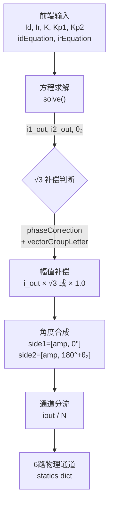

# 分相差动 (2I) 具体计算

> **代码入口**: [`diff_bridge.py#compute_2i`](../../calc/diff_bridge.py)
> **依赖**: [`diff.py#solve`](../../calc/diff.py) — 方程求解（所有方程路由见 [EquationRoutingDict.md](./EquationRoutingDict.md)）

---

## 1. 计算流程总览

> **与 6I 的关键区别**: 2I 模式**不使用**以下参数：
> - `testPhase`（测试相别） — 6I 才需要三相展开
> - `zeroSequenceCorrection`（零序校正） — 仅 6I 矩阵相关
> - `vectorGroupHighSideClock` / `vectorGroupLowSideClock`（钟点数） — 2I 不做相位旋转
>
> 2I 模式仅关注 `vectorGroupLetter1/2` + `phaseCorrection` 两个保护参数。



---

## 2. 方程求解 (共用)

与 6I 模式使用完全相同的 `solve()` 函数。输入 `(Id, Ir, K, Kp1, Kp2, idEquation, irEquation)`，输出 `(i1_out, i2_out, θ₂)`。

详细路由表见 [EquationRoutingDict.md](./EquationRoutingDict.md)。

---

## 3. √3 幅值补偿

### 3.1 补偿规则

**`phaseCorrection` 指定补偿哪一类绕组（Y 侧 / D 侧），然后查看每侧的绕组类型是否匹配。匹配则乘 √3，不匹配则不乘。**

```python
def _should_multiply_sqrt3(l_type, phase_correction):
    if phase_correction == "y-side"     and l_type == "y": return True
    if phase_correction == "delta-side" and l_type == "d": return True
    return False
```

### 3.2 完整真值表（12 场景）

| 场景 | phaseCorrection | 绕组 (侧1/侧2) | i1 处理 | i2 处理 |
|:---:|:---|:---|:---|:---|
| 1 | `none` | Y/D | 不变 | 不变 |
| 2 | `none` | Y/Y | 不变 | 不变 |
| 3 | `none` | D/Y | 不变 | 不变 |
| 4 | `none` | D/D | 不变 | 不变 |
| 5 | `y-side` | Y/D | ×√3 | 不变 |
| 6 | `y-side` | Y/Y | ×√3 | ×√3 |
| 7 | `y-side` | D/Y | 不变 | ×√3 |
| 8 | `y-side` | D/D | 不变 | 不变 |
| 9 | `delta-side` | Y/D | 不变 | ×√3 |
| 10 | `delta-side` | Y/Y | 不变 | 不变 |
| 11 | `delta-side` | D/Y | ×√3 | 不变 |
| 12 | `delta-side` | D/D | ×√3 | ×√3 |

> **注意**: 此补偿与时钟位（`vectorGroupHighSideClock` / `vectorGroupLowSideClock`）**完全无关**。2I 模式不使用时钟参数。

---

## 4. 角度计算

| 侧 | 相位公式 | 说明 |
|---|---|---|
| 侧 1 | `0.0°` | 始终为参考相位 |
| 侧 2 | `(180.0° + θ₂) mod 360°` | θ₂ 来自 solve()，归一化到 [-180°, 180°] |

典型值：
- `id_sum` → θ₂ = 180° → side2_angle = 360° → 归一化 = **0°**
- `id_diff` → θ₂ = 0° → side2_angle = 180° → 归一化 = **180°**

---

## 5. 通道映射与分流

### 5.1 TERMINAL_2I 映射表

前端通过 `i1Terminal` / `i2Terminal` 指定每侧使用哪些物理通道：

| 端子选项 | 通道索引 | 通道数 N | 每通道输出 |
|:---|:---|:---:|:---|
| `ia` | ["6"] | 1 | iout |
| `ib` | ["7"] | 1 | iout |
| `ic` | ["8"] | 1 | iout |
| `ix` | ["9"] | 1 | iout |
| `iy` | ["10"] | 1 | iout |
| `iz` | ["11"] | 1 | iout |
| `iab` | ["6", "7"] | 2 | iout / 2 |
| `ibc` | ["7", "8"] | 2 | iout / 2 |
| `ica` | ["8", "6"] | 2 | iout / 2 |
| `ixy` | ["9", "10"] | 2 | iout / 2 |
| `iyz` | ["10", "11"] | 2 | iout / 2 |
| `izx` | ["11", "9"] | 2 | iout / 2 |
| `iabc` | ["6", "7", "8"] | 3 | iout / 3 |
| `ixyz` | ["9", "10", "11"] | 3 | iout / 3 |

### 5.2 分流规则

**所有映射通道的电流之和 = iout，每个通道输出 `iout / N`。角度不变。此规则与 Y/D 绕组类型完全无关。**

```python
# 实现代码 (_build_fault_statics_2i)
ch_keys = self._resolve_channels(self._i1_terminal)
n = len(ch_keys)
divided = [side1[0] / n, side1[1]]  # 幅值均分，角度不变
for ch_key in ch_keys:
    statics[ch_key] = {"1": list(divided)}
```

### 5.3 安全置零

每次计算前，先将所有 6 个电流通道（索引 6~11）强制置零 `[0.0, 0.0]`，再填入计算结果。未被选中的通道保持零电流。

---

## 6. 完整算例

### 例1: Y/D + delta-side + iab/ixy

**输入参数**:
- Id = 0.5, Ir = 1.0, K = 2, Kp1 = Kp2 = 1
- idEquation = `id_sum`, irEquation = `ir_diff_k`
- letter1 = `y`, letter2 = `d`, phaseCorrection = `delta-side`
- i1Terminal = `iab`, i2Terminal = `ixy`

**计算过程**:

| 步骤 | 计算 | 结果 |
|:---|:---|:---|
| 1. solve() | i1' = (0.5 + 1.0×2) / 2 = 1.25, i2' = (1.0×2 - 0.5) / 2 = 0.75 | i1_out=1.25/1=1.25, i2_out=0.75/1=0.75, θ₂=180° |
| 2. i1 √3? | y-side? 否; delta-side + y → 不匹配 | i1 = 1.25 (不变) |
| 3. i2 √3? | delta-side + d → 匹配 ✓ | i2 = 0.75 × √3 ≈ 1.299 |
| 4. 角度 | side1 = 0°, side2 = 180° + 180° = 360° → 0° | side1=[1.25, 0°], side2=[1.299, 0°] |
| 5. 分流 | iab=2通道, ixy=2通道 | 每通道 = iout/2 |

**最终 6 路输出**:

| 通道 | 索引 | 幅值 (A) | 相位 (°) | 说明 |
|:---|:---:|:---|:---|:---|
| Ia | 6 | 0.625 | 0° | 1.25 / 2 |
| Ib | 7 | 0.625 | 0° | 1.25 / 2 |
| Ic | 8 | 0.0 | 0° | 未选中 |
| Ix | 9 | 0.650 | 0° | 1.299 / 2 |
| Iy | 10 | 0.650 | 0° | 1.299 / 2 |
| Iz | 11 | 0.0 | 0° | 未选中 |

---

### 例2: Y/Y + y-side + ia/ix

**输入参数**:
- Id = 1.0, Ir = 0.5, K = 2, Kp1 = Kp2 = 1
- idEquation = `id_sum`, irEquation = `ir_diff_k`
- letter1 = `y`, letter2 = `y`, phaseCorrection = `y-side`
- i1Terminal = `ia`, i2Terminal = `ix`

**计算过程**:

| 步骤 | 计算 | 结果 |
|:---|:---|:---|
| 1. solve() | i1' = (1.0 + 0.5×2) / 2 = 1.0, i2' = (0.5×2 - 1.0) / 2 = 0 | i1_out=1.0, i2_out=0, θ₂=180° |
| 2. i1 √3? | y-side + y → 匹配 ✓ | i1 = 1.0 × √3 ≈ 1.732 |
| 3. i2 √3? | y-side + y → 匹配 ✓ | i2 = 0 × √3 = 0 |
| 4. 角度 | side1 = 0°, side2 = 0° | — |
| 5. 分流 | ia=1通道, ix=1通道 | 不分流 |

**最终 6 路输出**:

| 通道 | 索引 | 幅值 (A) | 相位 (°) |
|:---|:---:|:---|:---|
| Ia | 6 | 1.732 | 0° |
| Ib~Ic | 7~8 | 0.0 | 0° |
| Ix | 9 | 0.0 | 0° |
| Iy~Iz | 10~11 | 0.0 | 0° |
