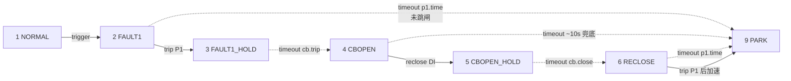
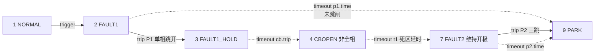
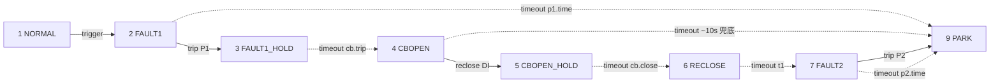

# 线路保护实验 — 状态序列实现逻辑

本文档把 `lp_test`（线路保护）实验落实为 USEEngine 上的**节点状态机**。
重点是**节点如何构造**——每个节点输出什么、靠什么条件跳到哪、三种实验链如何由配置"重连"、
以及五个动作时间如何记录——而**不关注每个状态的具体交流量计算**。

> **约定**：本实验只用静态交流量。每个状态就是一组 **12 通道 × layer 1** 的
> `[幅值, 相位°]` 数据。本文用**变量**（如 `NORMAL`、`FAULT(p)`）代替这些数据，
> 其具体数值由 `calc/line_fault.py`（见 [line-protection-fault-math.md](line-protection-fault-math.md)）计算，
> 与本文的状态机逻辑解耦。
>
> 本文内容**不涉及代码**，只论述节点构造与跳转。本版逻辑依据 [2.md](2.md) 完全重写。

---

## 1. 底层引擎机制（回顾）

实现完全建立在现有 USEEngine 的静态节点 FSM 之上（`logic/USEEngine.py`、`api/BaseApi.py`）：

- **节点 = 一个固定输出态（`mode=1`）+ 可选退出条件**。本实验只用 `mode=1`，不用步进/复位/扫描。
- **三类退出条件**（一个节点可同时挂超时与开入两条）：

  | 条件 | 配置字段 | 触发后跳转到 |
  |------|------|-----------|
  | 超时 | `timeoutMs` | `timeoutId` |
  | 开入匹配 | `diMatchMask` | `diMatchId` |
  | 手动 | API `trigNode(id)` | 立即跳转该 id |

- **保留节点**：`0x0000`=初始/复位态，`0xFFFF`=停止/错误态。跳转到这两者会**清空节点表**（`coreLoop` 末尾），故测点之间**不能**经过它们。
- **`diMatchMask` 语义**（`USEEngine._evalTrig` / `coreLoop`）：
  - 低 8 位 = 通道掩码；
  - `0x100` = AND 逻辑（全部变化才触发），不置则 **OR**（任一变化即触发）；
  - `0x200` = 参考值取**本节点进入时**的 DI（`diPrev`），不置则取实验起始 DI（`diStart`）；
  - `0x400` = 参考值取反；
  - 判定式：`val = (diNow ^ diRef) & mask`；OR 触发条件 `val != 0`，AND 触发条件 `val == mask`。
  - **本实验统一用 `mask | 0x200`（OR + 以节点进入态为参考）**：即"相对进入本节点时，掩码内任一开入发生跳变"。这天然兼容常开/常闭接点，无需关心初始电平。
- **硬件时间戳事件**（`emitEvent` → `BaseApi.onUpdate/onDi`）：
  - `onUpdate(nodeId, tick, hw_ts)`：进入某节点并完成首帧下发时回调，`hw_ts` = **该静态节点的开始时间**。
  - `onDi(diMask, hw_ts)`：开入变化时回调，`hw_ts` = 去抖后的变化时刻。
  - **动作时间 = `onDi.hw_ts − 相关基准节点的 onUpdate.hw_ts`**（见 §7）。
- **物理量→寄存器**：`BaseApi.physDictToReg({ch:{layer:[amp,phase]}})`。通道：0-5=电压(Ua,Ub,Uc,Ux,Uy,Uz)，6-11=电流(Ia,Ib,Ic,Ix,Iy,Iz)。RMS→峰值需 ×√2（FPGA 要峰值）。
- **模板**：`api/ApiDiffTest.py` —— 预编译固定节点 + 逐点 `upsertNodes`/`trigNode` + `asyncio.Event` 等挂起态。本实验在此之上扩展更多状态。

---

## 2. 状态（节点）变量约定

每个状态的 12 通道输出用一个变量表示（layer 1 交流幅值/相位），具体数值由计算模块产出：

| 变量 | 含义 | 电流 | 电压 |
|------|------|------|------|
| `NORMAL` | 正常/故障前态 | 三相负荷电流 `sys.iLoad` | 三相额定 `sys.v` |
| `FAULT(p)` | 故障态（参数 p = `ft,z,ang,i,dir`） | 故障量 | 故障量 |
| `OPEN(p)` | 断路器断开态（特殊正常态，见下） | 单相：故障相 0、余相载流；多相：全 0 | 三相额定 `sys.v` |
| `ZERO` | 全电流归零态（点间过渡 / 结束挂起） | 全 0 | 保留额定（或按需） |

**`OPEN(p)`（断路器断开后的"特殊正常态"）规则**（来自 [1.md](1.md) §4-5，已含 PT 安装侧影响）：

- **电压**：PT 安装侧决定——`pt=0`（母线侧）三相额定；`pt=1`（线路侧）被切除相=0（单相接地仅故障相=0，多相/三相全=0）。
- **电流**：
  - **单相接地**（`ft∈{0,1,2}`）：**仅故障相电流=0**，其余两相保持负荷电流。
  - **其他多相故障**（相间 / 两相接地 / 三相）：**三相电流全部=0**（无负荷电流）。

> 这些都是 12 通道数据的不同取值，本文不展开计算，只作为状态机的输出占位。

### 2.1 计算模块数据结构（接口契约）

`FAULT/OPEN/NORMAL` 的具体数值由 `calc/line_fault.py` 产出，但**状态机先按以下结构对接**
（实现先用变量占位，后续接入计算）：

**输入：故障参数 `p`（来自 `test`/`point`/`sys`）**

| 字段 | 含义 | 来源 |
|------|------|------|
| `ft` | 故障类型 0–9（单接地 0/1/2，相间 3/4/5，两相接地 6/7/8，三相 9） | point |
| `z` | 故障阻抗幅值 | point |
| `ang` | 故障阻抗角（°） | point |
| `i` | 故障电流（RMS） | point |
| `dir` | 方向：0 正向 / 1 反向（反向电流相量 +180°） | test/payload |
| `kL` | 零序补偿系数 | payload |
| `ratedV` | 额定相电压 `sys.v`（RMS） | sys |
| `iLoad` | 负荷电流（幅值+角度） | sys |
| `f` | 额定频率 | sys |

**输出：12 通道相量字典 `{ch: {1: [amp_RMS, phase_deg]}}`**

- 通道 0–5=电压(Ua,Ub,Uc,Ux,Uy,Uz)，6–11=电流(Ia,Ib,Ic,Ix,Iy,Iz)；只用 layer 1（基波）。
- 计算模块统一输出 **RMS 幅值 + 相位（°）**；下发 FPGA 前由节点构造层 ×√2 转峰值（§1）。
- 四个状态变量都是"同一字典结构、不同取值"：
  - `NORMAL`：三相额定压 + 三相负荷流；
  - `FAULT(p)`：按 `ft` 计算的故障压/流；
  - `OPEN(p)`：三相额定压 + 电流按 §2 单相/多相规则（故障相或全相置 0）；
  - `ZERO`：电流全 0，电压保留额定。

> 故障相集合 `P`（供 §3 掩码与 §2 `OPEN` 规则）由 `ft` 派生，是计算模块与状态机**共享**的映射。

---

## 3. 开入（DI）掩码构造

物理开入 8 通道：`A/B/C`=0/1/2，`R`=3，`a/b/c`=4/5/6，`r`=7。
`payload.di` 给每个通道一个角色：`0`=OTHER、`1`=THREE_TRIP（三跳）、`2`=TRIP_ABC（分相跳）；`R/r` 为 `3`=RECLOSER 或 `0`=OTHER。

前端可把 `{0,1,2}` 组**和** `{4,5,6}` 组各自独立配成"分相跳"或"三跳"，组合很多。
若在构造掩码时逐情况分支会很乱（[1.md](1.md) §26-27）。**优化办法：`_onSetup` 时先把角色归一化成两张"相位位集合"查找表**，
之后一切掩码构造与时间归因都查这两张表，消除分组特判。

### 3.1 归一化：通道角色 → 相位位集合

遍历 6 个跳闸通道 `(0→A,1→B,2→C,4→A,5→B,6→C)`，按角色填入 `trip_phase_bits`（每相对应的通道位集合）：

| 通道角色 | 归一化处理 |
|----------|-----------|
| `TRIP_ABC`（分相跳） | 该通道位计入它对应的**单相** |
| `THREE_TRIP`（三跳） | 任一相故障都会动作 → 该通道位计入 **A、B、C 三相** |
| `OTHER` | 不参与 |

遍历 `R/r`(3,7)，角色为 `RECLOSER` 的并入 `reclose_bits`。

归一化结果（两张表）：

| 表 | 含义 |
|----|------|
| `trip_phase_bits[A]` / `[B]` / `[C]` | 各相"被认为已跳闸"所涉及的开入位集合 |
| `reclose_bits` | 重合闸接点位集合 |

### 3.2 跳闸掩码（按故障相集合 P）

故障涉及的相集合 `P`（单相接地→{故障相}；相间/两相接地→{两相}；三相→{A,B,C}）：

> `trip_mask(P)` = 对 `P` 中每个相 `p` 取 `trip_phase_bits[p]` 的**并集**。

**对照 [1.md](1.md) 例验证**（A 故障，P={A}）：

| `{0,1,2}` 角色 | `{4,5,6}` 角色 | `trip_phase_bits[A]` | `trip_mask` |
|----------------|----------------|----------------------|-------------|
| TRIP_ABC | OTHER | {bit0} | `1` ✓ |
| TRIP_ABC | THREE_TRIP | {bit0, bit4} | `1\|16=17` ✓ |
| THREE_TRIP | THREE_TRIP | {bit0, bit4} | `17` ✓ |

AB 相间（P={A,B}）：`trip_phase_bits[A] ∪ trip_phase_bits[B]`，符合 [1.md](1.md) §9。

最终下发：**`diMatchMask = trip_mask(P) | 0x200`**（OR + 进入态为参考）。
> 因 THREE_TRIP 通道已被计入全部三相，`trip_mask` 天然同时覆盖"分相跳"与"三跳"接点——
> 这正是 [2.md](2.md) 所说"后加速 di 触发可以是跳 abc 也可以是三跳"的统一处理。

### 3.3 合闸掩码

> `reclose_mask` = `reclose_bits` 的并集（任一 R/r 接点）。
> 下发：**`diMatchMask = reclose_mask | 0x200`**。

---

## 4. 节点目录（State Catalog）

整个测点用**固定 9 个节点（ID 1–9）**。测点之间停在 `PARK`，逐点用 `upsertNodes` 覆盖 1–8、按需配置出口；
**不经过 `0x0000/0xFFFF`**，节点表得以保留、ID 复用。不用的节点不下发。

| ID | 名称 | 输出 | 说明 |
|----|------|------|------|
| `1` | `NORMAL` | `NORMAL` | 正常/故障前态，按 `trigger` 出口 |
| `2` | `FAULT1` | `FAULT(p1)` | 第一次故障 |
| `3` | `FAULT1_HOLD` | `FAULT(p1)` | 第一次故障跳闸后，断路器**跳闸延时**保持（`cb.trip`） |
| `4` | `CBOPEN` | `OPEN(p1)` | 断路器断开特殊正常态，等重合 |
| `5` | `CBOPEN_HOLD` | `OPEN(p1)` | 重合接点动作后，断路器**合闸延时**保持（`cb.close`） |
| `6` | `RECLOSE` | `NORMAL`（瞬时） / `FAULT(p1)`（永久） | 重合后状态，**仅输出按 `nature` 变**，出口固定 |
| `7` | `FAULT2` | `FAULT(p2)` | 故障转换故障态（type 5/6） |
| `8` | `FAULT2_HOLD` | `FAULT(p2)` | 转换故障跳闸后，断路器**跳闸延时**保持（`cb.trip`） |
| `9` | `PARK` | `ZERO` | 点间过渡 / 结束，无触发，等手动 `trigNode` |

**三个"按配置变形"的位置**（本结构的核心简化）：

1. **节点 6 的输出**：瞬时（`nature==0`）输出 `NORMAL`，永久（`nature==1`）输出 `FAULT(p1)`。
   —— **出口规则两者相同**（见 §5），只是输出态不同。
2. **节点 3 vs 节点 8**：哪一次故障导致跳闸，就用哪个跳闸延时保持态。
   第一次故障跳闸（基础流程 / after==1）→ 用 `3`；转换故障跳闸（after==0）→ 用 `8`。
3. **节点 7 的接入位置**：按 `after` 接在第一次故障后（after==0，节点 2 超时进入）或重合后（after==1，节点 6 超时进入）。

---

## 5. 跳转规则（逐节点）

记号：`p1`/`p2`=第一次/转换故障参数，`P1`/`P2`=各自故障相集合，`t1`=故障转换延时（`p.delay`）。
`cb_trip = ctrl.cb.sim && ctrl.cb.trip>0`，`cb_close = ctrl.cb.sim && ctrl.cb.close>0`。
落点缩写：`hold1 = cb_trip ? 3 : 4`（第一次故障跳闸落点），`hold2 = cb_trip ? 8 : 4`（转换故障跳闸落点），
`recl = cb_close ? 5 : 6`（重合落点）。

下表给出**基础形态**（type 0–4）的出口；故障转换对节点 2、6、7 的改写见 §5.末与 §6。

| 节点 | 输出 | 超时出口 `timeoutMs → timeoutId` | 开入出口 `diMatchMask → diMatchId` |
|------|------|------|------|
| `1` NORMAL | `NORMAL` | `trigger.type==1`：`trigger.time → 2` | `trigger.type==2`：`trigger.mask\|0x200 → 2`<br>`trigger.type==0`(KEY)：无，等前端 `next_node` → API `trigNode(2)` |
| `2` FAULT1 | `FAULT(p1)` | `p1.time → 9`（未跳闸结束） | `trip_mask(P1)\|0x200 → hold1` |
| `3` FAULT1_HOLD | `FAULT(p1)` | `cb.trip → 4` | — |
| `4` CBOPEN | `OPEN(p1)` | `MAX_RECLOSE_WAIT(≈10s) → 9`（未重合兜底） | `reclose_mask\|0x200 → recl` |
| `5` CBOPEN_HOLD | `OPEN(p1)` | `cb.close → 6` | — |
| `6` RECLOSE | `NORMAL`/`FAULT(p1)` | `p1.time → 9` | `trip_mask(P1)\|0x200 → 9` |
| `7` FAULT2 | `FAULT(p2)` | `p2.time → 9` | `trip_mask(P2)\|0x200 → hold2` |
| `8` FAULT2_HOLD | `FAULT(p2)` | `cb.trip → 4` | — |
| `9` PARK | `ZERO` | — | — |

> **节点 6 是统一的**（[2.md](2.md) 核心修订）：无论瞬时/永久，出口都是 `p1.time` 超时 → 9 **且** `trip_mask(P1)` 开入 → 9。
> 只有**输出态**随 `nature` 切换（瞬时=正常、永久=故障）。
> - 永久故障：节点 6 输出故障量，等后加速跳闸（开入出口触发，记录后加速时间）或超时结束。
> - 瞬时故障：节点 6 输出正常量，正常情况下应靠 `p1.time` 超时正常结束；若窗内出现跳闸开入则同样跳 9（视为重合后不该跳，可在判定中标记）。

**故障转换对基础表的改写（仅 type 5/6）：**

- **after==0（非全相：第一次跳闸后、断路器单相断开的死区内转换）**：第一次故障**正常跳闸**
  （节点 2 出口同基础表：`trip_mask(P1) → hold1`），经 `hold1`（cb_trip 时节点 3）进入
  **节点 4 CBOPEN（单相断开/非全相态）**；把**节点 4** 的出口改为 `t1（delay）→ 7`（超时，**不等重合**），
  即在死区内施加转换故障。**节点 7** 维持非全相开极（已跳开相电流=0），出口 `trip_mask(P2)|0x200 → 9`
  且 `p2.time → 9`（转换故障跳闸即三跳终结，不再重合）。**此链不用节点 5/6/8。**
  > 与早期"节点 2 不跳闸、固定延时背靠背切故障"的写法不同：现版重现真实非全相工况
  > （单相跳开 → 死区 → 死区内故障），符合 API 文档 `after=0`"第一次故障跳闸后"语义。
- **after==1（重合后转换）**：把**节点 6** 的出口改为 `t1 → 7`（超时，覆盖原 `p1.time/DI`）；
  并把**节点 7** 配成"原节点 6 的出口规则"——`p2.time → 9` 且 `trip_mask(P2)|0x200 → 9`。

---

## 6. 各测试类型的完整序列（流程图）

下列流程图为 `cb.sim=true`（含断路器延时）的完整链；不模拟断路器时跳过节点 3 与 5
（节点 2 跳闸直接 → 4，节点 4 重合直接 → 6）。虚线 = 超时出口，实线 = 开入/触发出口。

### 6.1 type 0–4（距离 / 零序 / 过流 / 负序 / 工变）— 基础链 `1→2→3→4→5→6→9`



- 节点 6 瞬时=输出 `NORMAL`（靠超时正常结束）；永久=输出 `FAULT(p1)`（等后加速跳闸或超时）。
- 若前端只测第一次跳闸、不真重合，可令节点 4 不配 `reclose_mask` → 仅靠超时兜底 → 9 结束。
- 最短形态（无 cb 模拟）：`1 ─trig─▶ 2 ─trip─▶ 4 ─(超时兜底)─▶ 9`，未跳闸 `2 ─超时─▶ 9`。

### 6.2 type 5/6，after==0（非全相：死区内转换）— 链 `1→2→(3)→4→7→9`



- 第一次单相故障**正常跳闸**（单相断开）→ 进入非全相死区（节点 4 CBOPEN，已跳开相电流=0）→
  经 `t1` 在死区内施加转换故障 `7`（节点 7 维持开极）→ 转换故障跳闸即三跳终结。
  **此链不重合，不用节点 5/6/8。** 无 cb 模拟时节点 2 跳闸直接 → 4。

### 6.3 type 5/6，after==1（重合后转换）— 链 `1→2→3→4→5→6→7→9`



- 第一次故障正常跳闸→重合（经 `3→4→5`）；重合后状态 `6`（瞬时=正常 / 永久=故障）经 `t1`
  施加转换故障 `7`；`7` 即承接"原节点 6"的出口（跳闸或超时均 → 9）。**此链不用节点 8**。

---

## 7. 时间记录机制

每点最多记录 5 个时间（[2.md](2.md)）：**跳A、跳B、跳C、重合、后加速跳闸**，全部用硬件时间戳，
**没有发生的不记录（留空）**；**同一记录项若多次动作，只记第一次**（首次命中后该项锁定，忽略后续跳变）。
三个基准时刻取相应节点的 `onUpdate.hw_ts`：

| 记录项 | 基准节点（entry） | 归因窗口 | 触发开入 |
|--------|------------------|----------|----------|
| 跳A / 跳B / 跳C | **节点 2 FAULT1 进入** | 节点 2 进入 ~ 重合（节点 4）之前 | `trip_phase_bits[A/B/C]` |
| 重合 | **节点 4 CBOPEN 进入** | 节点 4 期间 | `reclose_mask` |
| 后加速跳闸（仅永久故障） | **节点 6 RECLOSE 进入** | 节点 6 期间 | `trip_mask(P1)`（含三跳） |

**实现要点**（API 维护三个引用时刻 + 在 `onDi` 中归因）：

- 进入节点 2 时缓存 `t2`；进入节点 4 时缓存 `t4`；进入节点 6 时缓存 `t6`。这些缓存**跨节点保留**。
- `onDi` 每次开入变化都回调，携带**完整 diMask**。计算本次变化位 `changed = diMask XOR di_prev`，更新 `di_prev`。
- **归因规则**：
  - 当前若处于**节点 2 进入之后、节点 4 之前**（即节点 2/3，以及 after==0 链上的 7/8）：
    对每个相，若 `changed` 命中 `trip_phase_bits[相]` 且**该相尚未记录**，记 `跳X = hw_ts − t2`。
  - 当前在**节点 4**：若 `changed` 命中 `reclose_mask` 且 `重合` 尚未记录，记 `重合 = hw_ts − t4`。
  - 当前在**节点 6** 且为**永久故障**：若 `changed` 命中 `trip_mask(P1)` 且 `后加速` 尚未记录，记 `后加速 = hw_ts − t6`。

  > 三类记录均**只取第一次**：跳A/B/C 各相独立锁定，重合与后加速各自锁定一次。

### 7.1 Report 回传结构

**每测完一个 point 立即发一次** `sendReport`（不批量累积），`data` 只含该点的 `id` 与所记录的时间
（`id` 为前端下发的测点编号；未发生的时间留空 `null`，单位秒）：

```json
{
  "type": "report",
  "module": "lp_test",
  "data": {
    "id": 12,
    "tripA": 0.0231,
    "tripB": null,
    "tripC": null,
    "reclose": 0.5012,
    "postAccel": 0.0185
  }
}
```

- `id`：前端给定的测点编号（原样回传）。`tripA/B/C`：相对节点 2 进入的跳闸时间。
  `reclose`：相对节点 4 的重合时间。`postAccel`：相对节点 6 的后加速跳闸时间（仅永久故障）。
- 不附判定/告警/结束方式等字段——**只回 `id` + 时间**，无对应动作的时间留空。

> **要点①——跳闸时间必须以"故障开始"为基准、跨节点保留**：分相错时跳闸 + `cb.trip` 保持态时，
> 第二相可能落在节点 3（`FAULT1_HOLD`）期间。若用"当前节点进入时刻"作基准会算错。
> 故 API 缓存 `t2` 跨节点保留；`onDi` 对每个节点都回调，即使已跳到 3 仍能继续归因后到的相。
> （[2.md](2.md)："将状态 2 的进入时间记录下，后续就算跳出了这个状态后 di 动作，也可以计算时间"。）

> **要点②——重合后不再记跳闸**：节点 4 之后（重合已发生），跳闸开入不再计入"跳A/B/C"，
> 而专用于"后加速跳闸"（节点 6）。即"跳A/B/C"只采集**节点 2 进入到重合之间**的跳闸。

> **要点③——故障转换的归因**：
> - after==0：跳闸实际发生在节点 7/8，但仍落在"节点 2 进入 ~ 重合之前"窗口内，故跳A/B/C 仍以 `t2` 为基准。
> - after==1：转换故障在节点 7（重合之后），其跳闸为重合后动作，归入"后加速"语义，以节点 6 进入时刻 `t6` 为基准。

---

## 8. 点间过渡与主循环（流程，非代码）

逐点驱动流程：

1. **预热 + 预编译不变节点**：实验开始预热，先 `upsertNodes` 下发固定的 `PARK(9)` 节点。
2. **遍历 tests → points**：对每个测点：
   - `_build_nodes`：按 type / after / nature / cb 配置，构建并改写节点 1–8 的输出与出口（§5）。
   - `upsertNodes` 覆盖下发；**编译失败**则引擎转 `0xFFFF`、本次实验终止。
   - 复位本点记录、清 `di_prev` 基线、清"本点完成"事件。
   - `trigNode(1)`：从 `PARK`（或首点的 `0x0000` 后）触发进入节点 1，开始本点。
     若节点 1 为 KEY 触发（`trigger.type==0`），节点 1 无自动出口，等前端 `{"cmd":"next_node"}`（经 `onWebCommand`）再 `trigNode(2)`。
   - 等待"本点完成"事件（节点回到 `PARK`，`onUpdate(PARK, tick==0)` 置位）；附 `POINT_TIMEOUT` 二级兜底。
   - 上报本点结果（`sendReport`），继续下一点。
3. **全部结束**：`stopTest()` → 引擎 `manualTrig(0xFFFF)`。

- 点间在 `PARK` 挂起，`trigNode(1)` 启动下一点；**不经过 `0x0000/0xFFFF`**，故节点表保留、ID 复用。
- 首点由 `startTest` 的 `manualTrig(0x0000)` 后 API `trigNode(1)` 启动（同 `ApiDiffTest`）。
- 硬件错误（引擎自发跳 `0xFFFF`）→ 主循环检测到失活后退出。

---

## 9. DO 输出（开出）— 已实现

DO 由 `payload.do` 控制（`_parse_do`/`_apply_do`），编入相关节点的 `doActions`
（相对节点 t0 的 `[(delayMs<<8)|doByte,...]`，`doByte` 为该时刻的**绝对** 8bit 开出值）。
约定：**带 `doActions` 的节点改变 DO；不带的节点保持上一段 DO**（依赖下方跨节点改造）。

- `payload.do` **缺省 → 完全不输出 DO**（不触碰开出）。
- `init`：故障前开出初值，挂在节点 1（每点起始即复位为 `init`）。
- `mode=0 SYNC_WITH_RECLOSER`（**断路器辅助接点模拟**）：进入 **CBOPEN(4)** 翻转全部 DO（断路器断开），
  进入 **RECLOSE(6)** 翻回 `init`（断路器合闸）。**这是自动重合闸装置获取断路器位置回馈、从而启动重合的关键。**
- `mode=1 DELAY_FLIP_ALL`：编入 **FAULT1(2)**——`delay` 后翻转全部、再过 `hold` 翻回。
- `mode=2 CUSTOM`：编入 **FAULT1(2)**——逐通道 FLIP（`delay`/`hold`）累积成时间轴上的绝对 DO 字节序列；`action=0`(HOLD) 不参与。

> **跨节点保持（已就位）**：`USEEngine.coreLoop` 已改为**仅当新节点自带 `doActions` 时才取消上一段
> `_doTask`**（`USEEngine.py:303`），使 DO 输出跨节点持续——故 mode=0 的"断开翻转"能一直保持到"重合翻回"。

---

## 10. 逻辑漏洞检查与优化建议

1. **跳闸时间基准跨节点（要点①）**：分相错时跳闸 + `cb.trip` 保持态时第二相落在节点 3，
   时间基准必须是节点 2 进入时刻而非当前节点。→ API 缓存 `t2` 跨节点保留。
2. **CBOPEN / RECLOSE 必须有超时兜底**：若重合接点或后加速跳闸始终不来，节点会永久挂起。
   → 节点 4 加 `MAX_RECLOSE_WAIT(≈10s) → 9`，节点 6 加 `p1.time → 9`；`_run_point` 再加 `POINT_TIMEOUT` 二级兜底。
3. **多相同时跳闸的 OR 掩码只触发一次（注意点）**：OR 匹配在**第一**个变化位即跳转 2→3。
   但 `onDi` 对每次 DI 变化都回调且携带**完整 diMask**，故同帧多位可一次归因多相、错时到的相在后续节点继续归因。→ 不丢相。
4. **DI 角色归一化（优化，§3）**：两组跳闸通道独立配置造成的组合爆炸，用 `trip_phase_bits` 查找表消除，
   掩码构造与时间归因都查同一张表，避免散落的分组特判，并天然统一"分相跳/三跳"。
5. **`0x200` 参考态选择（健壮性）**：用"进入本节点时的 DI"作参考 + OR + XOR 变化检测，
   天然兼容常开/常闭跳闸接点，无需前端声明接点常态。
6. **节点 ID 复用而非清表（效率）**：测点之间停在 `PARK` 而非 `0x0000`，只 `upsertNodes` 覆盖 1–8。
   注意：**任何错误跳到 `0xFFFF` 会清表**，需重新预编译 `PARK`。
7. **节点 6 统一化（[2.md](2.md) 修订）**：相比早期"瞬时观察窗/永久后加速"两套出口，现节点 6 出口**完全统一**
   （超时 → 9 且跳闸 → 9），只切换输出态。逻辑更简、改写点更少；瞬时故障重合后若误跳，同样落 9，由判定逻辑识别。
8. **故障转换是同一套节点的"重连"**：after==0 改写节点 2 的超时出口指向 7；after==1 改写节点 6 的超时出口指向 7
   并把节点 7 配成"原节点 6 规则"。建议 `_build_nodes` 用 `after` 开关集中处理这两处改写。

---

## 11. 已定项与待定项

**已定（本版确认）：**

- **KEY 触发机制**（`trigger.type==0`）：前端发 `{"cmd":"next_node"}`，经 `EngineCtrl.HandleCommand` → `onWebCommand` → API `trigNode(2)` 推进。
- **Report 回传结构**：见 §7.1，**每点测完即发一次**，`data` 只含前端给定的 `id` + 五个时间（`tripA/B/C`、`reclose`、`postAccel`，未发生为 `null`），不附判定/告警字段。
- **`MAX_RECLOSE_WAIT`**：内部常量 **10s**（[2.md](2.md)），节点 4 未重合兜底。
- **计算接口数据结构**：见 §2.1，输入故障参数 `p`、输出 12 通道 `{ch:{1:[amp_RMS,phase_deg]}}`；状态机先以变量占位。

**待定（TODO）：**

- **故障量计算**：已由 `calc/calculation_engine.py` 实现（`calculate_fault` / `calculate_normal` / `calculate_open` / `pack_channels`），支持 10 种 ft、KL 补偿、CT/PT、vMode/iMode/Ux 通道映射。
