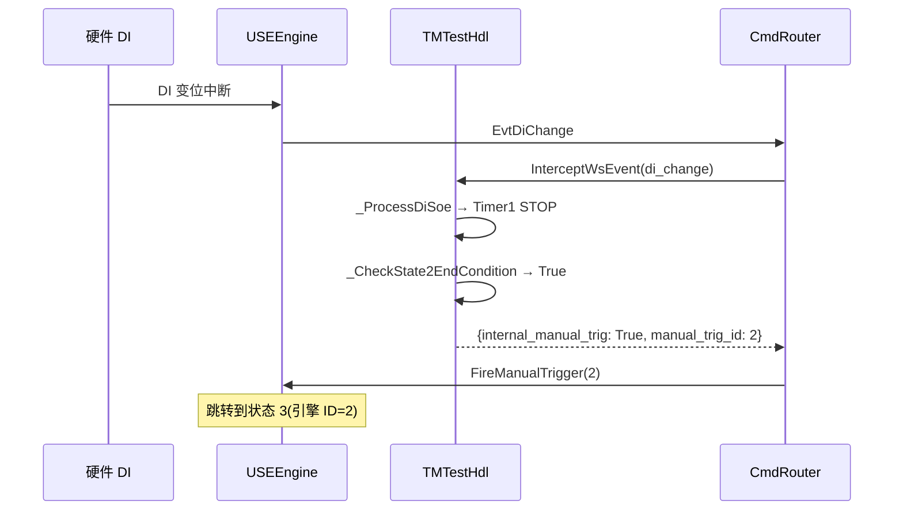

# TimeMeasurement 时间测量试验技术说明

> **模块**: `time_measurement`
> **Handler**: `api/TMTestHdl.py`
> **继保用途**: 精密测量继电器/断路器的动作时间、返回时间

---

## 1. 继电保护背景

### 1.1 什么是时间测量？

时间测量是继电保护测试中最基础也最重要的测试之一。它测量的是从**施加激励**到**保护装置输出动作信号**之间的时间差。

典型测量对象：
- **保护动作时间**: 故障出现 → 保护出口动作 (跳闸继电器吸合)
- **断路器跳闸时间**: 跳闸命令发出 → 断路器触头分离
- **保护返回时间**: 故障清除 → 保护出口返回
- **重合闸时间**: 跳闸 → 自动重合闸命令发出

### 1.2 三状态 + 三计时器架构

```
┌──────────────┐     ┌──────────────┐     ┌──────────────┐
│   状态 1      │ ──→ │   状态 2      │ ──→ │   状态 3      │ ──→ 结束
│  (准备态)     │     │  (动作态)     │     │  (结束态)     │
│              │     │              │     │              │
│ 按键/超时/DI  │     │ 超时/计时器   │     │ 按键/超时     │
└──────────────┘     └──────────────┘     └──────────────┘

Timer 1: ─────[START]━━━━━━━━━━━━━━━━[STOP]─────
Timer 2:                    [START]━━━━━━━━[STOP]─────
Timer 3:                              [START]━━━━━[STOP]
```

**设计理念**:
- **状态 1**: 输出故障前额定电量，等待操作员准备就绪
- **状态 2**: 输出故障电量，等待保护装置动作（计时器运行）
- **状态 3**: 故障清除，显示测量结果

---

## 2. 前端参数详解

### 2.1 系统参数

| 参数 | 含义 |
|------|------|
| `debounce` | FPGA 级 DI 硬件去抖(ms) |

### 2.2 计时器配置 (`timers`)

每个计时器有独立的启动/停止条件：

**启动条件 (`start_mode`)**:

| 值 | 含义 | 典型用途 |
|---|------|---------|
| `ENTER_STATE_2` | 进入状态2时启动 | 测量保护动作时间 |
| `DI_X_CLOSE_START` | DI-X 闭合启动 | 测量断路器跳闸时间 |
| `DI_X_OPEN_START` | DI-X 断开启动 | 测量返回时间 |
| `TIMER1_STOP_START` | Timer1停→Timer2启 | 级联计时 |
| `TIMER2_STOP_START` | Timer2停→Timer3启 | 级联计时 |

**停止条件 (`stop_mode`)**:

| 值 | 含义 | 典型用途 |
|---|------|---------|
| `DI_X_CLOSE` | DI-X 闭合停止 | 接收跳闸信号 |
| `DI_X_OPEN` | DI-X 断开停止 | 接收返回信号 |

> [!NOTE]
> X = A/B/C/R/a/b/c/r，对应 8 路 DI 端口

### 2.3 状态 2 结束条件

状态 2 的 `triggers[].condition` 支持计时器触发：

| 值 | 含义 |
|---|------|
| `TIMER_1` | Timer1 停止后退出状态 2 |
| `TIMER_1_2` | Timer1 AND Timer2 停止后退出 |
| `TIMER_1_2_3` | 全部停止后退出 |
| `TIME_CTRL` | 预留，时间控制模式 |

---

## 3. 内部实现机制

### 3.1 节点编译

```python
# 前端 ID 1,2,3 → 引擎 ID 0,1,2
internal_id = front_id - 1

# TIMER 类条件不生成引擎 trigger
# 而是由 Handler 管理，满足条件后注入 internal_manual_trig
```

**关键**: `TIMER_1`/`TIMER_1_2` 等条件**不映射为引擎 trigger**。引擎对状态 2 没有自动退出机制——Handler 在计时器全部满足后，通过返回 `internal_manual_trig` 通知 CmdRouter 触发 `FireManualTrigger`。

### 3.2 DI 边沿检测

```python
DI_OPEN_IS_HIGH = True  # 断开=高电平=1

# 闭合边沿: 1→0 (prev_bit=1, curr_bit=0)
# 断开边沿: 0→1 (prev_bit=0, curr_bit=1)
```

### 3.3 计时器状态机

```
IDLE ──→ RUNNING ──→ STOPPED
  │         ↑
  │         │ start_mode 满足
  └─────────┘
```

- **启动**: `_TryStartTimer(idx, hw_ts)` — 记录 `start_hw_ts`
- **停止**: `_TryStopTimer(idx, hw_ts)` — 计算 `elapsed_ms = (stop - start) & 0xFFFFFFFF / 1000.0`
- **级联**: 停止时检查其他计时器的 `TIMERX_STOP_START`

### 3.4 internal_manual_trig 机制



---

## 4. 事件流程

### 4.1 value_update 翻译

- 引擎遥测(tick有): 推送 `{nodeId: 前端ID}` + DO 变化
- DI 变位(di_change): 执行计时器逻辑 + 推送 DI

### 4.2 trigger 处理

- 跳转到状态 2(引擎ID=1): 检查 `ENTER_STATE_2` 启时条件
- 引擎 ID → 前端 ID 映射并转发

### 4.3 terminal → 报告

```json
{
  "type": "report",
  "data": {
    "timer1_elapsed_ms": 125.4,
    "timer2_elapsed_ms": 300.0,
    "timer3_elapsed_ms": null
  }
}
```

`null` = 计时器未完成(IDLE 或 RUNNING)

---

## 5. 代码审查发现

### ✅ 正确实现
- DI 边沿检测(支持 CLOSE/OPEN + 高/低电平配置)
- 级联计时器(TIMER1_STOP_START)
- `internal_manual_trig` → `FireManualTrigger` 路径
- hw_ts µs 精度计时

### ⚠️ 已修复
- `di_change` 事件类型未被处理(Bug #3)
