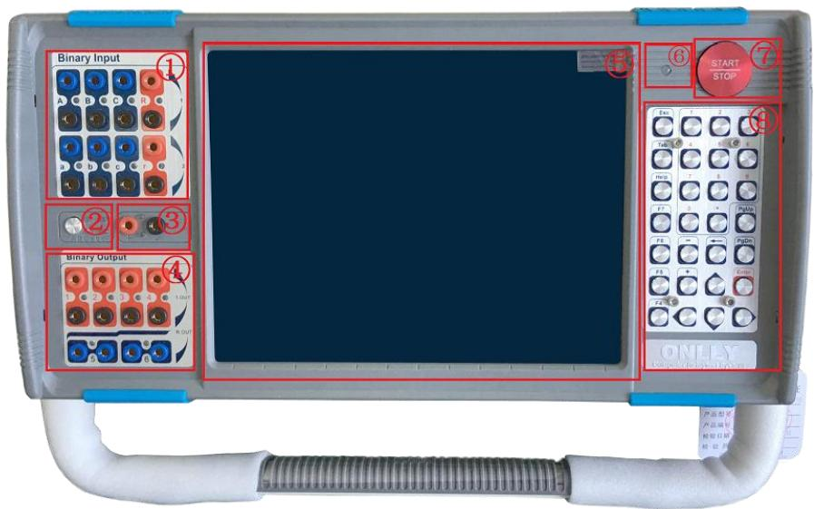
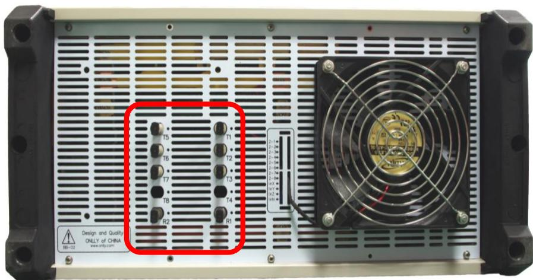
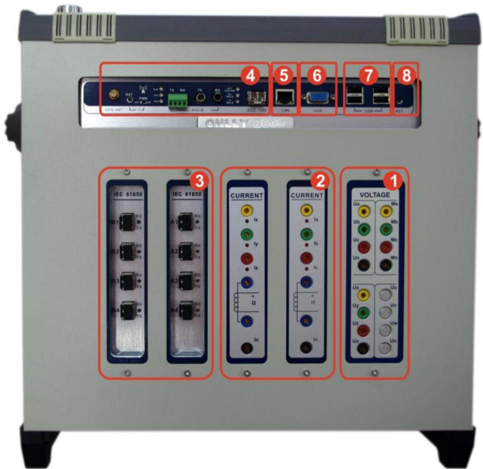
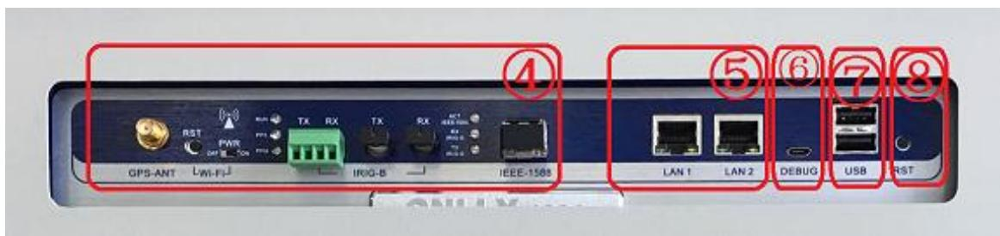

# 1. 产品简介

### 1.1功能说明（以下功能以BQ660 为例说明）

- 严格意义上的数模一体机，真正实现了数字信号与模拟信号同步输出；

- “内嵌工控机 $+ 10 . 4$ 寸触摸屏”，支持脱机操作，体积小巧，便于携带；

- 6 路 125V 电压 $+ 6$ 路35A电流功放输出，所有电压、电流相均可同时带载输出；

- 支持同时收发多路符合 IEC61850-9-1，IEC61850-9-2，IEC60044-7/8（FT3）规范的采样值（SMV）报文和GOOSE报文；

- 具有8对LC光纤以太网接口（可任意配置为9-1/9-2的SMV发送端或GOOSE发送接收端），8个FT3光纤接口（6个发送，2个接收），支持24路独立的 SMV通道映射；

- 可测试电压电流采样，开关跳闸或 GOOSE 跳闸保护装置；也可测试 SMV 采样，开关跳闸或GOOSE跳闸保护装置。

- (可选)支持高达50次谐波输出，可同时叠加间次谐波，方便测试高压直流滤波器等保护装置；

- 支持8路光功率测试；

- USB接口功能更加完善，支持外接鼠标、键盘，识别 U盘等，满足多种需求；

- 采用双网口，自动测试不需外接交换机，现场操作更方便；

- 脱机运行和外接PC操作使用的是同一套软件，不需要再学习另一套软件，操作使用上更方便；

- 具有 GPS，IRIG-B，IEEE-1588 等多种同步对时功能；

- 内置 Wi-Fi 接入功能，可实现用计算机通过无线网络控制测试仪，极大方便现场人员的操作；支持U盘升级上下位机程序，不需外接计算机，操作更方便；

- 模拟输出的电流地In 与电压地Un之间电气隔离，更加符合测试现场的接线要求。

- 程序可提供高达60个状态进行测试，所有状态均可由用户自由设置；各状态下的开出量的开合能自由控制，用于模拟保护出口接点的动作情况，尤其方便于故障录波器的独立调试；支持多次重复试验，记录多次结果的功能；支持阶梯变化；支持设置各自通道频率的线性变化；

- 能够对标准的COMTRADE格式的故障录波数据进行回放，可以查看原始录波文件波形，支持开出量回放及开入量记录，无需通过外接计算机进行操作；

- 有专用的不灵敏零序和自动重合闸及后加速定值校验菜单，可定性分析保护动作的灵敏性和可靠性，满足用户更多的测试需求；

- 提供了保护的阻抗特性编辑功能：可通过模板导入，也可以自定义；极大方便用户进行调试；能够对各种发电机、变压器、母差等差动保护的比例制动和谐波制动特性进行搜索和检验，支持边界搜索和定点测试，支持二分法搜索和单向搜索，满足用户更多的需求；

- 可以直接和保护装置进行通讯，读取保护定值、采样值、保护报告等信息，以及修改保护

定值、投退控制字及软压板等操作；

- 支持内嵌自动测试软件系统，为继电保护装置检验提供一个规范化、标准化和高效率的解决方案；

- 提供测试模板的开发平台，客户可以根据需求进行测试模板的定制与二次开发。

### 1.2 面板说明

ONLLY-BQ系列计算机继电保护测试仪的面板如下图所示。不同型号的具体面板说明详见出厂时的硬件技术资料。

### 前面板

图 1-1 前面板(型号：BQ660)

(1) Binary Input 开入量 ：

- 8对开入量（A、B、C、R、a、b、c、r），可接空节点和带电位节点（ 0  ~  250 V ) ）；

(2) 开入量A、B、C、a、b、c 黑色公共端控制开关：

- 切换开关，当绿灯亮时，表示 6个黑色公共端之间是相互隔离的；

- 切换开关，当红灯亮时，表示 6个黑色公共端之间是导通的，只需接其中任意一个即可。

(3) AUXDC 100mA： 

- AUXDC辅助直流输出电压（24V左右）可外串负载作为快速开出量的直流供电电源。

(4) Binary Output 开出量：

- 4对快速开出量（1、2、3、4）是由光耦控制的开出量，响应时间 $\langle 100 \mu$ s（具体使用方法参考附录三）；

- 2对通用开出量（5、6）是由继电器控制的开出量，为空节点；

- 快速开出量（1、2、3、4）可以控制 0  ~  2500 的电平信号，但是回路的电流不应大于0.5A，反接无效；

- 开出量的断开、闭合的状态切换由软件控制。

(5) 触摸屏：10.4寸触摸屏，用于显示和操作测试仪。

(6) RUN程序运行灯

(7) START/STOP：开始/结束试验快捷按钮

(8) 键盘：

- 1、2、3、4、5、6、7、8、9、0、· ：数字输入键；

$\bullet +$ 、-：数字输入键，作“+”、“-”号用；

$\bullet $ ：退格键，用于数字输入时，退格删除前一个字符；

- Enter：确认键；

- ←、→：左、右光标移动键；

- ↑、↓ ：列表测试上下移动快捷键；

- Esc：软件升级界面退出快捷键；

- Tab ：切换当前选择项；

- F4：软件界面最小化快捷键；

- F5：不同的界面作用不同，软件升级界面扫描升级包快捷键；在测试界面用作截屏快捷键。

- F6：不同的界面作用不同，在软件升级的时候用作升级程序的快捷键，在电压电流菜单用作手动增加变量。

- F7：不同的界面作用不同，在软件升级的时候用作查看版本信息的快捷键，在电压电流菜单用作手动减小变量。

- Help：帮助菜单快捷键。

- PgUp、PgDn：菜单栏切换快捷键（相当于翻页）。

### 后面板

图 1-2 后面板(型号：BQ660)

- T1-T8、R1-R2分别是FT3光纤接口的发送口与接收口

### 上盖

图 1-3 上盖板(型号：BQ660)

### ①VOLTAGE 电压输出端口：

- Ua、Ub、Uc、Ux、Uy、Uz（Uu、Uv、Uw）为内部功放电压输出端口，Un 为电压接地端子；

- Ma、Mb、Mc为小信号电压输出端口，Mn为电压接地端子；

### (2) CURRENT 电流输出端口：

- Ia、Ib、Ic、Ix、Iy、Iz为内部功放电流输出端口，In为电流接地端子；

- 注意：有的型号 Ir，Is为电流型小信号端子，支持4-20mA小电流输出；

### $\textcircled{3} 8$ 对标准 LC 接口：

- 可任意配置为 9-1/9-2 的 SMV 发送端或 GOOSE 发送接收端。

图 1-4 上盖板 (型号：BQ660)

### ④同步接口（SYN）与无线Wi-Fi：

- GPS-ANT：GPS 同步接口，接收天线装置（SMA 头）；

- Wi-Fi RST：无线 Wi-Fi 复位按钮；

- Wi-Fi PWR：无线 Wi-Fi 开关按钮，ON—开启无线 Wi-Fi；OFF—关闭无线 Wi-Fi；

- 电 B 码接口： 电 B 码对时接口，TX 为电 B 码发送端口，RX 为电 B 码接收端口；接口类型凤凰端子；

- 光B码接口：光 B码对时接口，TX为光B 码发送端口，RX为光B 码接收端口；接口类型 ST 接口；

- IEEE1588 接口：1588 对时接口，接口类型为 LC 接口；

- 指示灯：

RUN—程序运行灯；

PPS—秒脉冲信号灯，当对时成功后，收到 PPS 信号，则 PPS 灯一秒闪烁一次；

PPM—分脉冲信号灯，当对时成功后，收到 PPM 信号，则 PPM 灯会闪烁一次；

ACT IEEE-1588：1588 对时信号灯，当收到信号，则点亮并闪烁；

RX IRIG-B:光 B码接收信号灯，当收到光 B码信号，则常亮；

TX IRIG-B:光 B码输出信号灯，当输出光 B码信号，则点亮并闪烁；

(5) LAN：以太网通讯接口，用于与外接PC机通讯，联机操作；

(6) DEBUG：调试口，厂家专用；

(7) USB接口：2个，用于外接USB设备；

(8) RST：工控机复位开关Reset，用于复位工控机。

### 1.3 技术参数

<table><tr><td colspan="2">技术指标</td><td>BQ660</td></tr><tr><td colspan="2">供电电源</td><td>AC 220V±20%(47~63Hz),200~380VDC,总功耗&lt;2000VA</td></tr><tr><td colspan="2">支持协议</td><td>IEC61850-9-1/9-2,IEC60044-7/8(FT3),GOOSE</td></tr><tr><td rowspan="6">电压源</td><td>交流电压</td><td>6x(0~125)V</td></tr><tr><td>交流电压准确度</td><td>2V以下,绝对误差小于4mV;2V至满量程,相对误差小于0.2%</td></tr><tr><td>交流电压功率</td><td>输出额定电压时,功率不小于30VA;输出最大电压时,功率不小于60VA;所有电压相可同时带载输出</td></tr><tr><td>直流电压范围</td><td>0~350V(L-L);-175~+175V(L-N)</td></tr><tr><td>直流电压准确度</td><td>2V以下,绝对误差小于4mV;2V至满量程,相对误差小于0.2%</td></tr><tr><td>直流电压功率</td><td>在±350VDC,输出功率&gt;100W;在±125VDC,输出功率&gt;60W,所有电压相可同时带载输出</td></tr><tr><td rowspan="6">电流源</td><td>交流电流</td><td>6x(0~35)A</td></tr><tr><td>交流电流准确度</td><td>0.5A以下,绝对误差小于1mA;0.5A至量程,相对误差小于0.2%</td></tr><tr><td>交流电流功率</td><td>0.5A:最大负载大于18.0Ω;30A:最大负载大于0.30Ω(满足所有继电保护二次CT负载)所有电流相可同时带载输出</td></tr><tr><td>直流电流范围</td><td>(0~20)A</td></tr><tr><td>直流电流准确度</td><td>0.5A以下,绝对误差小于1mA;0.5A至满量程,相对误差小于0.2%</td></tr><tr><td>直流电流功率</td><td>单相功率&gt;200W所有电流相可同时带载输出</td></tr><tr><td rowspan="4">光纤以太网接口</td><td>传输网络</td><td>100Base-FX(100M全双工光纤网络)</td></tr><tr><td>传输端口数量</td><td>8对</td></tr><tr><td>传输端口类型</td><td>标准LC接口(可任意配置为9-1/9-2的SMV发送端或GOOSE发送接收端)</td></tr><tr><td>传输介质</td><td>50/125μm或62.5/125μm多模光纤,波长1310nm,有效传输距离&gt;1公里</td></tr><tr><td rowspan="4">FT3光纤接口</td><td>传输网络</td><td>实时快速单向光纤传输网络,速度可配置</td></tr><tr><td>传输端口数量</td><td>8个(6个发送,2个接收)</td></tr><tr><td>传输端口类型</td><td>标准ST接口</td></tr><tr><td>传输介质</td><td>62.5/125μm多模光纤,波长850nm,有效传输距离&gt;1公里</td></tr><tr><td rowspan="3">同步接口</td><td>内置GPS</td><td>1个(SMA头)</td></tr><tr><td>IRIG-B接口</td><td>2个ST光口(IN/OUT),2个电口(IN/OUT)</td></tr><tr><td>IEEE-1588接口</td><td>1对(LC光口)</td></tr><tr><td colspan="2">输出频率</td><td>范围:10-1000Hz;分辨率:0.001Hz误差:10Hz&lt;f≤65Hz,不超过±0.001Hz;65Hz&lt;f≤450Hz,不超过±0.01Hz;450Hz&lt;f≤1000Hz,不超过±0.02Hz;</td></tr><tr><td colspan="2">相位</td><td>范围:±360°;误差:&lt;0.2°;分辨率:0.1°</td></tr><tr><td colspan="2">开入量</td><td>八对开入量(电气隔离),可接空节点及带电位节点(0~250V)</td></tr><tr><td colspan="2">开出量(软件控制)</td><td>数量6对;类型:2对空接点不分极性(电气隔离)4对快速开出接点(响应时间&lt;100μs)直流容量:Vmax:250VDC/Imax:0.3A</td></tr><tr><td colspan="2">无线功能</td><td>内置 Wi-Fi 模块，可无线控制测试仪</td></tr><tr><td colspan="2">整机尺寸</td><td>390mm*200mm*380mm(长×宽×高)</td></tr><tr><td colspan="2">整机重量</td><td>&lt;15.8Kg</td></tr></table>

