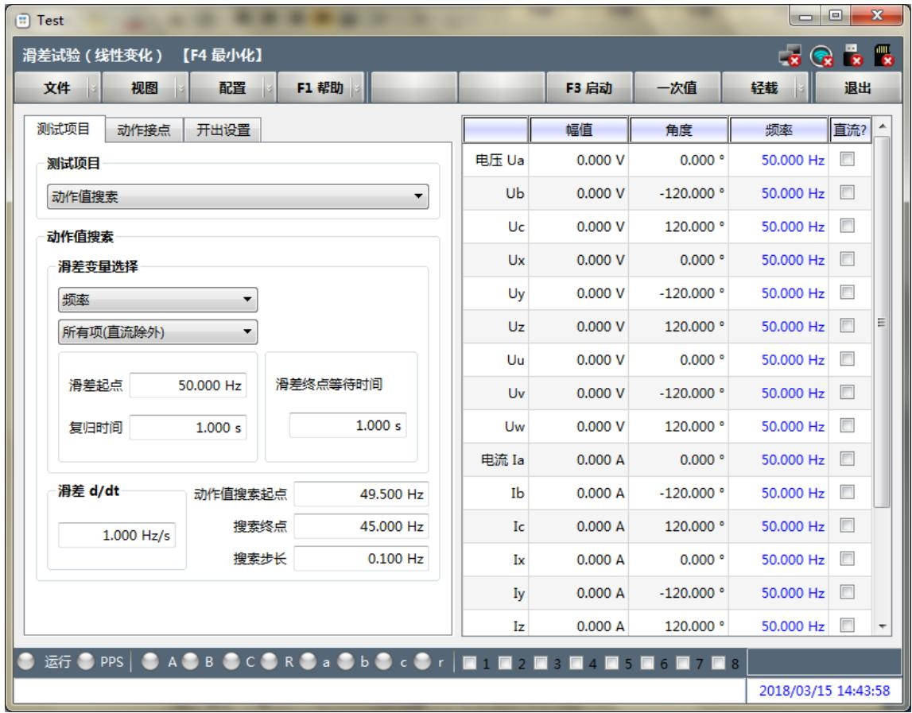
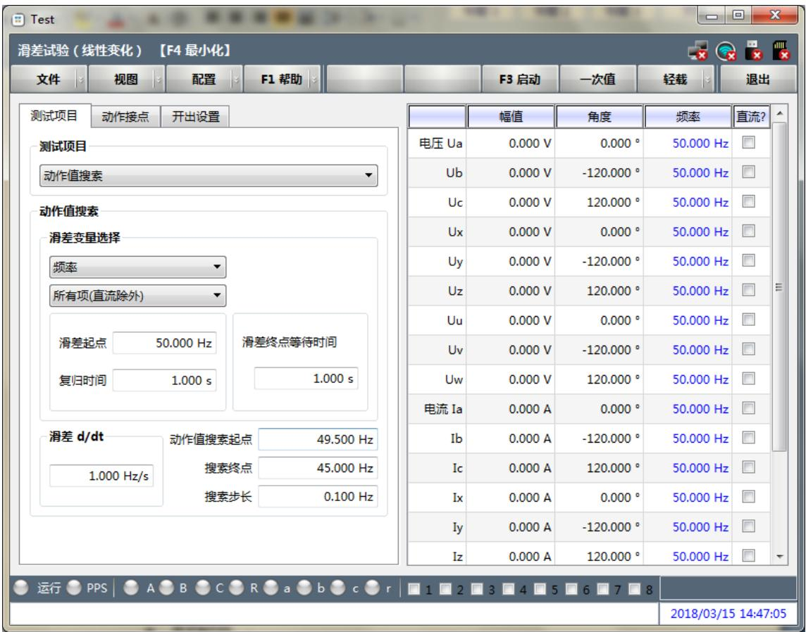
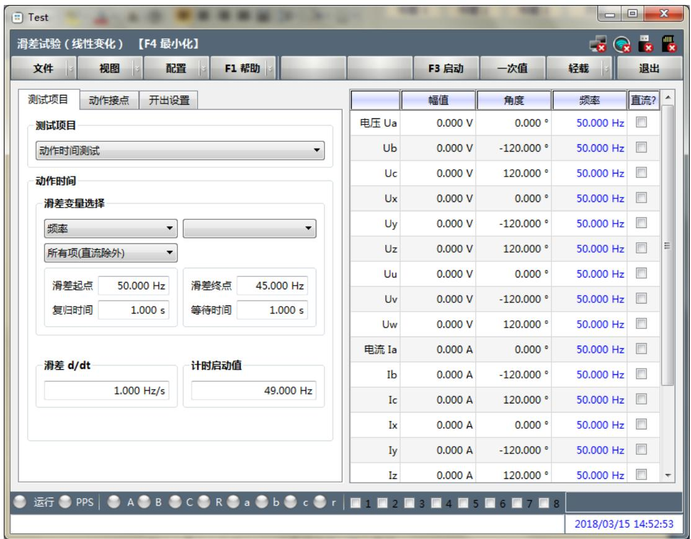
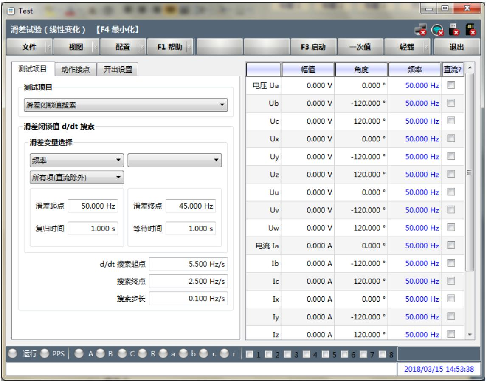
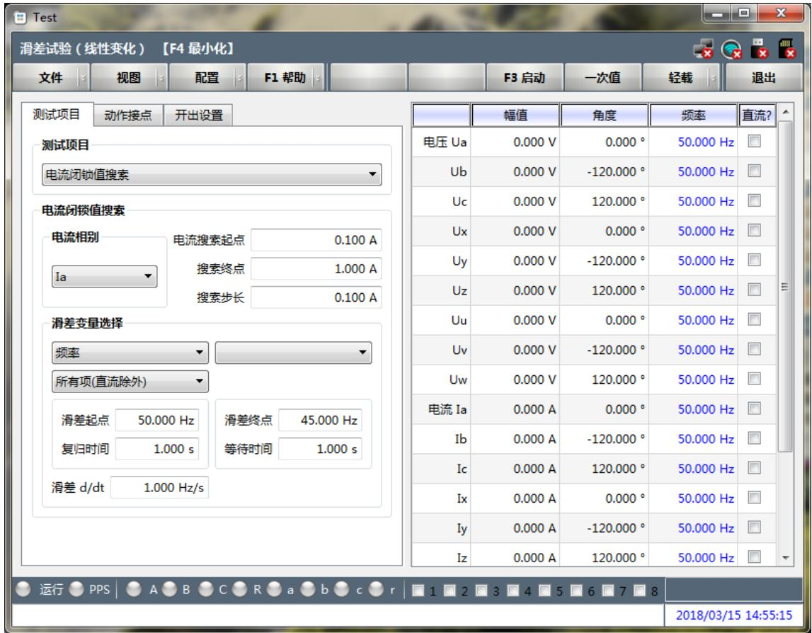
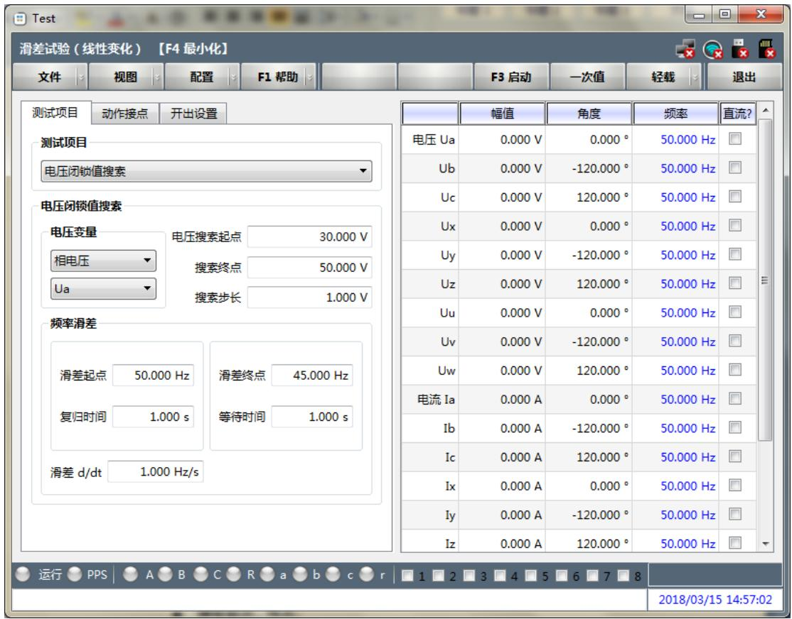
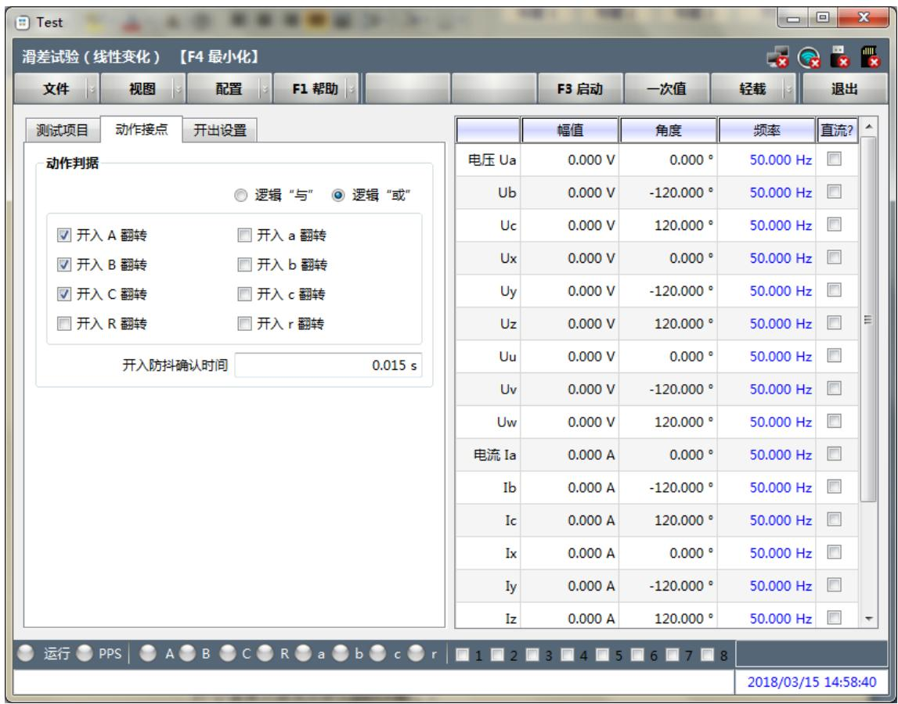
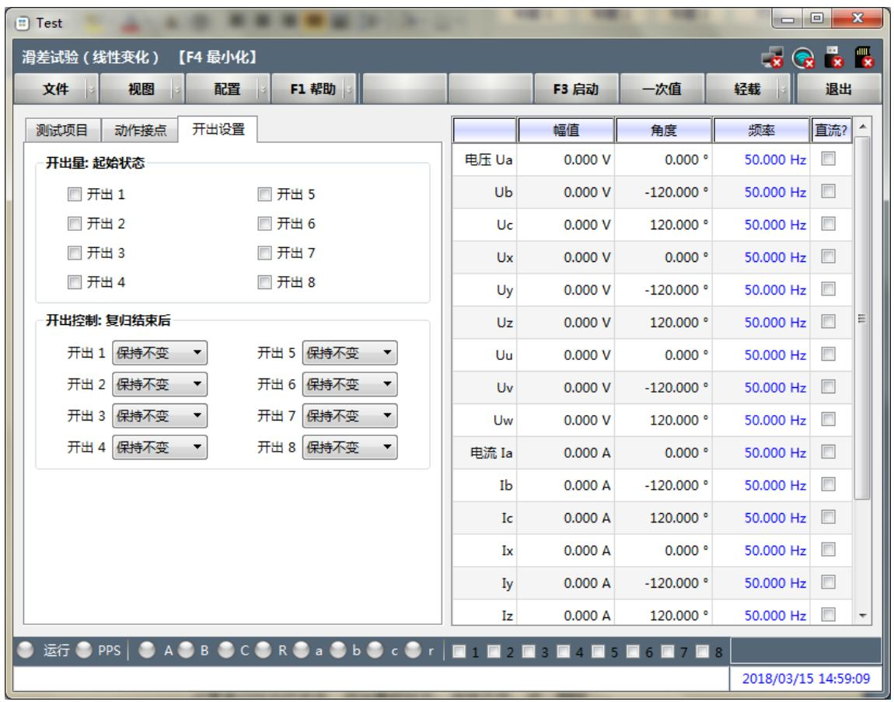
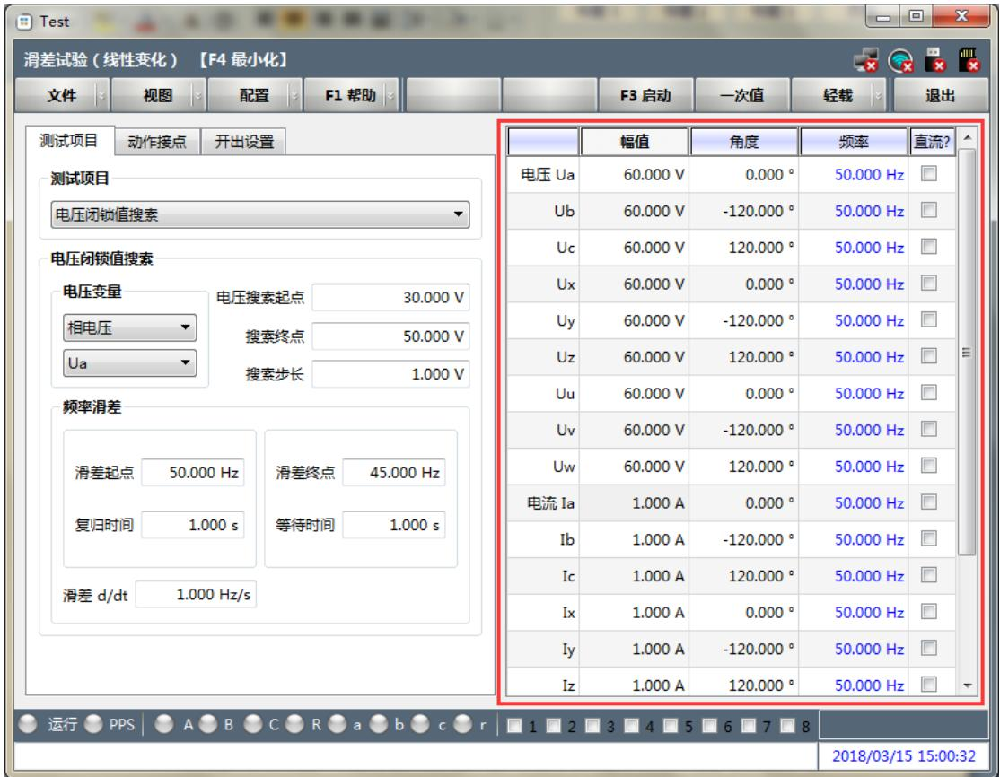
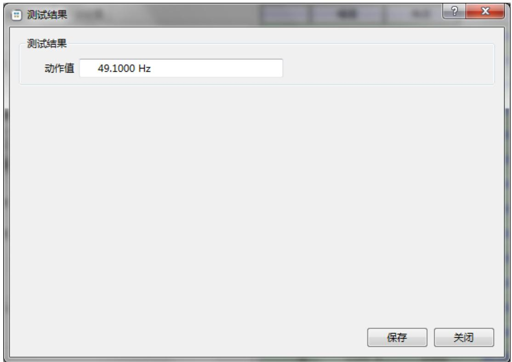

# 2.5 滑差试验

### 简介

滑差试验（线性变化）：指定的变量按给定的滑差d/dt，逐点变化；

可完成各种频率继电器、低周/低压减载装置等的动作值、动作时间以及滑差闭锁特性测试。

### 测试窗口

测试窗口用于试验参数设置；

滑差试验的测试窗口包括3 个属性页和1个右视图：

- 测试项目：根据测试需求， 选择测试项目，包括：动作值搜索、动作时间测试、滑差闭锁值搜索、电流闭锁值搜索、电压闭锁值搜索。以及变量的变化方式等参数设置；

- 动作接点：动作接点设置；

- 开出设置：设置开出量的状态。

右视图为试验过程的辅助显示区，以数字形式显示当前的电压电流输出，包括幅值、相位、频率等。

### 测试项目：动作值搜索

滑差变量选择：

根据需要选择变量，包括相电压、相电流、频率、线电压等；

滑差起点：

每步变化时，所选变量的变化起点，一般是保证保护可靠复归；

复归时间：

复归点的输出时间，通常取大于保护的复归时间，以保证保护可靠复归；

滑差 d/dt：

所选变量的滑差，即变化速度；

动作值搜索

- 搜索起点，终点

动作值的搜索起点和终点。搜索范围应覆盖动作值，并且一般从不动作区向动作区搜索；

- 搜索步长

动作值的搜索步长。通常，根据测试要求选择合适的步长，步长越小，测试精度越高。

滑差终点等待时间：

每步变化时，变量从复归点按滑差 d/dt变化到当前搜索值，如果期间未检测到保护的动作，则测试仪输出保持在当前搜索值，保持一个“等待时间”，等待保护的动作。通常，等待时间应大于保护的动作时间；

### 测试项目：动作时间测试

滑差变量选择：

根据需要选择变量，包括相电压、相电流、频率、线电压等；

滑差起点：

所选变量的变化起点，一般是保证保护可靠复归；

复归时间：

复归点的输出时间，通常取大于保护的复归时间，以保证保护可靠复归；

滑差终点：

所选变量的变化终点；

等待时间：

变量从复归点按滑差 d/dt变化到终点，如果期间未检测到保护的动作，则测试仪输出保持在当前搜索值，保持一个“等待时间”，等待保护的动作。

通常，等待时间应大于保护的动作时间；

滑差 d/dt：

所选变量的滑差，即变化速度；

计时启动值：

试验过程中，变量按设定的滑差 d/dt变化到“计时启动值”后，触发计时器启动计时，检测到保护动作停止计时。为保证测试结果的准确性，建议计时启动值取保护的动作值。

### 测试项目：滑差闭锁值搜索

### 滑差变量选择：

根据需要选择变量，包括相电压、相电流、频率、线电压等；

### 滑差起点：

每步变化时，所选变量的变化起点，一般是保证保护可靠复归；

### 复归时间：

复归点的输出时间，通常取大于保护的复归时间，以保证保护可靠复归；

### 滑差终点：

每步变化时，所选变量的变化终点；

### 等待时间：

变量从复归点按当前的滑差 d/dt变化到终点，如果期间未检测到保护的动作，则测试仪输出保持在当前搜索值，保持一个“等待时间”，等待保护的动作。

通常，等待时间应大于保护的动作时间；

### d/dt 搜索

### - 搜索起点，终点

滑差闭锁值 d/dt 的搜索起点和终点。搜索范围应覆盖闭锁值，并且一般从不闭锁区向闭锁区搜索；

### - 步长

滑差闭锁值 d/dt 的搜索步长。通常，根据测试要求选择合适的步长，步长越小，测试精度越高。

### 测试项目：电流闭锁值搜索

### 电流相别：

选择需要搜索的电流相别，可以根据需要选择单相，两相，三相和六相同时搜索；

### 电流搜索

### - 搜索起点，终点

电流闭锁值的搜索起点和终点。搜索范围应覆盖闭锁值，并且一般从不闭锁区向闭锁区搜索；

### - 步长

电流闭锁值的搜索步长。通常，根据测试要求选择合适的步长，步长越小，测试精度越高。

### 滑差起点：

每步变化时，所选变量的变化起点，一般是保证保护可靠复归；

### 复归时间：

复归点的输出时间，通常取大于保护的复归时间，以保证保护可靠复归；

### 滑差终点：

每步变化时，所选变量的变化终点；

### 等待时间：

变量从复归点按当前的滑差 d/dt变化到终点，如果期间未检测到保护的动作，则测试仪输出保持在当前搜索值，保持一个“等待时间”，等待保护的动作。

通常，等待时间应大于保护的动作时间；

### 滑差 d/dt：

所选变量的滑差，即变化速度；

### 测试项目：电压闭锁值搜索

### 电压变量：

选择需要搜索的电压，可设为相电压或者线电压，并根据需要选择对应的相别；

### 电压搜索

### - 搜索起点，终点

电压闭锁值的搜索起点和终点。搜索范围应覆盖闭锁值，并且一般从不闭锁区向闭锁区搜索；

### - 步长

电压闭锁值的搜索步长。通常，根据测试要求选择合适的步长，步长越小，测试精度越高。

### 滑差起点：

每步变化时，所选变量的变化起点，一般是保证保护可靠复归；

### 复归时间：

复归点的输出时间，通常取大于保护的复归时间，以保证保护可靠复归；

### 滑差终点：

每步变化时，所选变量的变化终点；

### 等待时间：

变量从复归点按当前的滑差 d/dt变化到终点，如果期间未检测到保护的动作，则测试仪输出保持在当前搜索值，保持一个“等待时间”，等待保护的动作。

通常，等待时间应大于保护的动作时间；

### 滑差 d/dt：

所选变量的滑差，即变化速度；

动作接点

### 动作接点：

试验时，程序将根据动作接点的设置确定保护是否动作或返回。

### 开入 A，B，C，R，a，b，c，r：

打“√”者表示被选中参与翻转判断；

### 动作逻辑：

“逻辑与”：所选开入量全部满足条件，动作成立；

“逻辑或”：所选开入量任何一个满足条件，动作成立；

如果只选中一个开入量，则“逻辑与”和“逻辑或”的效果相同。

### 开入防抖确认时间：

为避免继电器触点的抖动，开入接点的状态保持一个时间（确认时间）后，系统方予以确认生效。 通常取 10  ~  20 \mathrm  m s 。

### 开出设置

设置在复归状态及复归状态结束后的开出量状态。

### 开出量：起始状态：

设置复归状态，开出量的起始状态：断开，或，闭合；

注：打“√”表示开出量闭合；

### 开出量：复归结束后：

设置复归状态结束后，开出量的状态：保持不变，或，翻转。

保持不变：与复归状态中的开出量状态相同；

翻转：与复归状态中的开出量状态相反。

### 辅助右视图

测试窗口的右视图为试验过程的辅助显示区，以数字形式显示当前的电压电流输出，包括幅值、相位、频率、直流等，在试验前可设置各个通道输出的幅值角度和频率。

### 测试结果

试验过程中，测试仪根据接点的翻转，记录保护的动作值；

