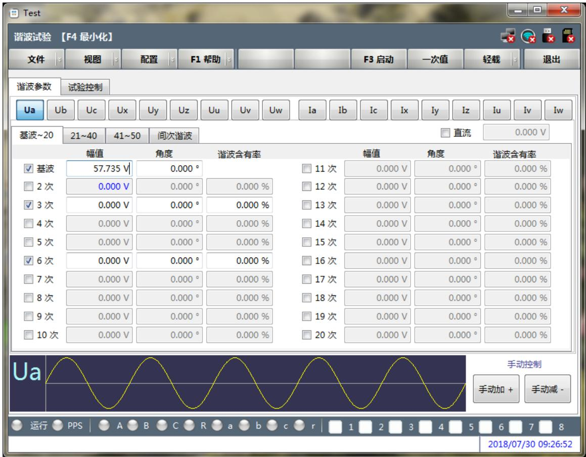
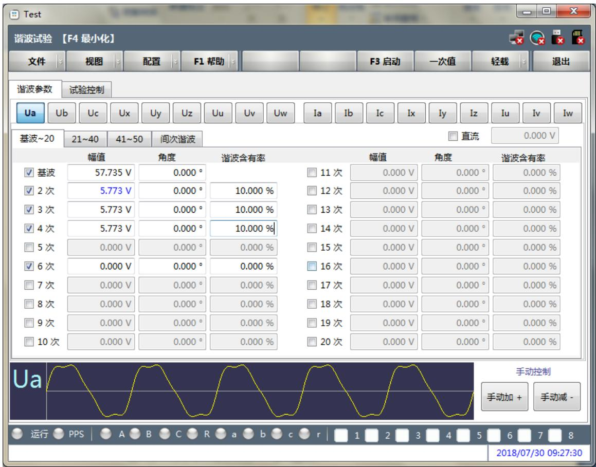
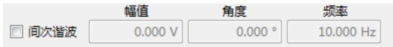
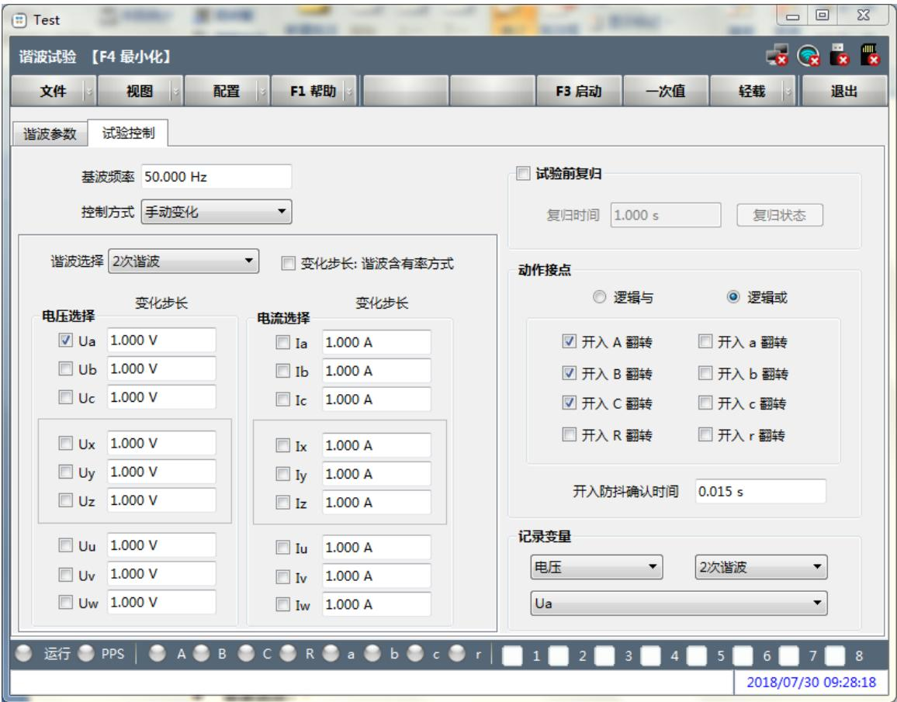
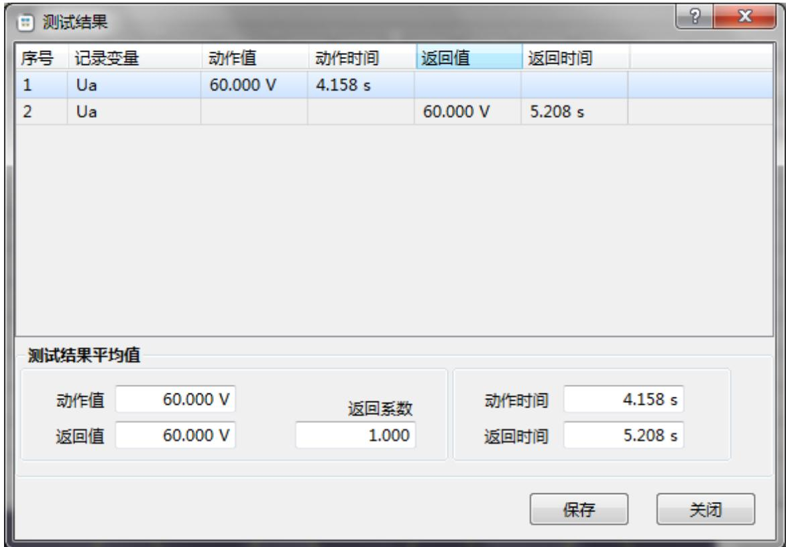

# 2.6 谐波试验

### 简介

本菜单主要用于校验保护装置对谐波或直流的反应，可以完成的试验项目包括

- 谐波采样精度的检查；

- 动作/返回值测试；

- 动作/返回时间的测试（利用输出锁定功能）；

可作为模拟量信号源输出，最多可18 通道（ $90 + 91$ ）的模拟量信号，各通道互相独立，可分别同时叠加直流、基波、 _  2 ~ 50 次谐波，以及间次谐波；

提供多个变量的组合控制方式，可完成多通道模拟量谐波幅值的实时调节；

谐波输入方式灵活，提供绝对值和相对值（谐波含有率）两种输入方式；

提供波形预览（波形图），及简单的谐波分析功能；

### 测试窗口

测试窗口用于试验参数设置；

谐波试验的测试窗口包括 2个属性页和一个当前通道波形预览界面：

- 谐波参数：设置并显示各通道电压电流的次谐波和间次谐波叠加情况：幅值、角度、谐波含有率；

- 试验控制：试验控制参数，包括试验过程中的变化方式、选择的变化量、动作接点

设置，以及记录变量等设置等；

### 谐波参数：

电压 Ua，Ub，Uc，Ux，Uy，Uz，Uu，Uv，Uw：

电流 Ia，Ib，Ic，Ix，Iy，Iz，Iu，Iv，Iw：

设置测试仪各通道电压、电流的谐波叠加情况，包括基波和谐波的幅值、角度等。注：打 $" \lor ^ { \prime \prime }$ 表示本次谐波被选中，参与叠加；

间次谐波的总控开关，

打 $" \nu  ^ { \prime \prime }$ 表示本次试验叠加间次谐波，具体叠加情况各通道可继续自定义；

否则所有通道均不叠加间次谐波；

### 试验控制：

控制方式：

系统提供了2 种变量变化方式：手动变化，自动变化；

基波频率：

设置基波的频率，通常为工频 $50 . 0 H z $ ，可设为 50Hz 或 60Hz。

谐波选择：

可以选择的变量包括直流、基波、2 次谐波-50 次谐波和间次谐波。

□变化步长：谐波含有率方式：

设置变量的数据输入格式。

不打“√”，即为有效值输入方式；打“√”，即为谐波含有率输入方式。

### 手动变化

电压选择、电流选择：

试验过程中，用户可自由选择变量；打“√”，即为选中该变量。

当前变量的变化由用户自行控制（通过按键，或点击菜单/工具栏上的“↑”、“↓”按钮）；

步长：

设置变量的每步变化步长。

通常，根据测试要求选择合适的步长，步长越小，测试精度越高。

### 自动变化：

自动变化可以根据相关的设置，代替用户实现“当前变量”的自动变化控制。

注意：此处的每步时间不能保证较高的精度，随 PC 机性能而变，误差约为 50ms 或以上；

### 通道选择：

单击鼠标左键，选择试验过程中的变量，如电压、电流等。

### 变化范围：

设置变量的变化起点和终点，起点可以大于终点，也可以小于终点。

通常，变化范围的设置应能覆盖继电器的动作/返回值区间。

### 步长：

设置变量的每步变化步长。

通常，根据测试要求选择合适的步长，步长越小，测试精度越高。

### 每步时间：

变量按设定的步长变化时，每一步大小的保持时间。

通常，每步时间的设置应大于继电器的动作（或返回）时间。

### 变化方式：

设置变化量的变化方式，“始”为变化范围的起点，“终”为终点，

- “始 终”为单程变化，只能测量动作值；

- “始 终 始”为双程变化，可以同时测量动作值、返回值，并自动计算出返回系数/或灵敏角；

### 动作返回：

设置变量的返回方式，

- 动作返回：

变量在从起点 终点的变化过程中，一旦检测到继电器的动作，自动根据变化方式确定是否继续试验：

 变化方式为“始 终”：结束试验；

 变化方式为“始→终 始”：改变变量的变化方向，向起点返回。

- □动作返回：

即“全程变化”。试验过程中，无论继电器动作与否，变量一直按所设置的变化范围进行变化，直至到达终点或返回起点。

注：“灵敏角”的测试必须采用“始→终 始”，“全程变化”的方式！

### 试验前复归：

如果试验前需要输出一个复归状态（保护PT 断线复归），则选中该项；

复归状态:

设置“复归状态”，通常为空载状态。

复归时间：

大于保护的 PT断线复归时间，从而保证保护的可靠复归。

### 动作接点：

试验时，程序将根据动作接点的设置确定保护是否动作或返回。

### 动作逻辑：

“逻辑与”：所选开入量全部满足条件，动作成立；

“逻辑或”：所选开入量任何一个满足条件，动作成立；

如果只选中一个开入量，则“逻辑与”和“逻辑或”的效果相同。

- 开入 A，B，C，R，a，b，c，r：

打 $" \lor ^ { \prime \prime }$ 者表示被选中参与翻转判断；

### 开入防抖确认时间：

为避免继电器触点的抖动，开入接点的状态保持一个时间（确认时间）后，系统方予以确认生效。 通常取 10  ~  20 \mathrm  m s 。

### 记录变量：

记录变量选择。包括次谐波、间次谐波及总合成有效值等。

试验过程中，根据接点的翻转情况，记录该变量的动作值或返回值。

### 波形预览视图

以波形的方式预览当前所选通道（电压或者电流）的谐波叠加情况，选择手动控制的时候，可以通过界面上的手动加＋、手动减－或者小键盘上的 F7、F6来手动控制变量的增加或者减少。

### 测试结果

试验过程中，测试仪根据接点的翻转，记录保护的动作和返回值结果；

