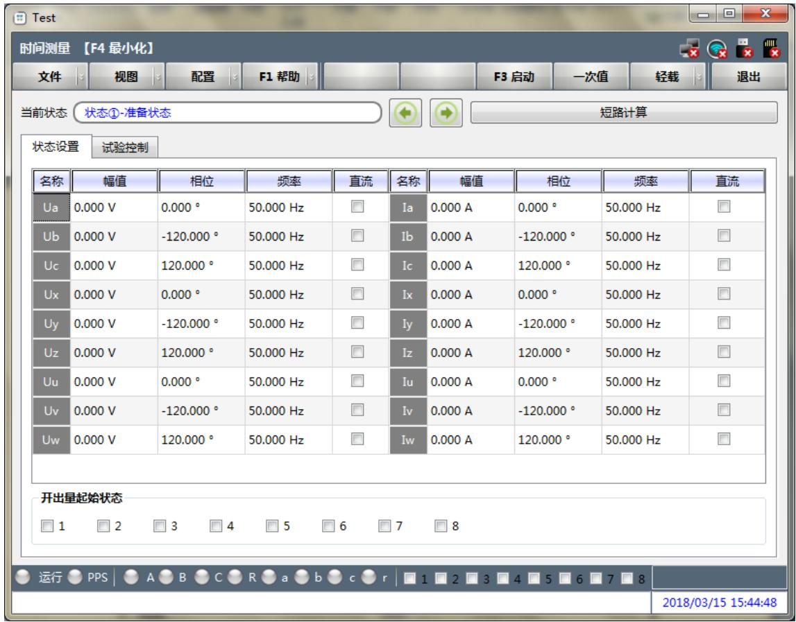
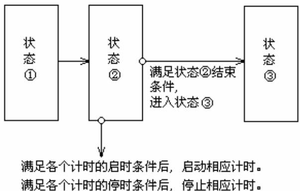
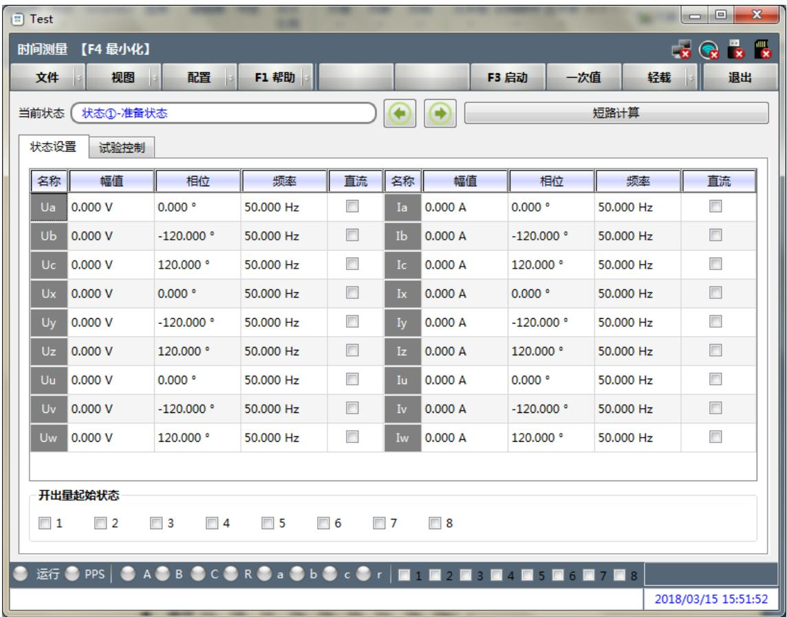
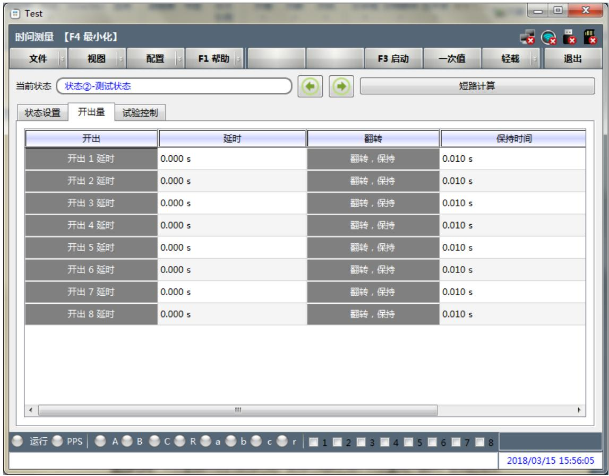
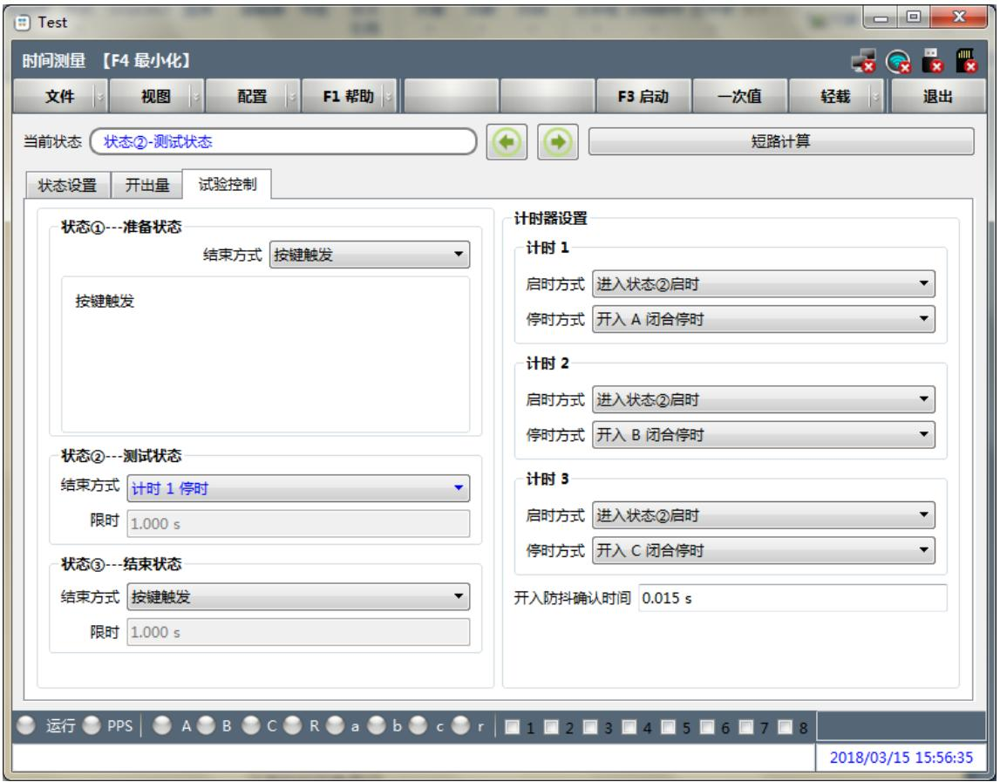
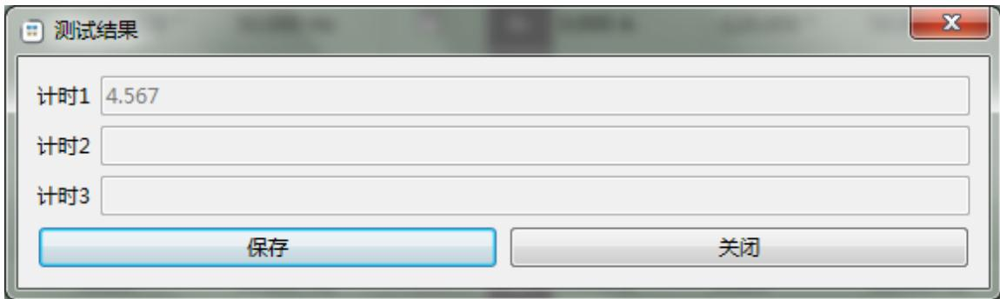

# 2.7 时间测量

### 简介

本菜单主要用于测试各种保护的动作时间。

- 系统提供了 3 个状态，包括：状态 (1) — 准备状态；状态 (2) — 测试状态；状态 (3) —结束状态；

三个状态均可由用户自由设置；

- 提供了3个计时器，以及灵活的计时器启动方式配置；

通过各计时器启时方式的灵活配置，程序不仅可测量动作/返回时间，还可以直接测量各种脉冲宽度（空接点，或，带电位接点）；

- 测试状态具有4 种不同的触发方式：

按键触发，时间触发，PPM分脉冲触发，开入接点翻转触发；

“PPM 分脉冲触发”方式可以实现保护的双端远距离 GPS 对调；

### 测试窗口

测试窗口用于试验参数设置；

时间测量的测试窗口包括 2 个属性页：

- 状态设置：设置 3个状态下的电压、电流及开出量输出；

- 试验控制：设置 3 个状态的结束方式，以及 3 个计时器的启/停时方式等；

### 状态设置

“时间测量”的试验过程分 3 个状态：状态 $\textcircled{1} $ 状态 $\textcircled{2} $ 状态 (3) ；

通常，状态 (1) 为试验的起始状态，状态 (2) 为测试状态，状态 (3) 为试验的结束状态。其中“状态 (2) -- 测试状态”为试验的关键状态，3 个计时器的启/停时控制以及开出量的控制均在状态 (2) 中进行。

当前状态：

根据需要选中待编辑的状态列，通过 选择当前状态

短路计算：

系统提供了“短路计算”的辅助功能，可根据短路模型自动计算故障情况下的电压电流。

电压 Ua，Ub，Uc，Ux，Uy，Uz，Uu，Uv，Uw：

电流 Ia，Ib，Ic，Ix，Iy，Iz，Iu，Iv，Iw：

设置本状态下，测试仪各路电压、电流的输出，包括幅值、角度和频率。

直流：

设置本模拟通道的输出方式：交流，或，直流。“√”表示直流。

开出量起始状态：

根据设置，测试仪可以通过开出量发出一个信号。

仅对状态 (1) 有效；

开出量的起始状态：断开，或，闭合，在“状态 $\textcircled{1} \textcircled{1} \textcircled{1}$ 起始状态”中输出；

开出量：起始状态

□1

15□ 

□ 

□： 

注：打 $" \lor ^ { \prime \prime }$ 表示开出量闭合。

进入状态 (2) 后：

仅对状态 (2) 有效；

设置进入“状态 (2) -- 测试状态”后，开出量的翻转时刻及保持时间，

延时：以进入状态 (2) 为参考点，即进入状态 (2) 后，经过所设定的延时，开出量翻转（与各自的起始状态相反）。

注：该“延时”应小于状态 (2) 的“持续时间”。

保持时间：开出量翻转后的保持时间。保持时间到达后，开出量再次翻转，返回起始状态；

### 试验控制

### 状态 (1) 准备状态：

### 结束方式：

状态 (1) 的结束方式，系统提供了 4种触发方式，包括：

- 按键触发：

测试仪保持状态 (1) 输出，等待用户按确认键后进入状态 (2) ；

- 时间触发：

测试仪保持状态 (1) 输出，“限时”（即状态 (1) 的输出时间）到达后自动进入状态 (2) ；

通常，限时时间的设置应大于保护的复归时间（ 20  ~  25 秒左右），以保证保护的可靠复归。

- PPM 分脉冲触发：

对时成功后，测试仪保持状态 (1) 输出；

试验的双方人员联系，在同一分钟之内（ 10  ~ 50 秒之间的任意一刻）按确认键；

测试仪检测到确认后的第一个 PPM脉冲，进入状态 (2) ；

- 开入接点翻转触发：

测试仪保持状态 (1) 输出，设定的开入翻转条件满足后，进入状态 (2) ；

### 状态 (2) — 测试状态：

### 结束方式：

选择状态 (2) 的结束方式，系统提供了 8 种结束方式，包括“计时 1 停时”、“计时2停时” 、“计时3 停时”，…，以及“时间控制”等。

一旦条件满足，则状态 (2) 结束，测试仪进入状态 (3) （即试验的结束状态）；

### 限时：

状态 (2) 结束方式选择为“时间控制”时有效；

状态 (2) 的输出时间；

### 状态 (3) — 结束状态：

### 结束方式：

状态 (3) 的结束方式，系统提供了 2 种结束方式：

- 按键控制：测试仪保持状态 (3) 输出，等待用户按键后结束试验；

- 时间控制：测试仪保持状态 (3) 输出，所设定的时间（即状态 (3) 的输出时间）到达后自动结束试验。

### 计时 1：

### 计时 2：

### 计时 3：

启时方式：计时器 1、2、3 的启动计时触发条件

停时方式：计时器 1、2、3 的停止计时触发条件；

### 开入防抖确认时间：

为避免继电器触点的抖动，开入接点的状态保持一个时间（确认时间）后，系统方予以确认生效。 通常取 10  ~  20 \mathrm  m s 。

### 测试结果

进入状态 (2) -- 测试状态后，测试仪可各计时器的启/停时设置，自动记录计时结果；

