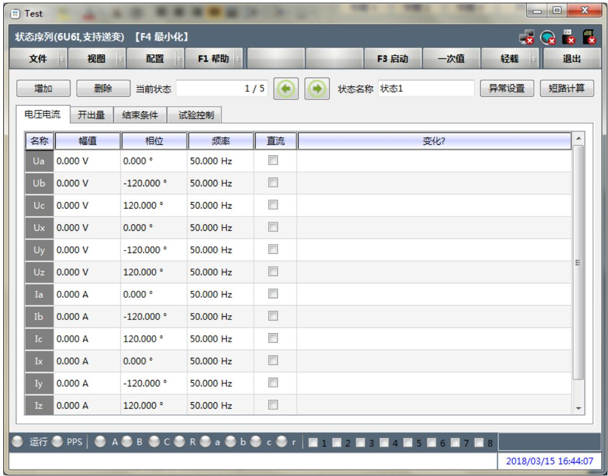
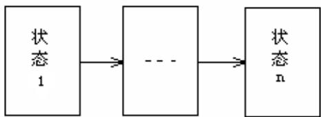
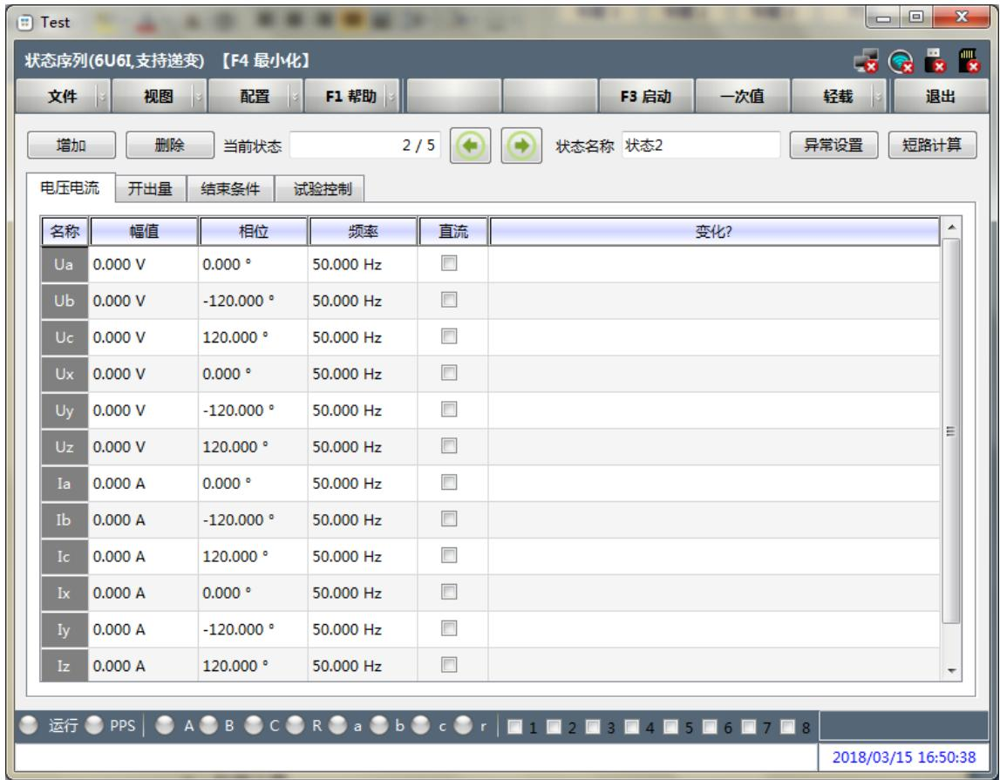
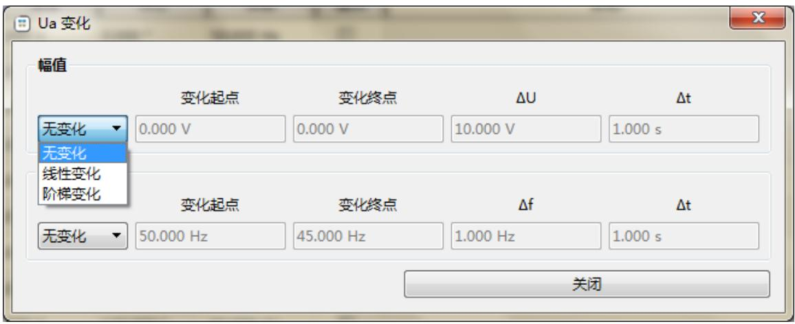
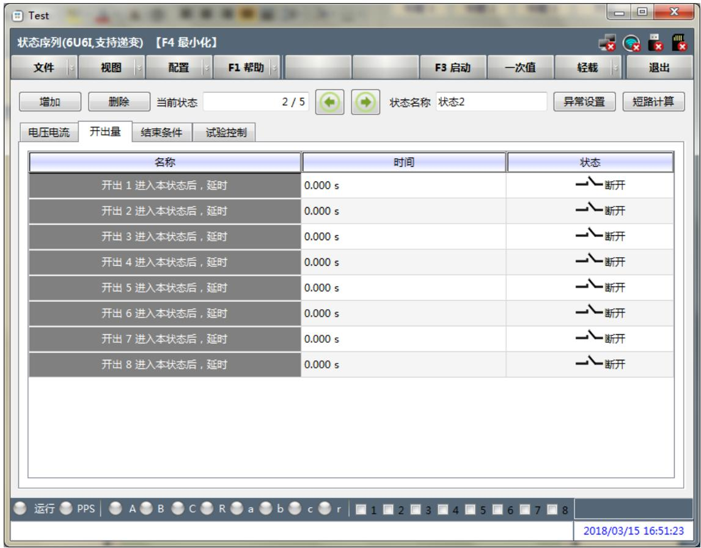
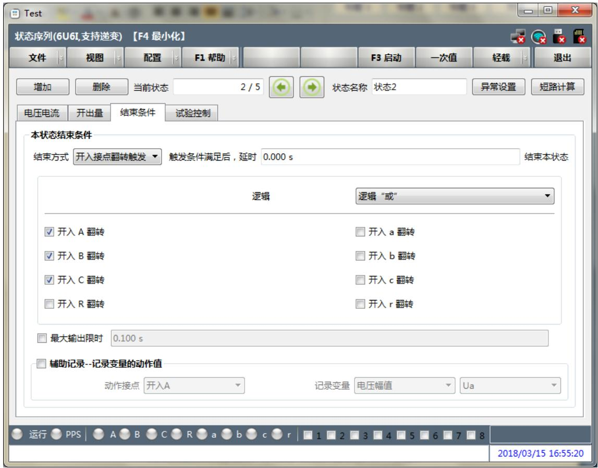
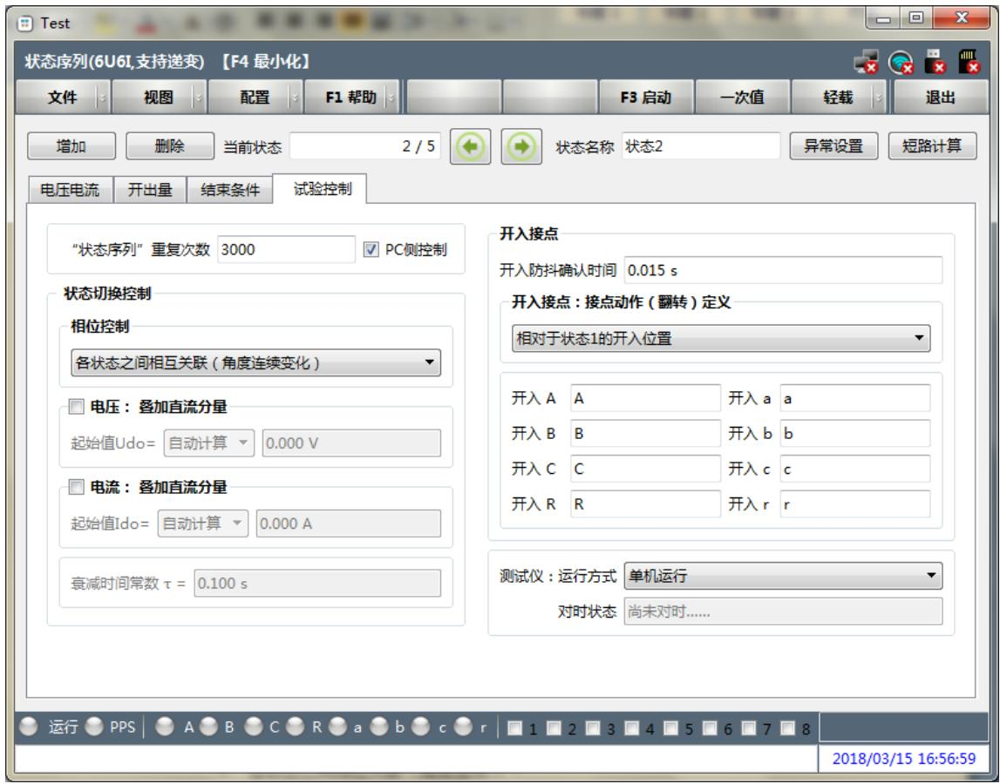
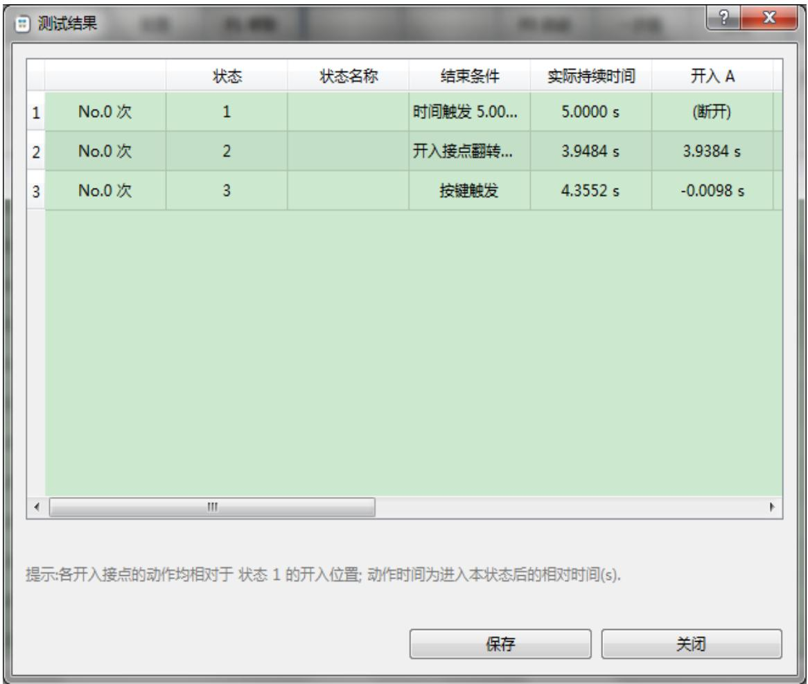

# 2.9 状态序列（6U6I，支持递变）

### 简介

本菜单可由用户自由定制试验方式。

- 程序最多允许输入60个状态，所有状态均由用户自由设置；

- 本菜单最多可提供12通道（ $60 + 61$ ）的模拟量信号同时输出，各通道幅值、角度和频率互相独立，交、直流任意设置；

- 支持电压电流通道的幅值和频率按设定值进行递变变化（线性变化/阶梯变化）；

- 提供了 6 种状态切换方式：按键触发，时间触发，GPS 分脉冲触发，开入接点翻转触发(可带最大输出限时)，幅值触发，频率触发；

- 各状态下8 对开出量的断开和闭合能自由控制，可用于模拟保护出口接点的动作情况。

### 测试窗口

测试窗口用于试验参数设置；

状态序列的测试窗口包括 4 个属性页：

- 电压电流：状态编辑，设置各状态下的电压、电流的幅值、角度、频率，交直流，以及递变方式、递变参数等；

- 开出量：进入本状态后开出接点的变化设置；

- 结束条件：本状态的结束条件，即下一状态的触发条件；

- 试验控制：设置状态序列的循环次数，是否叠加非周期分量，以及开入接点的动作定义等；

### 电压电流

试验过程分n个状态：状态 $1  \ldots $ 状态 n。其中，1≤n≤60，具体的状态个数由用户根据试验需要设定。

各状态之间的切换由“结束方式”实现。

### 当前状态：

根据需要选中待编辑的状态列，通过 选择当前状态

### 增加，删除

根据需要增加或者删除状态，通常为三个状态或者五个状态。

异常设置：进行 SMV异常、GOOSE输出设置，仅用于数字化测试仪；

### 短路计算：

系统提供了“短路计算”的辅助功能，可根据短路模型自动计算故障情况下的电压电流。

电压 Ua，Ub，Uc，Ux，Uy，Uz：

电流 Ia，Ib，Ic，Ix，Iy，Iz：

设置本状态下，测试仪各路电压、电流的输出，包括幅值、角度和频率。

### 直流：

设置本模拟通道的输出方式：交流，或，直流。“√”表示直流。

### 变化？：

根据需要设置，电压、电流的幅值或频率按设定值进行变化，如线性变化或阶梯变化。

### 开出量

设置进入本状态后，各开出接点的变化情况：延时断开，或，延时闭合；

### 时间：

以进入本状态为时标起点，即进入本状态后，开出接点根据设置延时断开或闭合。“延时”必须小于本状态的“持续时间”。

### 开出状态：

延时到达后，开出量的输出状态，断开，或闭合；

### 结束方式

### 本状态序列中，各状态的结束条件为：

触发条件满足后，经过指定的延时后，结束本状态，进入下一状态。

系统提供了6种触发条件，包括

- 按键触发：

测试仪保持本状态输出，等待用户按确认键后进入下一状态；

- 时间触发：

测试仪保持本状态输出，“最大持续时间”到达后自动进入下一状态；

- PPM分脉冲触发：

对时成功后，测试仪保持本状态输出；

试验的双方人员联系，在同一分钟之内（ 10 ~ 50 秒之间的任意一刻）按确认键；测试仪检测到确认后的第一个 PPM脉冲，进入下一状态；

- 开入接点翻转触发：

测试仪保持本状态输出，设定的开入翻转条件满足后，进入下一状态；

如果勾选最大输出限时 （ ），则开入翻转或最大输出限时任一条件满足后，进入下一状态；

- 幅值触发：

测试仪保持本状态输出，等待所选通道幅值达到设置门槛后进入下一状态；

- 频率触发：

测试仪保持本状态输出，等待所选通道频率达到设置门槛后进入下一状态；

### 辅助记录--记录变量的动作值

打“√”表示试验记录变量的动作值，“ ”表示试验不记录变量的动作值。

- 动作接点：

试验时，程序将根据动作接点的设置确定保护是否动作或返回。

- 记录变量

本状态试验过程中动作或返回时需要记录的变量，如电压电流的幅值或频率。

### 试验控制

“状态序列：重复次数

设置整个状态序列的循环重复输出次数，最多可循环 3000 次；

□PC 侧控制：勾选，则重复次数由上位机 PC 控制，可记录每次的测试结果；

不勾选，则重复次数由下位机程序控制，只能记录第一次的测试结果。

状态切换控制：

相位控制：

- 各状态之间相互关联（角度连续变化）：

状态切换时，各状态之间的角度保持连续变化；

- 各状态之间相互独立：

状态切换时，各状态之间的相位独立，每个状态开始输出的时候输出该状态各个通道设置的角度。

### 电压、电流叠加直流分量：

选择状态切换过程中，是否需要在电压、电流上叠加一衰减的非周期直流分量。

### 衰减时间常数 ：

非周期直流分量的衰减时间常数；

### 开入防抖确认时间：

为避免继电器触点的抖动，开入接点的状态保持一个时间（确认时间）后，系统方予以确认生效。 通常取 10  ~  20 \mathrm  m s 。

### 开入接点：接点动作（翻转）定义：

- 相对于状态 1的开入位置：

所有开入接点的动作（翻转）均以状态 1 结束时的开入位置为起始状态；

- 相对于上一个状态的开入位置：

所有开入接点的动作（翻转）均以上一个状态结束时的开入位置为起始状态。

### 开入接点：分别接自保护：

根据测试仪开入接点和保护动作出口接点的连接定义，如跳A、B、C，重合R 等。

### 测试仪运行方式：

测试仪提供了2 种运行方式：

- 单机运行：单台测试仪独立运行；

- PPS同步：通过 PPS信号实现远距离的测试仪电压电流同步；

### 对时状态：

测试仪的运行方式选择为“PPS同步”时有效。

当收到 PPS 信号，则显示对时成功；否则显示为对时失败或尚未对时。

### 测试结果

试验过程中，测试仪自动记录各状态的持续时间，以及进入各状态后 8 对开入接点的变化情况；

