# 2.11 整组试验

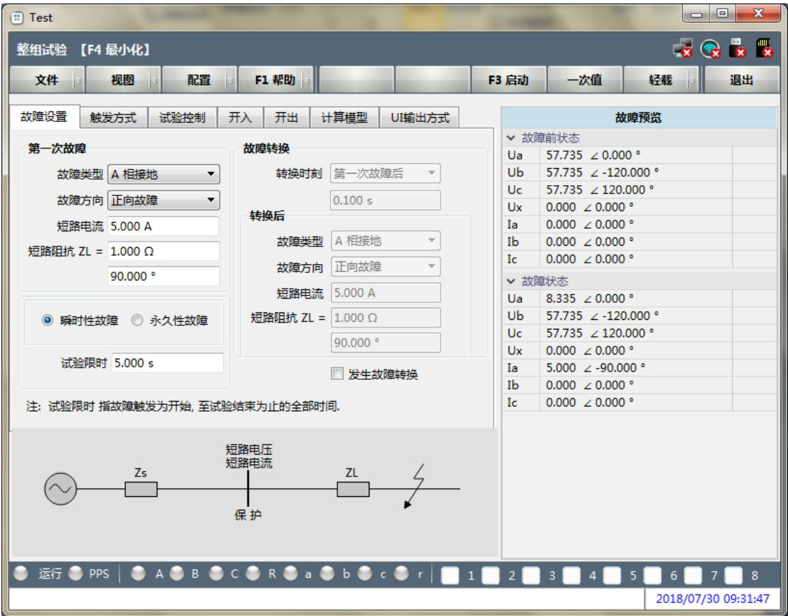

### 简介

本菜单以单机对无穷大系统为模型，提供电力系统的简单故障仿真功能，用于测试保护的整体传动特性，可模拟瞬时性、永久性、转换性故障，以及多次重合闸等。

可完成的测试项目包括：

- 距离，零序，过流等保护的整组传动试验；

- 重合闸动作特性；

- 双端线路保护的 GPS 对调。

提供多种简单故障的计算模型，包括电源阻抗恒定，短路电流恒定，以及短路电压恒定；提供多种故障触发方式，包括按键触发，时间触发，PPM分脉冲触发，开入接点触发；

### 测试窗口

测试窗口用于试验参数设置；

整组试验的测试窗口包括7 个属性页和1个右视图：

- 故障设置：故障参数设置，包括第1 次故障、故障转换，以及试验限时等；

- 触发方式：第1 次故障的触发方式设置；

- 试验控制：试验控制参数，包括故障前、合闸角、非周期分量叠加、PT/CT位置等；

- 开入：测试仪开入量设置，用于设置接入的跳闸信息；

- 开出：测试仪开出量设置，用于设置开出的断开或闭合状态；

- 计算模型：短路计算模型设置；

- UI输出方式：设置测试仪的电压电流输出方式；

右视图用于故障预览，可以预览故障前和故障状态下输出的电压电流值。

### 故障设置

试验过程如下：

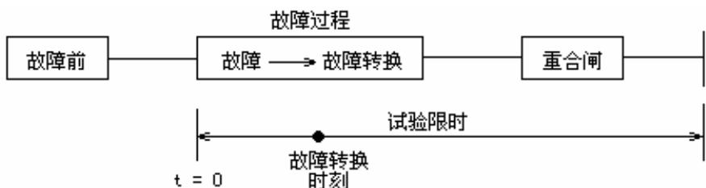

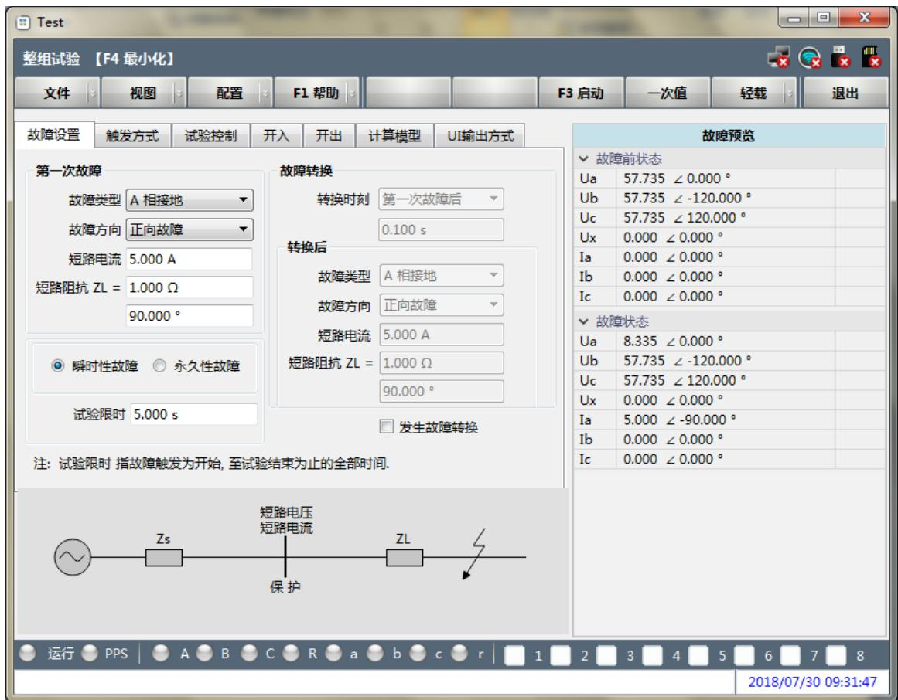

### 第一次故障：

设置第一次故障的故障参数，包括故障类型，故障方向和短路电流。

### 故障类型：

系统提供了10种故障类型，包括：A、B、C接地，AB、BC、CA相间，AB、BC、CA两相接地，以及三相短路。系统根据计算模型的设置以及相应的故障参数，自动计算A、B、C 三相的电压、电流；

### 故障方向：

正方向故障，或反方向故障；

### 短路电流/短路电压：

短路电流：短路故障时，流经保护安装处的故障相电流If；

短路电压：短路故障时，保护安装处的故障电压 Uf，

- 接地故障时，Uf为各故障相的对地电压；

- 相间故障时，Uf为故障相之间的相间电压。

注：计算模型为“短路电压 Uf 恒定”时，短路电流自动转变为短路电压。

### 短路阻抗 ZL：

故障时，保护安装处距离短路点之间的短路阻抗，极坐标形式：幅值，角度；

### 瞬时性故障/永久性故障：

设置故障性质；

- 瞬时性故障：跳闸后故障消失，保护重合闸后输出故障前状态；

- 永久性故障：跳闸后故障切除，保护重合闸后故障恢复；

注：如果需要测试保护的后加速功能，一般建议选择“永久性故障”；

### 故障转换：

试验过程中是否发生故障转换；

### 转换时刻：

故障转换发生的时刻，系统提供了两种不同的时间设置方式：

- 第一次故障后：即第一次故障后发生故障转换，“转换时刻”以进入第一次故障的时刻为时标起点 $\scriptstyle { t  } = 0$ ；

- 重合闸后：即重合后发生故障转换，“转换时刻”以进入重合闸状态为时标起点$\scriptstyle { t  } = 0$ ；

### 故障类型：

系统提供了10种故障类型，包括：A、B、C接地，AB、BC、CA相间，AB、BC、CA两相接地，以及三相短路。

系统根据计算模型的设置以及相应的故障参数，自动计算 A、B、C 三相的电压、电流；

### 故障方向：

正方向故障，或反方向故障；

### 短路电流/短路电压：

短路电流：短路故障时，流经保护安装处的故障相电流 If；

短路电压：短路故障时，保护安装处的故障电压 Uf，

- 接地故障时，Uf为各故障相的对地电压；

- 相间故障时，Uf为故障相之间的相间电压。

注：计算模型为“短路电压Uf 恒定”时，短路电流自动转变为短路电压。

### 短路阻抗 ZL：

故障时，保护安装处距离短路点之间的短路阻抗，极坐标形式：幅值，角度；

### 试验限时：

从“第一次故障”触发到全部试验结束的时间限制。通常，根据测试需要调整该时间，

- 测试保护跳闸，则“故障限时”只需要大于保护的动作时间定值并留有足够的裕度即可；

- 测试保护的重合闸，则“故障限时”应保证保护在该时间内可以完成 “跳闸 重合→再跳闸”的整个过程；

### 触发方式

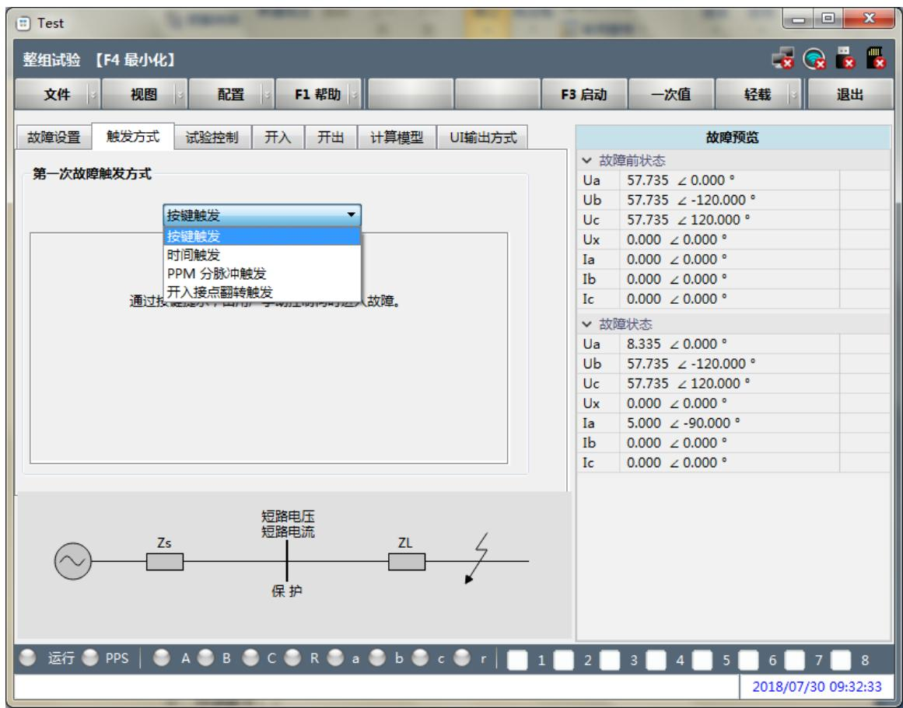

### 第一次故障触发方式：

设置第一次故障的触发方式，系统提供了 4种触发方式：

- 按键触发：

测试仪保持故障前状态，等待用户按确认键后触发故障；

- 时间触发：

测试仪保持故障前状态，“故障前时间”到达后触发故障；

通常，故障前时间的设置应大于保护的复归时间（ 20  ~  25 秒左右），以保证保护的可靠复归。

- PPM 分脉冲触发：

对时成功后，测试仪保持故障前状态；

试验的双方人员联系，在同一分钟之内（ 10  ~  50 秒之间的任意一刻）按确认键；

测试仪检测到确认后的第一个 PPM脉冲，触发故障；

- 开入接点翻转触发：

测试仪保持故障前状态，设定的开入翻转条件满足后，触发故障；

试验控制

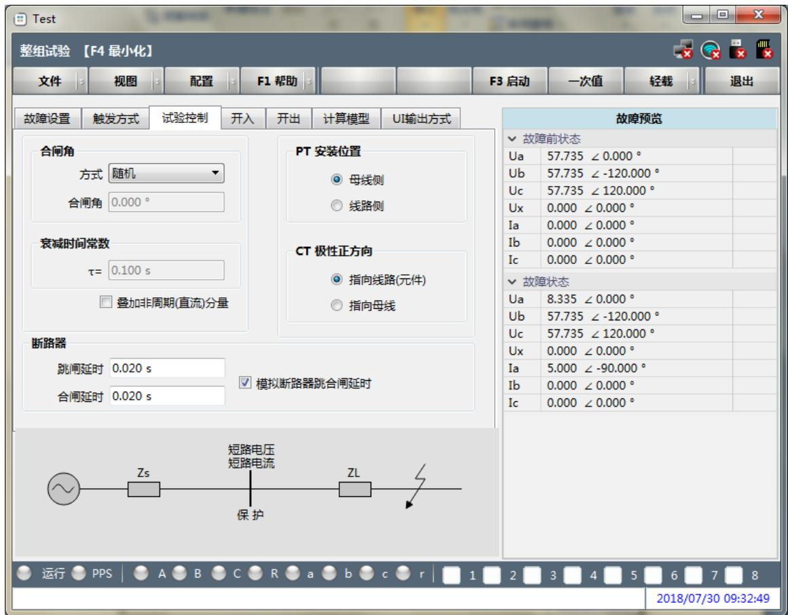

### 合闸角：

此处“合闸角”定义为故障发生瞬间电源电压的瞬时角度。

合闸角的大小决定了直流电流分量初始值的大小。

### 方式：

合闸角方式：合闸角固定，或，合闸角随机；

### 合闸角：

合闸角方式选择“合闸角固定”时有效；

根据故障类型的不同，合闸角的选取如下表所示：

<table><tr><td>故障类型</td><td>合闸角</td></tr><tr><td>A相接地</td><td>φ(∪A)</td></tr><tr><td>B相接地</td><td>φ(∪B)</td></tr><tr><td>C相接地</td><td>φ(∪C)</td></tr><tr><td>AB相间</td><td>φ(∪AB)</td></tr><tr><td>BC相间</td><td>φ(∪BC)</td></tr><tr><td>CA相间</td><td>φ(∪CA)</td></tr><tr><td>AB两相接地</td><td>φ(∪A)</td></tr><tr><td>BC两相接地</td><td>φ(∪B)</td></tr><tr><td>CA两相接地</td><td>φ(∪C)</td></tr><tr><td>三相短路</td><td>φ(∪A)</td></tr><tr><td>自定义故障</td><td>φ(∪A)</td></tr></table>

### 衰减时间常数：

故障后回路的衰减时间常数；

用户自设，一般可取 0.1秒；

### 叠加非周期（直流）分量：

故障触发瞬间，故障电流中是否叠加一衰减的非周期直流分量，该直流分量的大小为：

$$ I_{dc}(t) = \left[ I_{pm0} \cdot \sin(\alpha - \varphi_0) - I_{pm} \cdot \sin(\alpha - \varphi) \right] \cdot e^{-t/\tau} $$

式中：
- $I_{pm0}$：故障前的电流最大值
- $I_{pm}$：故障后的稳态短路电流最大值
- $\varphi_0$：故障前的回路阻抗角
- $\varphi$：故障后的回路阻抗 $Z$ 的阻抗角（$Z = Z_S + Z_L$）
- $\alpha$：故障瞬间电源电压的角度
- $\tau$：故障后回路的衰减时间常数（由用户根据实际情况输入）

> **注**：
> 1. 短路故障计算建模时，通常假设线路阻抗角等于系统阻抗角度，故短路电压中的直流分量 $V_{dc}(t) = 0$。
> 2. 通常情况下，继电保护关注的是故障后的稳态短路电流、电压，所以不需要叠加非周期（直流）分量。

### PT 安装位置：

保护 PT 的安装位置；

母线侧：PT 位于母线侧，则跳闸后故障相电压恢复为母线电压（即额定电压）；

线路侧：PT 位于线路侧，则跳闸后故障相电压变为0。

通常，220KV及以下的保护，PT位于母线侧；

### CT极性正方向：

保护 CT 极性的正方向；

CT 极性指向线路（元件）为正：电流从母线流向线路为正；

CT 极性指向母线为正：电流从线路流向母线为正；

### 模拟断路器跳合闸延时：

选择试验过程中是否需要模拟断路器的跳/合闸延时；

### 跳闸延时：

模拟断路器的跳闸动作时间；

测试仪检测到保护的跳闸信号后，经过“跳闸延时”方切除故障，进入跳闸后的电压电流状态。

（注：如果测试仪的开入接点直接连断路器的“跳位”接点，则跳闸延时可取为0）；

### 合闸延时：

模拟断路器的合闸动作时间；

测试仪检测到保护的合闸信号后，经过“合闸延时”方进入重合闸后的电压电流状态。

（注：如果测试仪的开入接点直接连断路器的“合位”接点，则合闸延时理论上可取为0，但考虑到躲开三相重合动作的不一致性，建议至少取0.02 秒）；

### 开入

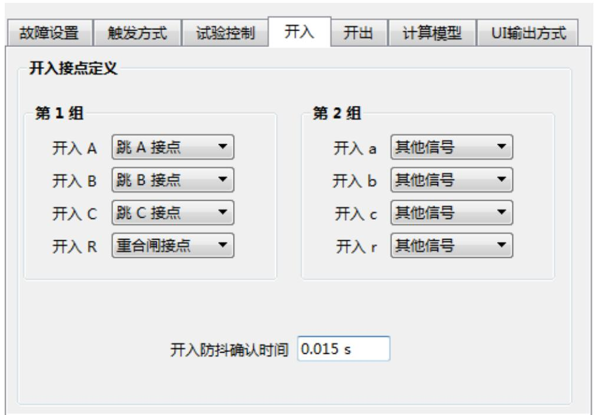

### 开入接点定义：

配置测试仪的开入接点与保护动作出口接点的连接方式，如跳A、B、C，重合 R等。

### 第 1 组：

开入 A：可选择为“跳 A 接点”， “三跳接点”，或“其他信号”；

开入 B：可选择为“跳 B 接点”， “三跳接点”，或“其他信号”；

开入 C：可选择为“跳 C 接点”， “三跳接点”，或“其他信号”；

开入 R：可选择为“重合闸接点”， 或“其他方式”；

### 第 2组：

开入 a：可选择为“跳 A 接点”， “三跳接点”，或“其他信号”；

开入 b：可选择为“跳 B接点”， “三跳接点”，或“其他信号”；

开入 c：可选择为“跳 C 接点”， “三跳接点”，或“其他信号”；

开入 r：可选择为“重合闸接点”， 或“其他信号”；

注：当开入接点选为跳 A、B、C（或三跳接点），重合接点时，该接点除了记录动作时间外，程序还会根据该接点的翻转进行相应的故障切除；当选为其他方式时，该接点只记录其动作时间；

### 开入防抖确认时间：

为避免继电器触点的抖动，开入接点的状态保持一个时间（确认时间）后，系统方予以确认生效。 通常取 10  ~  20 \mathrm  m s 。

### 开出

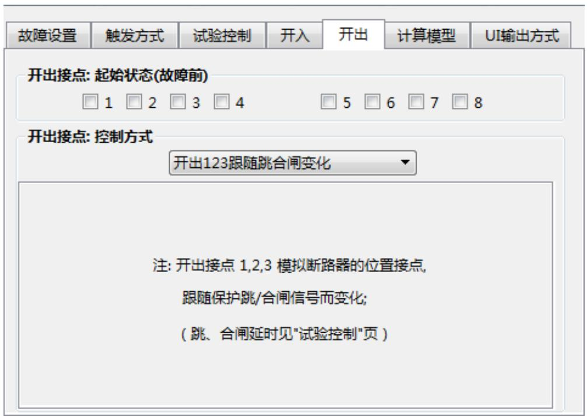

开出接点：起始状态（故障前）：

开出量的起始状态：断开，或，闭合；

注：打“√”表示开出量闭合；

开出接点：控制方式：

系统提供了开出接点的三种翻转控制方式：

- 跟随跳/合闸信号变化：

该方式相当于利用测试仪的开出接点模拟断路器的位置接点；

开入接点 ABC 动作，则开出接点 123 翻转，即与其起始状态相反；

开入接点R 动作，则开出接点123再次翻转，即恢复为起始状态；

- 故障触发后延时翻转：

该方式相当于故障触发后，通过测试仪的开出接点发出一个信号；

 翻转延时：

以进入第一次故障为参考点，即进入故障后，经过所设定的延时，开出量翻转（与各自的起始状态相反）。

注：该“延时”应小于“试验限时”。

 保持时间：

开出量翻转后的保持时间。保持时间到达后，开出量再次翻转，返回起始状态；

- 自定义控制：

该方式相当于由用户自己控制开出量的状态；

 翻转延时：

以进入第一次故障为参考点，即进入故障后，经过所设定的延时，开出量翻转（与各自的起始状态相反）。

注：该“延时”应小于“试验限时”。

###  保持时间：

开出量翻转后的保持时间。保持时间到达后，开出量再次翻转，返回起始状态；

### 计算模型

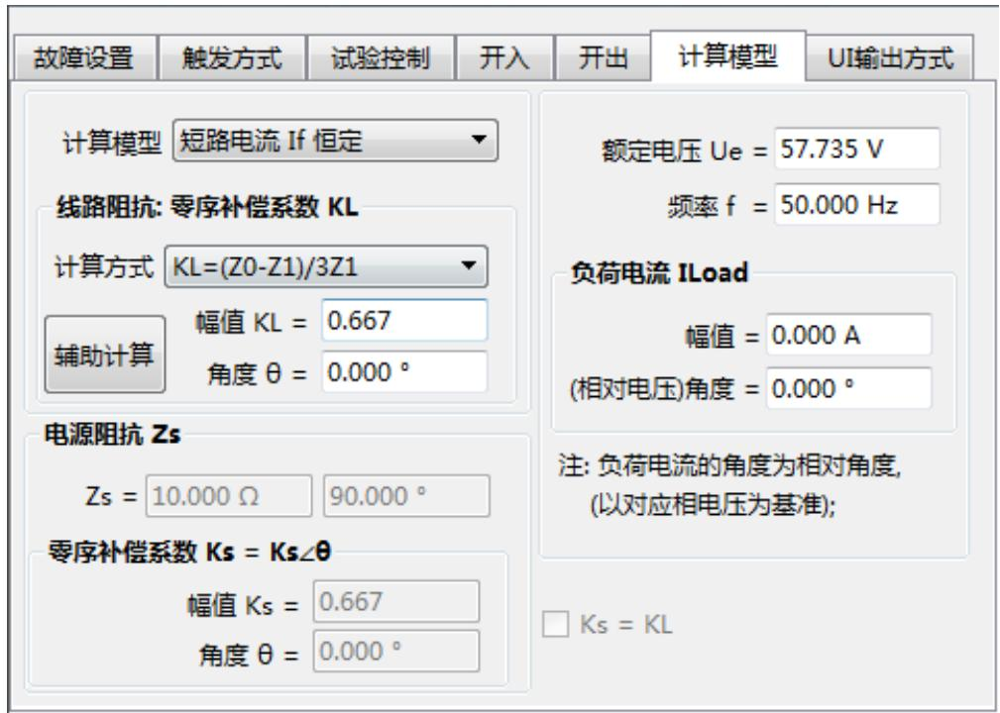

### 计算模型：

系统提供了三种短路计算模型：

- 短路电流 If恒定：

短路时，流经保护安装处的故障电流 If 恒定；

- 短路电压 Uf恒定：

短路时，保护安装处的故障电压 Uf 恒定；

- 电源阻抗 Zs恒定：

短路时，系统电源到保护安装处的等值阻抗（正序阻抗）Zs 恒定；

通常取“短路电流 If恒定”，即定电流（短路电流）方式。

### 短路阻抗的零序补偿系数KL：

短路阻抗Zf 的零序补偿系数，系统提供了 3种设置方式；

- KL =（Z0–Z1）/（3 * Z1）：极坐标形式表示：幅值，角度；

K L = \frac {Z _ {0} - Z _ {1}}{3 * Z _ {1}} = \operatorname {R e} (K L) + j \operatorname {I m} (K L) = | K L | \angle \theta

考虑到一般情况下，电力系统假定零序阻抗Z0和正序阻抗Z1的阻抗角度相等，则

Im（KL） ${ } = 0$ ，KL 为一实数，通常取 0.667，角度为 0° 。

\because \quad K R = (R 0 - R 1) / (3 * R 1), \quad K X = (X 0 - X 1) / (3 * X 1)

即 KR，KX 方式；

K R = \frac {R _ {0} - R _ {1}}{3 * R _ {1}}, K X = \frac {X _ {0} - X _ {1}}{3 * X _ {1}}

\quad \Leftrightarrow \quad K L = Z 0 / Z 1

极坐标形式表示：幅值，角度；

### 电源阻抗：

计算模型为“电源阻抗 Zs恒定”时有效；

### 电源阻抗 Zs：

系统电源到保护安装处的线路等值阻抗 Zs（正序阻抗），极坐标表示：幅值，角度；

### 零序补偿系数 Ks：

电源阻抗 Zs的零序补偿系数，模型为“电源阻抗Zs恒定”时有效，

$$
K _ {S} = \frac {Z _ {S 0} - Z _ {S 1}}{3 * Z _ {S 1}} = \operatorname {R e} \left(K _ {S}\right) + j \operatorname {I m} \left(K _ {S}\right) = \left| K _ {S} \right| \angle \theta
$$

极坐标表示：幅值，角度，

考虑到一般情况下，电力系统假定零序阻抗 Z0和正序阻抗Z1 的阻抗角度相等，则

Im（Ks） $\mathtt { = 0 }$ ，Ks 为一实数，通常取0.667，角度为 0° 。

### 额定电压 Ue：

保护 PT 二次侧的额定相电压，通常为 57.735V；

### 频率 f：

电压、电流的输出频率，通常为工频 $50 . 0 H z $ ；

### 负荷电流 ILoad：

通常取0，即空载。因为与故障后的短路电流相比，负荷电流很小，可忽略不计；

### （相对电压）角度：

以电压为参照，各相负荷电流相对于本相电压的角度偏移。

### UI 输出方式

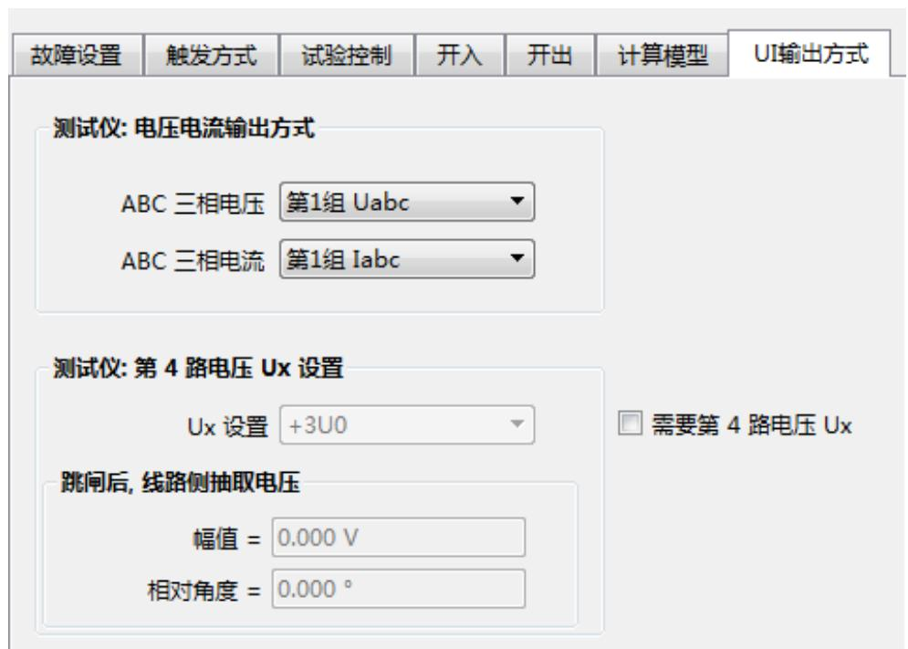

测试仪：电压电流输出方式：设置 ABC 三相电压电流的输出方式

- ABC 三相电压：系统提供了4种输出方式：第1 组 Uabc输出；第2 组 Uxyz输出；第 3 组 Uuvw 输出；第 4 组 Urst 输出。

- ABC 三相电流：系统提供了 4 种输出方式：第 1 组 Iabc 输出；第 2 组 Ixyz 输出；第 3 组 Iuvw 输出；第 4 组 Irst 输出。

测试仪：第4路电压 Ux设置：仅当勾选“需要第4路电压Ux”设置时有效。

Ux 设置：

系统提供了 10 种不同的输出方式，包括： 3U0 、 3U0、 3U0 3 、 3U0 3、检同期 A、检同期 B、检同期 C、检同期 AB、检同期 BC、检同期 $- 3 U  0 * \sqrt { 3 }$ CA 等；

注：如果Ux设置选择为检同期方式，以“检同期 $A  ^ { \prime \prime }$ 为例，则Ux的输出过程为：

故障前以及故障中：Ux 均输出 A 相电压 Ua；

跳闸后：Ux输出线路抽取电压；

重合闸后：Ux 恢复为 A 相电压 Ua。

线路抽取电压：

Ux设为检同期方式时有效。

“线路抽取电压”用于模拟断路器跳闸后至重合闸这一段时间内线路侧的输出电压，可用于测试保护重合闸的“检同期”、“检无压”功能；

### 故障预览

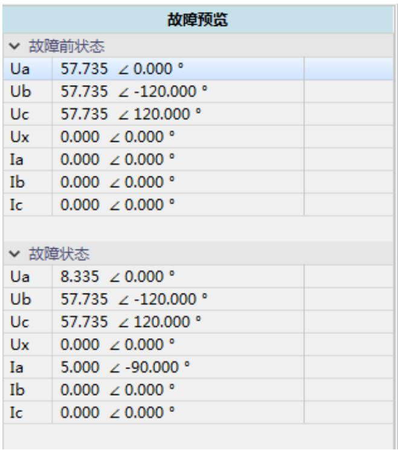

显示故障前、故障、故障转换后的电压、电流，以及线序电压、电流分量和矢量图。

### 测试结果

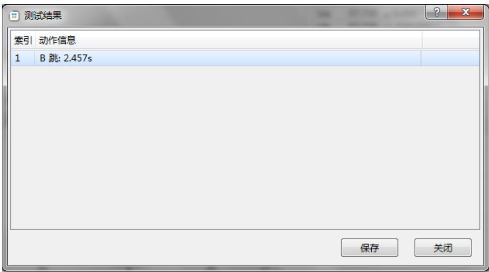

试验结束后，测试仪根据开关量的设置，自动记录各接点的动作情况；

