# 2.12 线路保护定值校验

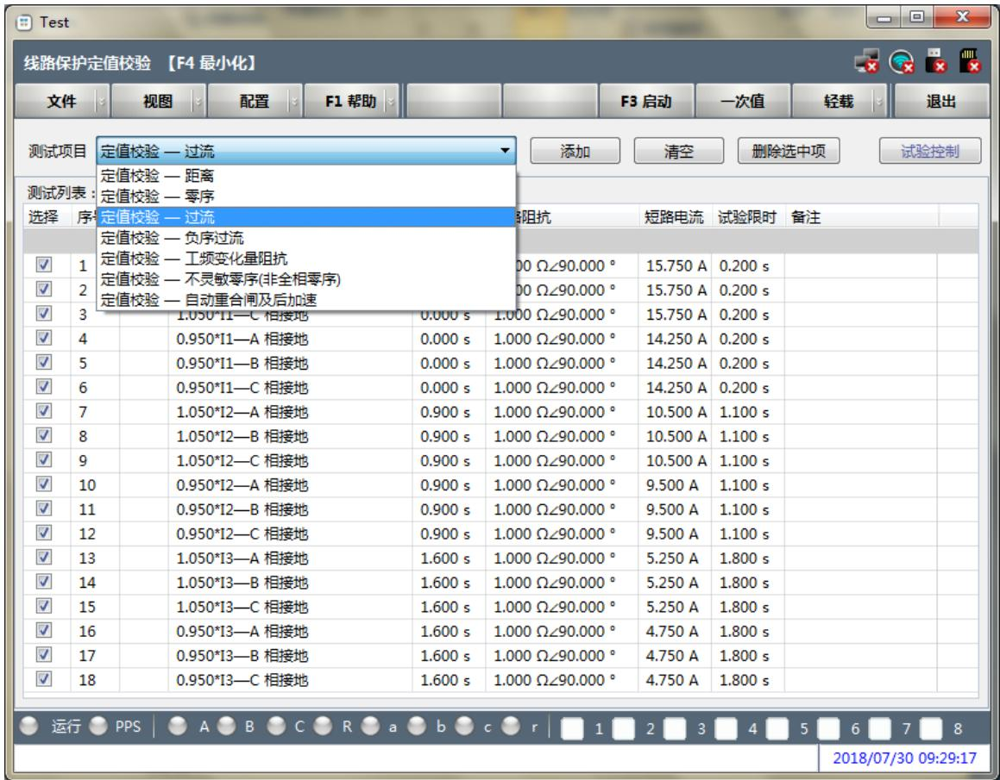

### 简介

本菜单主要用于测试距离，零序，过流，负序过流，工频变化量阻抗，不灵敏零序（非全相零序），自动重合闸及后加速等保护的各段定值校验。可定性分析保护各段动作的灵敏性和可靠性。可以添加不同的保护测试类型，实现对于同一个保护装置，不同保护类型的批量定值校验。可模拟瞬时性、永久性、转换性故障，以及重合闸等。

可完成的测试项目包括：

- 距离，零序，过流，负序过流，工频变化量阻抗，不灵敏零序（非全相零序）等保护的各段定值校验；

- 重合闸及后加速动作特性；

- 双端线路保护的 GPS对调。

提供多种简单故障的计算模型，包括电源阻抗恒定，短路电流恒定，以及短路电压恒定；提供多种故障触发方式，包括按键触发，时间触发，PPM分脉冲触发，开入接点触发；提供了保护的阻抗特性编辑功能（可通过模板导入，也可以自定义）；

### 测试窗口

测试窗口用于试验参数设置；

测试窗口包括2 个属性页：

- 测试列表：选择测试类型，设置保护定值，设置故障参数，添加测试项目等；

- 试验控制：用于进行触发方式，试验参数，开入，开出，计算模型，UI输出方式的设置。

### 测试列表

根据测试类型，测试项目和故障类型的选择，分别由若干个子试验项目构成，各子项目的试验过程分别如下图所示：

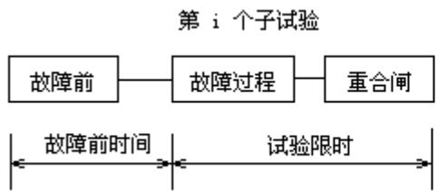

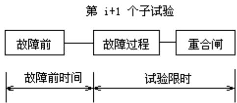

其中，每一个子试验项目中故障的启动方式由用户设置的“第一次故障触发方式”决定。

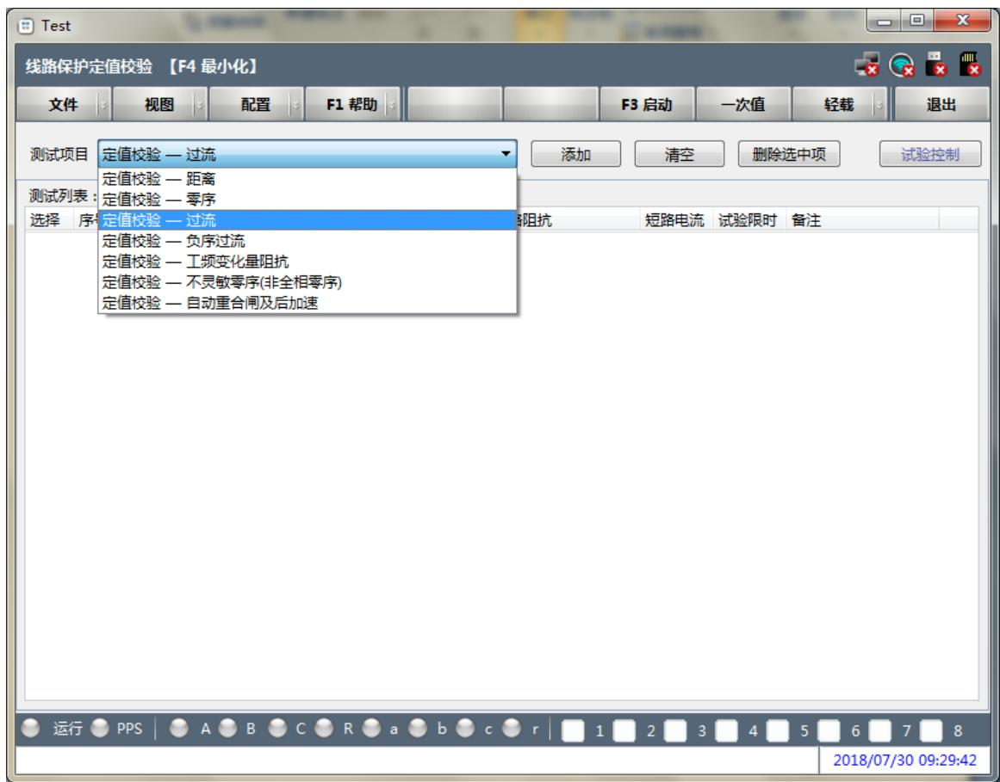

### 测试项目：

选择定值校验的测试项目，包括：距离，零序，过流，负序过流，工频变化量阻抗，不

灵敏零序（非全相零序）和自动重合闸及后加速等。

点击 添加 按钮，弹出相应的定值校验参数设置框。具体如下：

### 1 .定值校验--距离

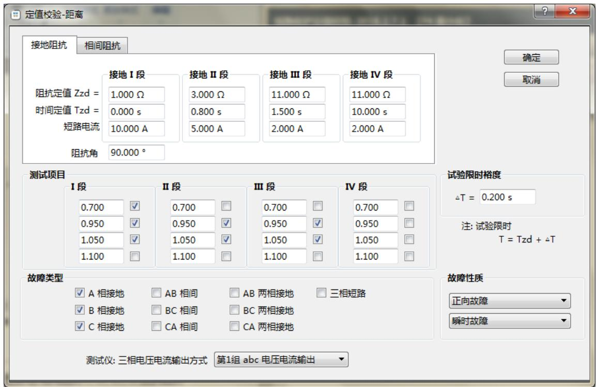

### 接地阻抗/相间阻抗：

阻抗定值以极坐标形式表示：幅值，角度。

- 阻抗定值 Zzd：根据保护定值，分别设置接地/相间阻抗 I、II、III、IV 段的阻抗定值；

- 时间定值 Tzd：根据保护定值，分别设置接地/相间阻抗 I、II、III、IV 段的时间定值。

- 短路电流：根据接地/相间阻抗I、II、III、IV 段的阻抗定值，分别设置试验时该段的短路电流。（注：如果阻抗定值比较小，如 0.1 欧左右，则为了减小保护测量电压电流的相对误差，应相应地增大短路电流；反之，应减小短路电流，以免短路电压过高）

- 阻抗角：根据保护定值，设置接地/相间阻抗的阻抗角，通常取正序灵敏角。

### 测试项目：

根据需要选择各段阻抗定值的测试倍数，倍数可以改变，打“√”者表示选中测试。

- I段：选择 I段阻抗的各测试项目；

- II 段：选择 II 段阻抗的各测试项目；

- III段：选择 III段阻抗的各测试项目；

- IV段：选择 IV 段阻抗的各测试项目；

### 故障类型：

根据需要选择需要进行测试的故障类型，包括：

- A相接地；打“√”者表示选中测试；

- B相接地：打“√”者表示选中测试；

- C相接地：打“√”者表示选中测试；

- AB相间：打“√”者表示选中测试；

- BC 相间：打“√”者表示选中测试；

- CA 相间：打“√”者表示选中测试；

- AB两相接地：打“√”者表示选中测试；

- BC两相接地：打“√”者表示选中测试；

- CA两相接地：打“√”者表示选中测试；

- 三相短路：打“√”者表示选中测试；

### 试验限时裕度△T：

设置试验限时裕度，即每段的试验限时 $\Psi  =$ 该段的时间定值Tzd+试验限时裕度△T，保证保护能可靠动作，默认值为0.2s。

### 故障性质：

根据需要选择测试的故障性质，包括：正/反相故障，瞬时性故障/永久性故障。

- 瞬时性故障：跳闸后故障消失，保护重合闸后输出故障前状态；

- 永久性故障：跳闸后故障切除，保护重合闸后故障恢复；

注：如果需要测试保护的后加速功能，一般建议选择“永久性故障”；

测试仪：三相电压电流输出方式：设置ABC 三相电压电流的输出方式

系统提供了4种输出方式：第1 组 abc电压电流输出；第 2组 xyz 电压电流输出；第 3组 uvw 电压电流输出；第4 组 rst电压电流输出。

### 2 .定值校验--零序

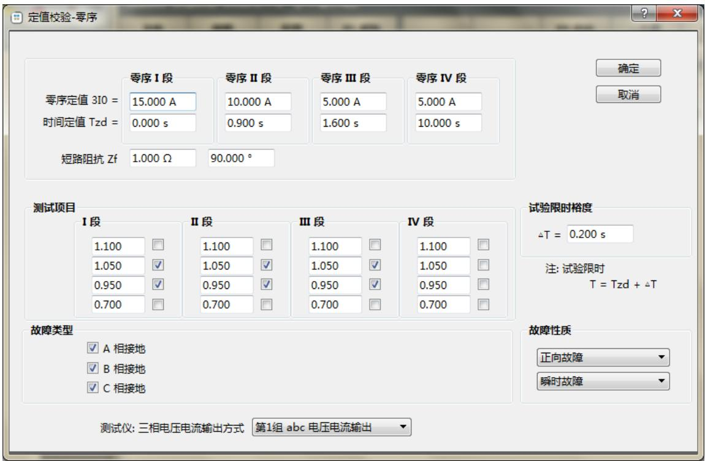

### 零序定值：

- 零序定值 3I0：根据保护定值，分别设置零序I、II、III、IV 段的电流定值；

- 时间定值 Tzd：根据保护定值，分别设置零序I、II、III、IV 段的时间定值。

- 短路阻抗 Zf：根据短路阻抗Zf值进行短路计算。

### 测试项目：

根据需要选择各段零序电流定值的测试倍数，倍数可以改变，打“√”者表示选中测试。

- I段：选择零序 I段的各测试项目；

- II段：选择零序 II段的各测试项目；

- III段：选择零序 III段的各测试项目；

- IV段：选择零序 IV 段的各测试项目；

### 故障类型：

根据需要选择需要进行测试的故障类型，包括：

- A相接地；打“√”者表示选中测试；

- B相接地：打“√”者表示选中测试；

- C相接地：打“√”者表示选中测试；

### 试验限时裕度△T、故障性质、测试仪：三相电压电流输出方式：

以上参数定义详见“1 .定值校验--距离”中的相关说明。

### 3 .定值校验--过流

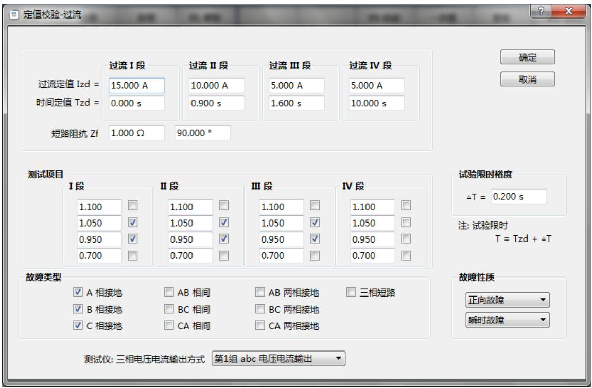

### 过流定值：

- 过流定值 Izd：根据保护定值，分别设置过流 I、II、III、IV 段的电流定值；

- 时间定值 Tzd：根据保护定值，分别设置过流I、II、III、IV 段的时间定值。

- 短路阻抗 Zf：根据短路阻抗Zf值进行短路计算。

### 测试项目：

根据需要选择各段过流定值的测试倍数，倍数可以改变，打“√”者表示选中测试。

- I段：选择过流 I段的各测试项目；

- II 段：选择过流 II 段的各测试项目；

- III段：选择过流 III段的各测试项目；

- IV段：选择过流 IV 段的各测试项目；

### 故障类型：

根据需要选择需要进行测试的故障类型，包括：

- A相接地；打“√”者表示选中测试；

- B相接地：打“√”者表示选中测试；

- C相接地：打“√”者表示选中测试；

- AB 相间：打“√”者表示选中测试；

- BC相间：打“√”者表示选中测试；

- CA相间：打“√”者表示选中测试；

- AB两相接地：打“√”者表示选中测试；

- BC 两相接地：打“√”者表示选中测试；

- CA两相接地：打“√”者表示选中测试；

- 三相短路：打“√”者表示选中测试；

试验限时裕度△T、故障性质、测试仪：三相电压电流输出方式：

以上参数定义详见“1 .定值校验--距离”中的相关说明。

### 4.定值校验--负序过流

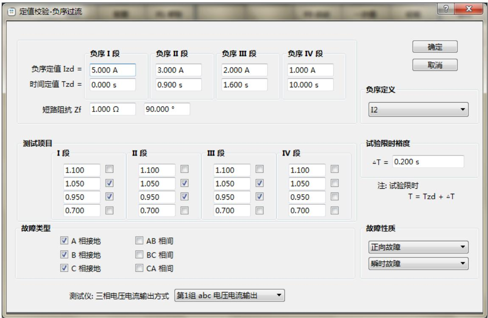

### 负序定值：

- 负序定值 Izd：根据保护定值，分别设置负序过流I、II、III、IV段的电流定值；

- 时间定值 Tzd：根据保护定值，分别设置负序过流I、II、III、IV段的时间定值。

- 短路阻抗 Zf：根据短路阻抗Zf值进行短路计算。

- 负序定义：根据需要，设置负序电流是 I2 或 3I2。

### 测试项目：

根据需要选择各段负序过流定值的测试倍数，倍数可以改变，打“√”者表示选中测试。

- I段：选择负序过流 I段的各测试项目；

- II段：选择负序过流 II段的各测试项目；

- III段：选择负序过流 III段的各测试项目；

- IV段：选择负序过流 IV 段的各测试项目；

### 故障类型：

根据需要选择需要进行测试的故障类型，包括：

- A 相接地；打“√”者表示选中测试；

- B相接地：打“√”者表示选中测试；

- C相接地：打“√”者表示选中测试；

- AB相间：打“√”者表示选中测试；

- BC相间：打“√”者表示选中测试；

- CA 相间：打“√”者表示选中测试；

试验限时裕度△T、故障性质、测试仪：三相电压电流输出方式：

以上参数定义详见“1 .定值校验--距离”中的相关说明。

### 5 .定值校验--工频变化量阻抗

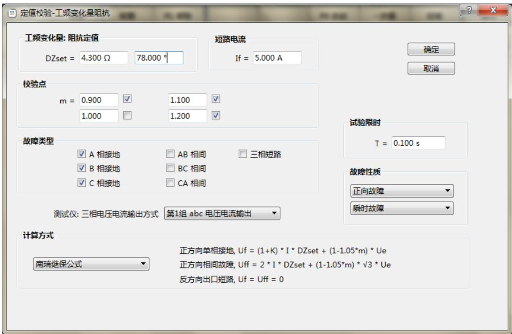

工频变化量：阻抗定值：

- DZset：阻抗定值以极坐标形式表示：幅值，角度。

- 短路电流 If：短路故障时，流经保护安装处的故障相电流If。

- 校验点 $m   ^ { = }$ ：根据需要选择系数，系数值可以改变，打“√”者表示选中测试；

故障类型：

根据需要选择需要进行测试的故障类型，包括：

- A相接地；打“√”者表示选中测试；

- B相接地：打“√”者表示选中测试；

- C相接地：打“√”者表示选中测试；

- AB 相间：打“√”者表示选中测试；

- BC 相间：打“√”者表示选中测试；

- CA相间：打“√”者表示选中测试；

- 三相短路：打“√”者表示选中测试；

### 试验限时 T：

每次子试验项目从进入故障到结束之间的时间，通常，应保证保护在该时间内可以完成整个“跳闸 → 重合 → 再跳闸”的过程。

### 计算方式：

根据需要选择短路故障的计算方式，包括：南瑞继保公式，许继电气公式。

- 南瑞继保公式：

模拟故障电流固定(其数值应使模拟故障电压在 0 ~ U _  \ N 范围内)，故障电压为正方向单相接地， $U f = ( 1 + K ) * I * D Z s e t + ( 1 - 1 . 05 ^ { * } m ) * U e$ 

正方向相间故障， $U f f = 2 * I * { D Z s e t } + ( 1 - 1 . 05 * m ) * \sqrt { 3 } * U e$ 

反方向出口短路： $U f = U f f = 0$ 

- 许继电气公式：

模拟故障电流固定(其数值应使模拟故障电压在 0 ~ U _  \ N 范围内)，故障电压为

正方向单相接地， $U f = ( 1 + K ) * I * D Z s e t + ( 1 - 1 . 4 ^ { * } m ) * U e$ 

正方向相间故障，Uff I DZset m Ue        2 (11.3* ) 3 $$$ U_{ff} = 2 \times I \times Z_{set} + (1 - 1.3m) \times \sqrt{3} U_e $$$ 

反方向出口短路：Uf Uff   0 $U f = U f f = 0$ 

式中： $m$ ——校验点的系数；

DZset——工频变化量距离保护定值。

工频变化量距离保护在 $m = 1.1$ 时，应可靠动作；在 $m { = } 0 . 9$ 时，应可靠不动作；在 $m { = } 1 . 2$ 时，测量工频变化量距离保护动作时间。

### 故障性质、测试仪：三相电压电流输出方式：

以上参数定义详见 $^ { \mathfrak { s } } 1 $ .定值校验--距离”中的相关说明。

### 6. 定值校验--不灵敏零序（非全相零序）

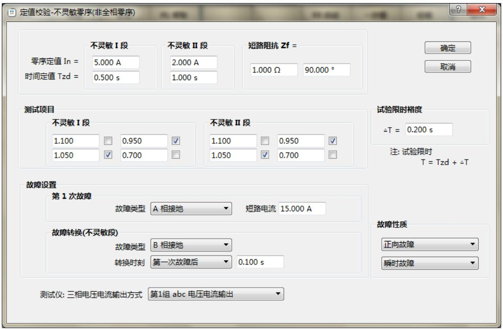

### 零序定值：

- 零序定值 In：根据保护定值，分别设置不灵敏零序I、II段的电流定值；

- 时间定值 Tzd：根据保护定值，分别设置不灵敏零序I、II段的时间定值。

- 短路阻抗 Zf：根据短路阻抗Zf值进行短路计算。

### 测试项目：

根据需要选择各段不灵敏零序定值的测试倍数，倍数可以改变，打“√”者表示选中测试。

- 不灵敏 I段：选择不灵敏I段的各测试项目；

- 不灵敏 II段：选择不灵敏II段的各测试项目；

### 第1次故障：

- 故障类型：根据需要选择第1次故障的故障类型，包括A 相接地、B 相接地、C相接地；

- 短路电流：根据保护定值，设置第1 次故障的短路电流。

### 故障转换（不灵敏段）：

- 故障类型：根据需要选择故障转换的故障类型，包括 A 相接地、B 相接地、C相接地；一般设置与第1次的故障类型不同。

- 转换时刻：故障转换发生的时刻，系统提供了两种不同的时间设置方式。

- 第一次故障后：即第 1次故障后发生故障转换，“转换时刻”以进入第1 次故障的时刻为时间坐标起点 $\scriptstyle { t  } = 0$ ；

- 重合闸后：即重合闸后发生故障转换，“转换时刻”以进入重合闸状态为时间坐标起点 $\scriptstyle { t  } = 0$ ；

试验限时裕度△T、故障性质、测试仪：三相电压电流输出方式：

以上参数定义详见“1 .定值校验--距离”中的相关说明。

### 7. 定值校验--自动重合闸及后加速

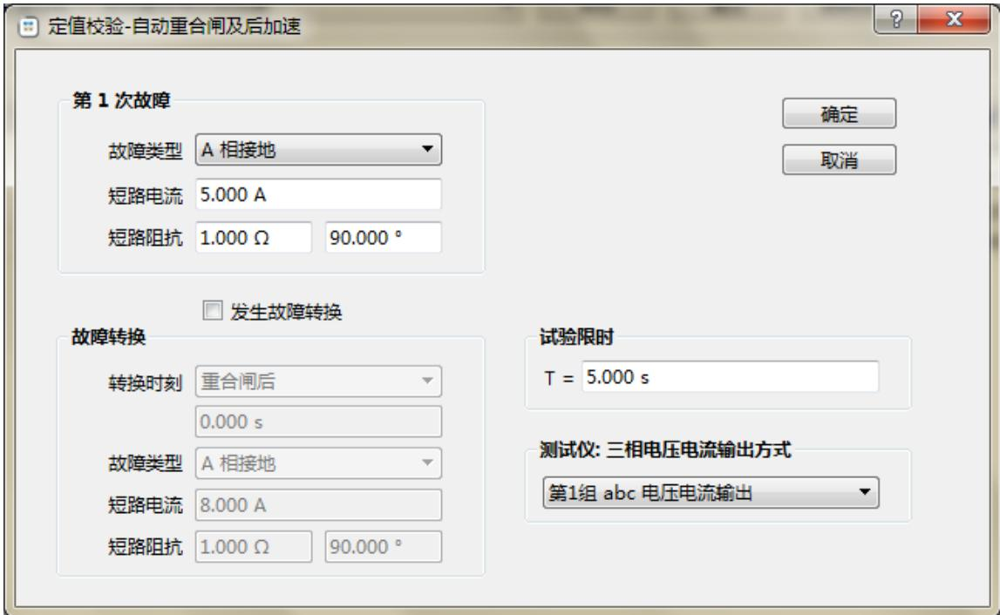

### 第1次故障：

- 故障类型：根据需要选择第1次故障的故障类型，包括A 相接地、B 相接地、C相接地、AB 相间、BC 相间、CA相间、AB两相接地、BC 两相接地、CA两相接地、三相短路；

- 短路电流：设置第1次故障的短路电流。

- 短路阻抗：设置第1次故障的短路阻抗值。

. □发生故障转换：设置重合闸前后是否发生故障转换。仅当勾选“发生故障转换”时有效。

- 转换时刻：故障转换发生的时刻，系统提供了两种不同的时间设置方式。

- 第一次故障后：即第 1次故障后发生故障转换，“转换时刻”以进入第1 次故障的时刻为时间坐标起点 $\scriptstyle { t  } = 0$ ；

- 重合闸后：即重合闸后发生故障转换，“转换时刻”以进入重合闸状态为时间坐标起点 $\scriptstyle { t  } = 0$ ；

- 故障类型：根据需要选择故障转换的故障类型，包括 A 相接地、B 相接地、C相接地、AB 相间、BC 相间、CA相间、AB两相接地、BC 两相接地、CA两相接

### 地、三相短路；

- 短路电流：设置故障转换后的短路电流。

- 短路阻抗：设置故障转换后的短路阻抗值。

### 试验限时 T：

试验从进入故障到结束之间的时间，通常，应保证保护在该时间内可以完成整个“跳闸 → 重合 → 再跳闸”的过程。

测试仪：三相电压电流输出方式：设置 ABC 三相电压电流的输出方式

系统提供了4种输出方式：第1 组 abc电压电流输出；第 2组 xyz 电压电流输出；第 3组 uvw 电压电流输出；第4 组 rst电压电流输出。

注：对于该测试项目，程序默认的故障性质是正向故障，永久性故障。

### 试验控制

包括触发方式，试验控制，开入，开出，计算模型，UI 输出方式等。

- 触发方式：故障的触发方式设置；

- 试验控制：试验控制参数，包括合闸角、非周期分量叠加、PT/CT 位置等；

- 开入：测试仪开入量设置；

- 开出：测试仪开出量设置；

- 计算模型：短路计算模型设置，故障前参数设置，以及 Ux输出方式设置。

- UI输出方式：第四路电压的输出方式；

### 触发方式

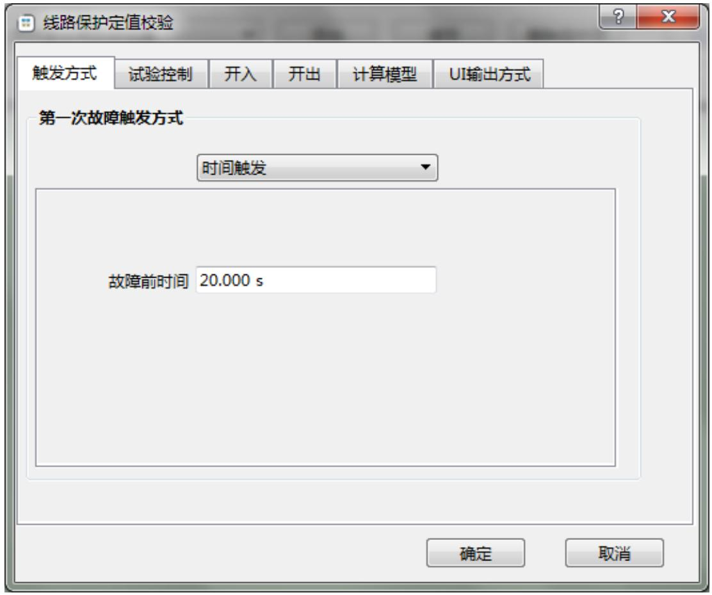

### 第一次故障触发方式：

设置第一次故障的触发方式，系统提供了 4种触发方式：

- 按键触发：

测试仪保持故障前状态，等待用户按确认键后触发故障；

- 时间触发：

测试仪保持故障前状态，“故障前时间”到达后触发故障；

通常，故障前时间的设置应大于保护的复归时间（ 20  ~  25 秒左右），以保证保护的可靠复归。

- PPM分脉冲触发：

对时成功后，测试仪保持故障前状态；

试验的双方人员联系，在同一分钟之内（ 10  ~  50 秒之间的任意一刻）按确认键；

测试仪检测到确认后的第一个 PPM脉冲，触发故障；

- 开入接点翻转触发：

测试仪保持故障前状态，设定的开入翻转条件满足后，触发故障；

### 试验控制

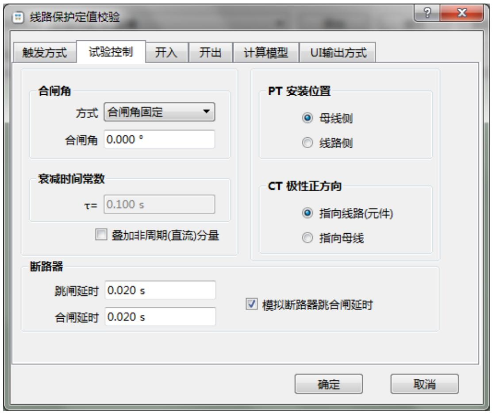

### 合闸角：

此处“合闸角”定义为故障发生瞬间电源电压的瞬时角度。

合闸角的大小决定了直流电流分量初始值的大小。

### 方式：

合闸角方式：合闸角固定，或，合闸角随机；

### 合闸角：

合闸角方式选择“合闸角固定”时有效；

根据故障类型的不同，合闸角的选取如下表所示：

<table><tr><td>故障类型</td><td>合闸角</td></tr><tr><td>A相接地</td><td>φ(ÛA)</td></tr><tr><td>B相接地</td><td>φ(ÛB)</td></tr><tr><td>C相接地</td><td>φ(ÛC)</td></tr><tr><td>AB相间</td><td>φ(ÛAB)</td></tr><tr><td>BC相间</td><td>φ(ÛBC)</td></tr><tr><td>CA相间</td><td>φ(∪CA)</td></tr><tr><td>AB两相接地</td><td>φ(∪A)</td></tr><tr><td>BC两相接地</td><td>φ(∪B)</td></tr><tr><td>CA两相接地</td><td>φ(∪C)</td></tr><tr><td>三相短路</td><td>φ(∪A)</td></tr><tr><td>自定义故障</td><td>φ(∪A)</td></tr></table>

### 衰减时间常数 ：

故障后回路的衰减时间常数；

用户自设，一般可取 0.1 秒；

### 叠加非周期（直流）分量：

故障触发瞬间，故障电流中是否叠加一衰减的非周期直流分量，该直流分量的大小为

I _ {d c} (t) = \left[ I _ {p m 0} \cdot \sin \left(\alpha - \varphi_ {0}\right) - I _ {P m} \cdot \sin \left(\alpha - \varphi\right) \right] \cdot e ^ {- t / \tau}

式中：

$I _ { p m 0  }$ 为故障前的电流最大值，

$I _ { p m  }$ 为故障后的稳态短路电流最大值，

$\Phi _ { 0 }$ 为故障前的回路阻抗角，

$\Phi $ 为故障后的回路阻抗 Z 的阻抗角， $Z = Z _ { S  } + Z _ { d  }$ 

$\alpha$ 为故障瞬间电源电压的角度，

 为故障后回路的衰减时间常数（该参数由用户根据实际情况输入）

注：

1）短路故障计算建模时，一般假设线路阻抗角等于系统阻抗角度，故，短路电压中的直流分量 $V  _ { d c  } ( t  ) = 0$ 。

2）一般情况下，继电保护关注的是故障后的稳态短路电流、电压，所以一般不需要叠加非周期（直流）分量；

### PT安装位置：

保护 PT 的安装位置；

母线侧：PT 位于母线侧，则跳闸后故障相电压恢复为母线电压（即额定电压）；

线路侧：PT 位于线路侧，则跳闸后故障相电压变为0。

通常，220KV及以下的保护，PT位于母线侧；

### CT 极性正方向：

保护 CT 极性的正方向；

CT 极性指向线路（元件）为正：电流从母线流向线路为正；

CT 极性指向母线为正：电流从线路流向母线为正；

### 模拟断路器跳合闸延时：

选择试验过程中是否需要模拟断路器的跳/合闸延时；

### 跳闸延时：

模拟断路器的跳闸动作时间；

测试仪检测到保护的跳闸信号后，经过“跳闸延时”方切除故障，进入跳闸后的电压电流状态。

（注：如果测试仪的开入接点直接连断路器的“跳位”接点，则跳闸延时可取为0）；

### 合闸延时：

模拟断路器的合闸动作时间；

测试仪检测到保护的合闸信号后，经过“合闸延时”方进入重合闸后的电压电流状态。

（注：如果测试仪的开入接点直接连断路器的“合位”接点，则合闸延时理论上可取为0，但考虑到躲开三相重合动作的不一致性，建议至少取0.02 秒）；

### 开入

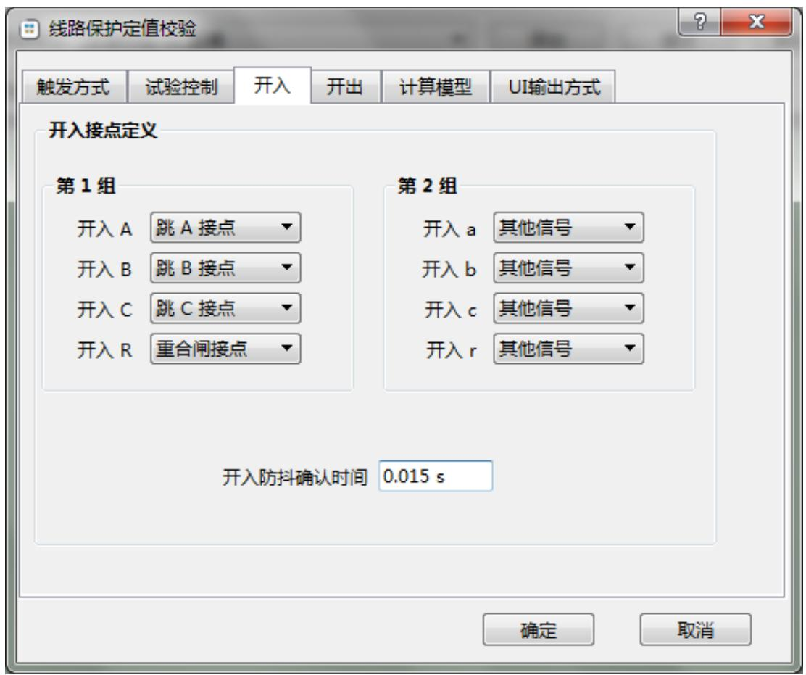

### 开入接点定义：

配置测试仪的开入接点与保护动作出口接点的连接方式，如跳A、B、C，重合 R等。

### 第 1 组：

开入 A：可选择为“跳A 接点”， “三跳接点”，或“其他信号”；

开入 B：可选择为“跳 B 接点”， “三跳接点”，或“其他信号”；

开入C：可选择为“跳C 接点”， “三跳接点”，或“其他信号”；

开入 R：可选择为“重合闸接点”， 或“其他信号”；

### 第 2 组：

开入 a：可选择为“跳 A 接点”， “三跳接点”，或“其他信号”；

开入 b：可选择为“跳 B 接点”， “三跳接点”，或“其他信号”；

开入c：可选择为“跳C接点”， “三跳接点”，或“其他信号”；

开入 r：可选择为“重合闸接点”， 或“其他信号”；

注：当开入接点选为跳 A、B、C（或三跳接点），重合接点时，该接点除了记录动作时间外，程序还会根据该接点的翻转进行相应的故障切除；当选为其他方式时，该接点只记录其动作时间；

### 开入防抖确认时间：

为避免继电器触点的抖动，开入接点的状态保持一个时间（确认时间）后，系统方予以确认生效。 通常取 10  ~  20 \mathrm  m s 。

### 开出

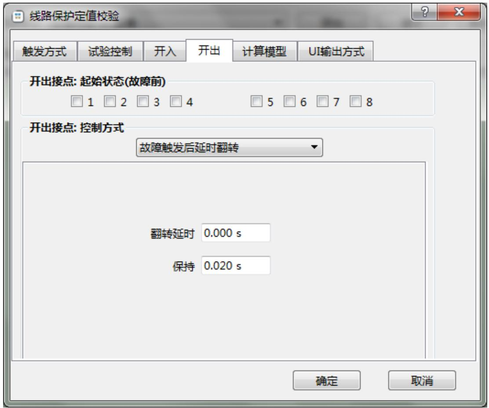

### 开出接点：起始状态（故障前）：

开出量的起始状态：断开，或，闭合；

注：打“√”表示开出量闭合；

### 开出接点：控制方式：

系统提供了开出接点的三种翻转控制方式：

- 跟随跳/合闸信号变化：

该方式相当于利用测试仪的开出接点模拟断路器的位置接点；

开入接点 ABC 动作，则开出接点 123 翻转，即与其起始状态相反；

开入接点R 动作，则开出接点123再次翻转，即恢复为起始状态；

- 故障触发后延时翻转：

该方式相当于故障触发后，通过测试仪的开出接点发出一个信号；

### 翻转延时：

以进入第一次故障为参考点，即进入故障后，经过所设定的延时，开出量翻转（与各自的起始状态相反）。

注：该“延时”应小于“试验限时”。

###  保持时间：

开出量翻转后的保持时间。保持时间到达后，开出量再次翻转，返回起始状态；自定义控制：

该方式相当于由用户自己控制开出量的状态；

### 翻转延时：

以进入第一次故障为参考点，即进入故障后，经过所设定的延时，开出量翻转（与各自的起始状态相反）。

注：该“延时”应小于“试验限时”。

###  保持时间：

开出量翻转后的保持时间。保持时间到达后，开出量再次翻转，返回起始状态；

### 计算模型

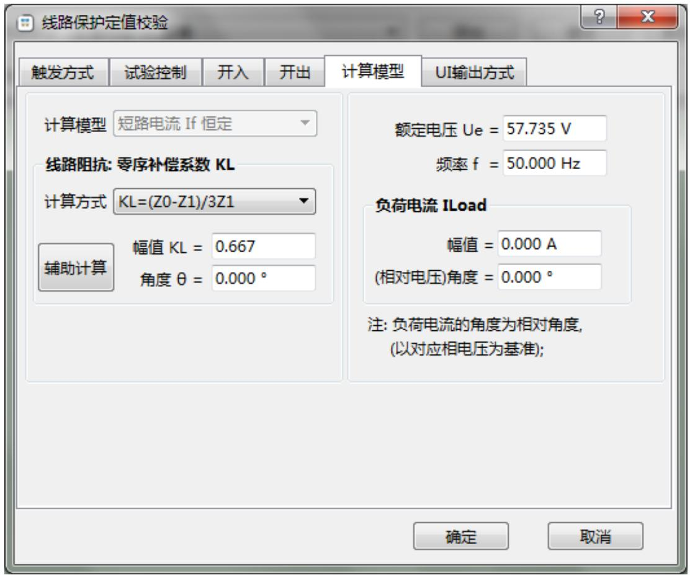

### 计算模型：

注：本测试菜单，程序把短路计算模型固定为“短路电流 If 恒定”。

### 短路阻抗的零序补偿系数KL：

短路阻抗Zf 的零序补偿系数，系统提供了 3种设置方式；

- KL =（Z0–Z1）/（3 * Z1）：极坐标形式表示：幅值，角度；

K L = \frac {Z _ {0} - Z _ {1}}{3 * Z _ {1}} = \operatorname {R e} (K L) + j \operatorname {I m} (K L) = | K L | \angle \theta

考虑到一般情况下，电力系统假定零序阻抗Z0和正序阻抗Z1的阻抗角度相等，则

Im（KL） ${ } = 0$ ，KL 为一实数，通常取 0.667，角度为 0° 。

\because \quad K R = (R 0 - R 1) / (3 * R 1), \quad K X = (X 0 - X 1) / (3 * X 1)

即 KR，KX 方式；

K R = \frac {R _ {0} - R _ {1}}{3 * R _ {1}}, K X = \frac {X _ {0} - X _ {1}}{3 * X _ {1}}

\quad \Leftrightarrow \quad K L = Z 0 / Z 1

极坐标形式表示：幅值，角度；

额定电压 Ue：

保护 PT 二次侧的额定相电压，通常为 57.735V；

频率 f：

电压、电流的输出频率，通常为工频 $50 . 0 H z $ ；

负荷电流 ILoad：

通常取0，即空载。因为与故障后的短路电流相比，负荷电流很小，可忽略不计；

（相对电压）角度：

以电压为参照，各相负荷电流相对于本相电压的角度偏移。

### UI 输出方式

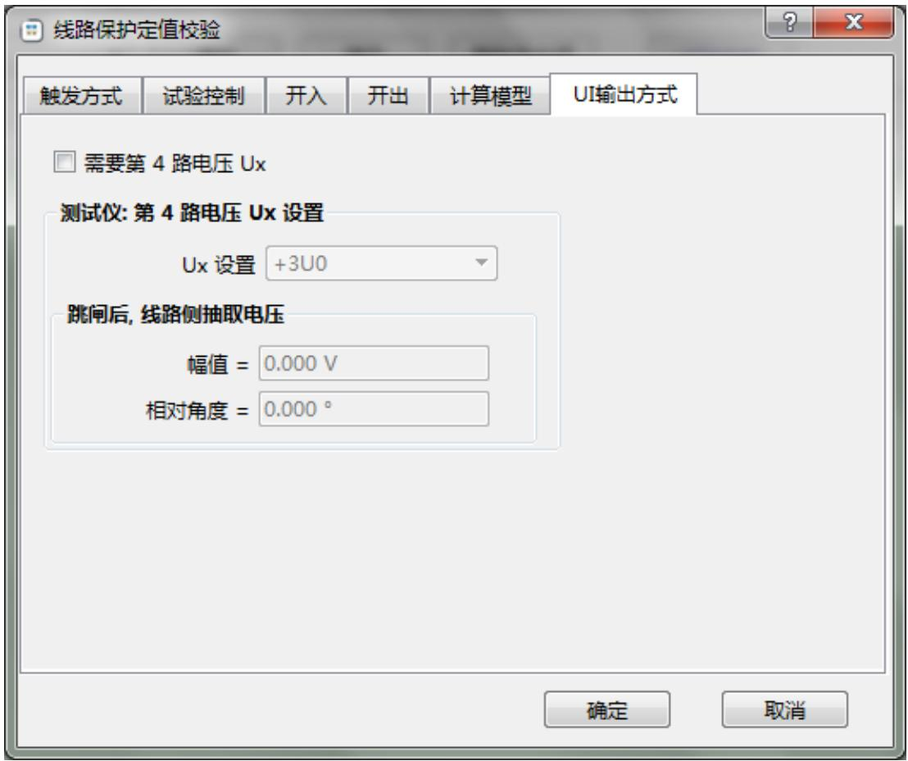

需要第 4 路电压 $u  x $ 设置：仅当勾选“需要第 4 路电压 Ux”设置时有效。

Ux设置：

系统提供了 10 种不同的输出方式，包括： 3U0 、 3U0、 3U0 3 、 3U0 3、检同期 A、检同期 B、检同期 C、检同期 AB、检同期 BC、检同期 $- 3 U  0 * \sqrt { 3 }$ CA 等；

注：如果Ux设置选择为检同期方式，以“检同期A”为例，则Ux的输出过程为：

故障前以及故障中：Ux均输出A 相电压 Ua；

跳闸后：Ux输出线路抽取电压；

重合闸后：Ux恢复为A 相电压Ua。

线路抽取电压：

Ux设为检同期方式时有效。

“线路抽取电压”用于模拟断路器跳闸后至重合闸这一段时间内线路侧的输出电压，可用于测试保护重合闸的“检同期”、“检无压”功能；

### 测试结果

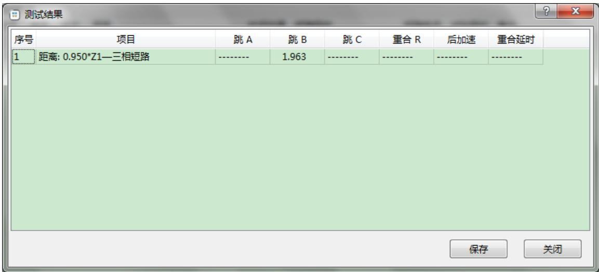

试验结束后，测试仪根据开关量的设置，自动记录各接点的动作情况；

