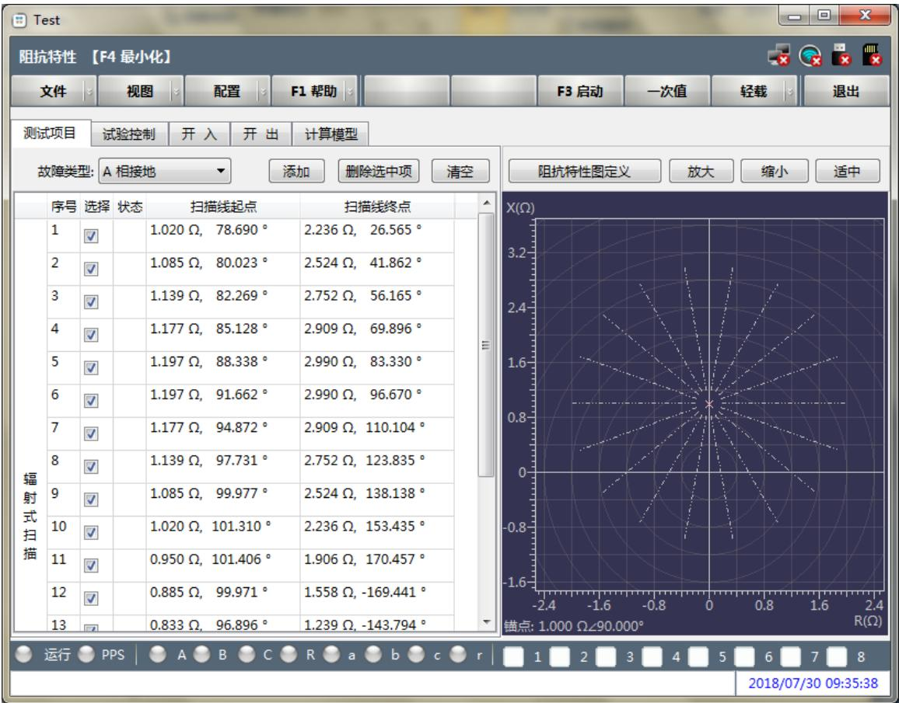
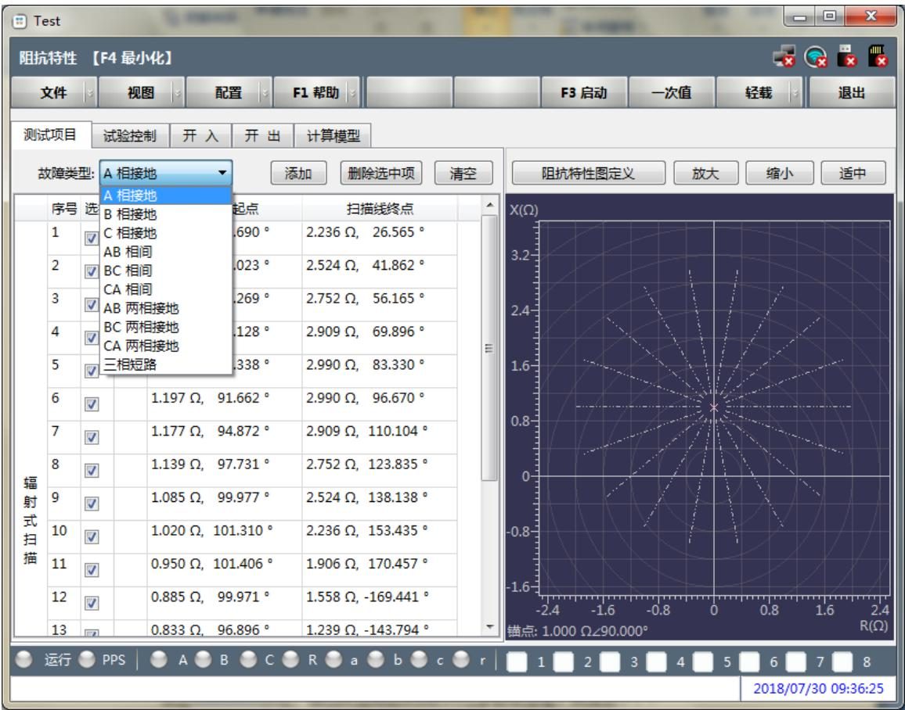
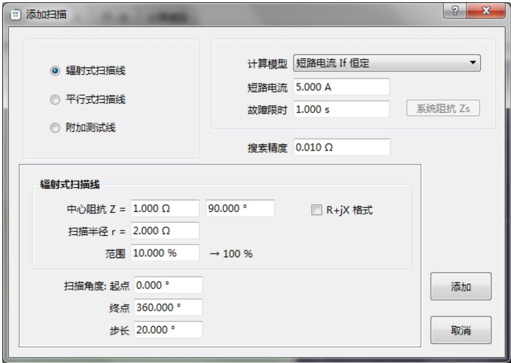
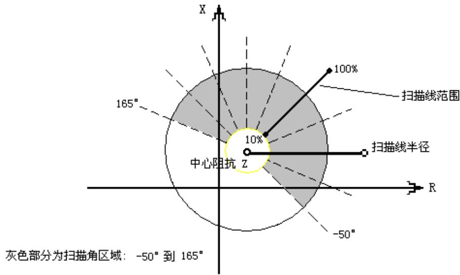
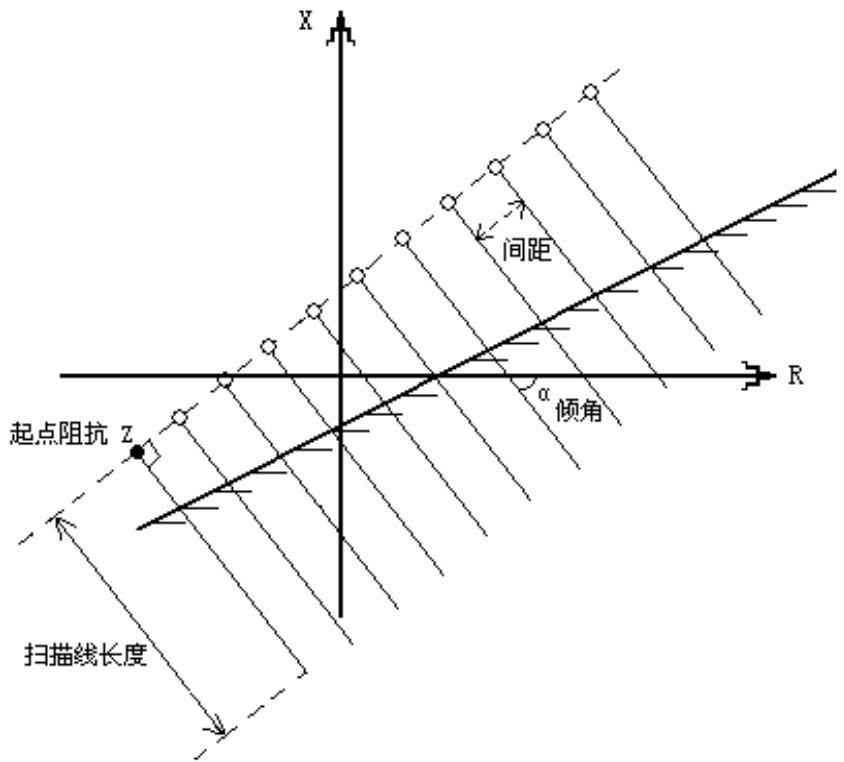
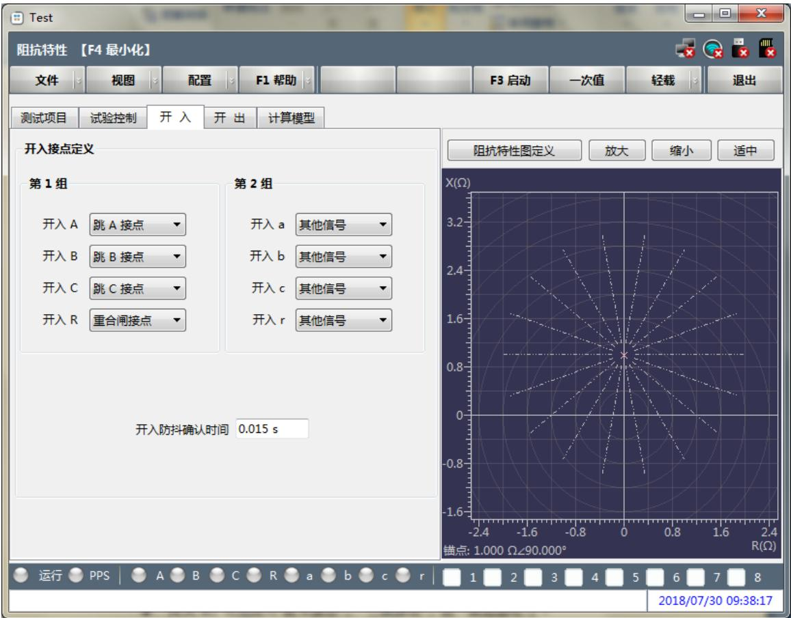
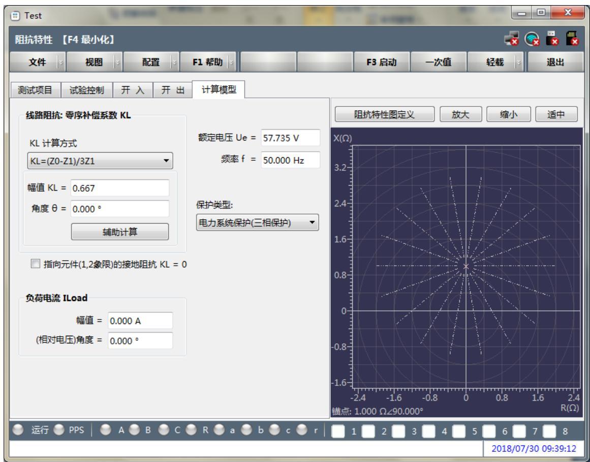
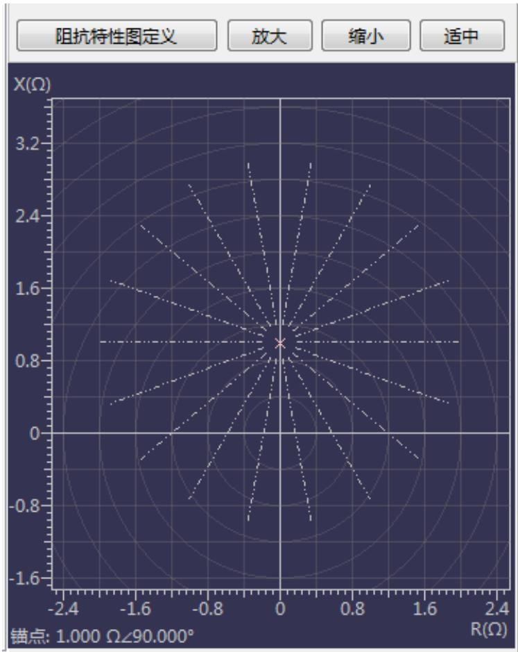
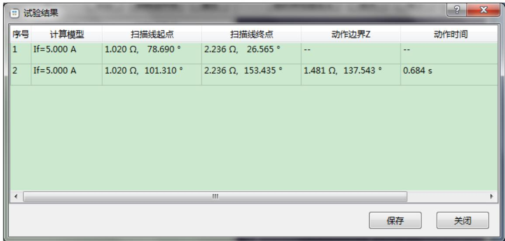

# 2.13 阻抗特性测试

### 简介

本菜单主要用于测试阻抗型继电器（包括阻抗继电器、功率方向继电器）的动作边界特性，

提供多种简单故障的计算模型，包括电源阻抗恒定，短路电流恒定，以及短路电压恒定；提供了保护的阻抗特性编辑功能（可通过模板导入，也可以自定义）；

### 测试窗口

测试窗口用于试验参数设置；

测试窗口包括5 个属性页和 1个右视图：

- 测试项目：选择测试项目，设置故障参数，添加测试点等；

- 试验控制：试验控制参数，包括合闸角、非周期分量叠加、PT/CT 位置等；

- 开入：测试仪开入量设置；

- 开出：测试仪开出量设置；

- 计算模型：短路计算模型设置，故障前参数设置等。

右视图用于显示阻抗特性图、阻抗测试点及其测试结果，以及精工电流，精工电压曲线。

### 测试项目

### 故障类型：

根据需要选择需要进行测试的故障类型，包括：A相接地，B 相接地C 相接地，AB 相间，BC 相间，CA相间，AB两相接地，BC两相接地，CA两相接地，三相短路。

点击 添加 按钮，弹出所选测试项目的对应参数设置框。具体如下：

根据阻抗整定特性的不同，系统提供了两种不同的扫描方式：辐射式，平行式。

辐射式扫描一般用于搜索圆形、四边形等封闭式的动作边界（如阻抗继电器），而平行式则通常用于直线动作边界特性的扫描（如功率方向继电器）。

### （1）动作边界的扫描方式

- 辐射式：比较适用于封闭型的动作边界特性扫描；

扫描方式选择辐射式时，试验中待测试的扫描边界点由扫描角区域和步长决定，此处，扫描角度以平行于R 轴为0°。例：取扫描角区域为- $. 50 ^ { \circ }$ °到165°，步长为 $25 ^ { \circ }$ ，则系统自动以 $\cdot 50 ^ { \circ }$ 为起点，以 $165 ^ { \circ }$ 为终点，按逆时针方向，每隔 $25 ^ { \circ }$ 计算一条扫描线，如上图各虚线所示。各扫描线的起点均为中心阻抗 Z，长度由扫描半径决定，每条扫描线与整定边界特性的交叉点即为测试时等待搜索的动作边界点。

为了加快每个边界点的搜索过程，各扫描线上的搜索起点应尽可能地接近边界点，为此系统提供了扫描线搜索起点 $K \%$ 的设置，即边界点只需在每条扫描线扫描半径的 K%到 $100 \%$ 之间进行搜索即可。通常，应保证扫描半径的 K%位于动作区内， $100 \%$ 位于动作区外，即扫描线必须完全覆盖动作边界。

如果程序计算过程中发现某条扫描线的搜索起点或终点的电压、电流越限，则自动忽略该扫描线。

- 平行式：比较适用于直线式边界特性的扫描；

扫描方式选择平行式时，试验中待测试的扫描边界点由起点阻抗 Z、扫描线倾角、间距以及扫描线数目决定，同理，此处扫描线倾角以平行于 R 轴为 0° 。设置完以上参数后，系统自动以起点阻抗Z为开始，沿R 轴正方向，按“间距”等距离地计算各扫描线，扫描线的方向平行于“倾角”方向，扫描线的长短由“长度”确定。每条扫描线与整定边界特性的交叉点即为测试时等待搜索的动作边界点。

如果程序计算过程中发现某条扫描线的搜索起点或终点的电压、电流越限，则自动忽略该扫描线。

### （2）动作边界的搜索原理

本试验中，对于一般扫描线上的测试点，程序采用二分法原理进行动作边界点搜索，其搜索过程如下：

1）测试扫描线起点；

2）测试扫描线终点；

3）根据起点和终点的动作情况，决定下一步的搜索动作：

- 二者动作情况相同，则说明边界点不在此扫描线上，或者可能存在两个以上的边

界点，结束本边界点的搜索；

- 二者动作情况不同，则说明有唯一边界点存在于本扫描线上，进入二分法搜索，逐步逼近边界点，直到满足测试精度后，结束本边界点的搜索；

### 辐射式扫描线：

以“中心阻抗Z”为圆心，以“扫描线半径 r”为半径作外圆，以扫描线“范围”为半径作内圆；在“扫描角区域”内沿逆时针方向，每隔一个“步长”作一条扫描线，扫描线的方向为圆环的半径方向。

- 中心阻抗 Z：辐射式扫描圆圆心 Z 的极坐标形式，大小，角度；

- $R + j  X $ 格式：辐射式扫描圆圆心Z的直角坐标形式，电阻，电抗；

- 扫描半径 r：辐射式扫描圆的半径，相对于中心阻抗 Z。即以 Z 为圆心，以扫描线半径为半径画圆则构成扫描圆；

- 范围：为了加快动作边界的搜索，各扫描线上的搜索起点应尽可能地接近边界点，为此系统提供了扫描范围的设置： K \% ~ 100 \% 的扫描线半径，即边界点只需在每条扫描线扫描半径的 $K \%$ 到 $100 \%$ 之间进行搜索即可。通常，应保证扫描半径的 K%位于动作区内， $100 \%$ 位于动作区外，即扫描线必须完全覆盖动作边界。

- 扫描角度：扫描角的起点和终点，二者沿逆时针方向所包围的区域即为扫描角区域；

注：此处扫描角度均以中心阻抗 Z 为参考原点。

- 步长：从扫描角起点开始，以步长为间距，沿逆时针方向确定需要测试的扫描线；

### 平行式扫描线：

以“起点阻抗 Z”为起点，沿“扫描线倾角”方向作出第一条扫描线后，在起点 Z 处作直线垂直于本扫描线，沿垂线每隔“间距”长度作一扫描线，扫描线的条数由“扫描线数目”决定，各扫描线均平行于第一条扫描线。

- 起点阻抗 Z：平行扫描线是一簇平行的线段，该簇平行线的起点为 Z，本参数设置Z的极坐标形式，大小，角度；

- $R + j  X $ 格式：起点阻抗 Z 的直角坐标形式，电阻，电抗；

- 扫描线倾角：本簇平行扫描线的倾斜角，相对于横坐标的正方向而言，即与 R轴正方向的夹角；

- 扫描线长度：每条扫描线段的长度；

- 扫描线数目：从起点阻抗Z 开始，本簇平行扫描线的最大条数；

- 扫描线间距：相邻两条扫描线之间的最短距离（即公垂线段长度）；注：如果某条扫描线的起点和终点阻抗导致故障电压或电流越限，则该条扫描线将被取消，所以图中显示出的扫描线为最终参加测试的扫描线；

### 附加测试线：

以“起点 Z1”为起点，以“终点 Z2”为终点的一条附加测试线，一般应保证起点Z1在动作区内，终点Z2在动作区外。

- 起点 Z1，终点 Z2：设置起点 Z1，终点 Z2 的极坐标形式，大小，角度；

- $R + j  X $ 格式：起点 Z1 与终点 Z2 的直角坐标形式，电阻，电抗；

. 计算模型：阻抗型继电器的动作边界特性分为两种，“静态特性”和“动态特性”。

- “静态特性”的测试，通常取“电流恒定”，即定电流（短路电流）方式。所谓电流恒定，即短路故障时，流经保护安装处的故障电流 If恒定

- “动态特性”的测试，则一般采用“Zs 恒定”。所谓Zs恒定，即短路故障时，系统电源侧阻抗恒定。此处 Zs指系统电源到保护安装处的线路等值阻抗（正序阻抗）；

- 短路电流：短路故障时，流经保护安装处的故障相电流 If。计算模型为“短路电流If 恒定”时有效；

- 短路电压：短路故障时，保护安装处的故障相电压 Uf。计算模型为“短路电压 Uf恒定”时有效；

系统阻抗Zs：计算模型为“电源阻抗Zs恒定”时有效；

- 电源阻抗 Zs：系统电源到保护安装处的线路等值阻抗 Zs（正序阻抗），，极坐标表示：幅值，角度；

- 零序补偿系数 Ks：电源阻抗Zs的零序补偿系数，极坐标表示：幅值，角度，

K _ {S} = \frac {Z _ {S 0} - Z _ {S 1}}{3 * Z _ {S 1}} = \operatorname {R e} \left(K _ {S}\right) + j \operatorname {I m} \left(K _ {S}\right) = \left| K _ {S} \right| \angle \varphi

考虑到一般情况下，电力系统假定零序阻抗 Z0和正序阻抗Z1的阻抗角度相等，则Im（Ks） $= 0$ ，Ks 为一实数，通常 $\left| K _ { s } \right|$ 取 0.667，角度 $\varphi$ 为 0° °。

故障限时：故障时间阶段输出故障后的电压、电流状态；

注：为了正确地搜索出本段的动作边界，必须保证“故障限时”的设置大于本段的整定动作时间，但小于下一段的整定动作时间。如测试距离保护 II 段的动作边界，则“故障限时”必须大于 II 段的整定时间，但小于 III段的整定时间。

### 搜索精度：

由于每个动作边界点的搜索为一逐渐逼近的过程，所以必须为其设置一个收敛标准，即测试精度。当所搜索到的动作点和不动作点之间的阻抗大小之差小于该精度时，即可认为二者为同一点，也即动作边界点。

### 试验控制

### 合闸角：

此处“合闸角”定义为故障发生瞬间电源电压的瞬时角度。

合闸角的大小决定了直流电流分量初始值的大小。

### 方式：

合闸角方式：合闸角固定，或，合闸角随机；

### 合闸角：

合闸角方式选择“合闸角固定”时有效；

根据故障类型的不同，合闸角的选取如下表所示：

<table><tr><td>故障类型</td><td>合闸角</td></tr><tr><td>A相接地</td><td>φ(∪A)</td></tr><tr><td>B相接地</td><td>φ(∪B)</td></tr><tr><td>C相接地</td><td>φ(∪C)</td></tr><tr><td>AB相间</td><td>φ(∪AB)</td></tr><tr><td>BC相间</td><td>φ(∪BC)</td></tr><tr><td>CA相间</td><td>φ(∪CA)</td></tr><tr><td>AB两相接地</td><td>φ(∪A)</td></tr><tr><td>BC两相接地</td><td>φ(∪B)</td></tr><tr><td>CA两相接地</td><td>φ(∪C)</td></tr><tr><td>三相短路</td><td>φ(∪A)</td></tr><tr><td>自定义故障</td><td>φ(∪A)</td></tr></table>

### 衰减时间常数 ：

故障后回路的衰减时间常数；

用户自设，一般可取 0.1 秒；

### 叠加非周期（直流）分量：

故障触发瞬间，故障电流中是否叠加一衰减的非周期直流分量，该直流分量的大小为

I _ {d c} (t) = \left[ I _ {p m 0} \cdot \sin \left(\alpha - \varphi_ {0}\right) - I _ {P m} \cdot \sin \left(\alpha - \varphi\right) \right] \cdot e ^ {- t / \tau}

式中：

$I _ { p m 0  }$ 为故障前的电流最大值，

$I _ { p m  }$ 为故障后的稳态短路电流最大值，

$\Phi _ { 0 }$ 为故障前的回路阻抗角，

$\Phi $ 为故障后的回路阻抗 Z 的阻抗角， $Z = Z _ { S  } + Z _ { d  }$ 

$\alpha$ 为故障瞬间电源电压的角度，

 为故障后回路的衰减时间常数（该参数由用户根据实际情况输入）

注：

1）短路故障计算建模时，一般假设线路阻抗角等于系统阻抗角度，故，短路电压中的直流分量 $V  _ { d c  } ( t  ) = 0$ 。

2）一般情况下，继电保护关注的是故障后的稳态短路电流、电压，所以一般不需要叠加非周期（直流）分量；

### 模拟断路器跳合闸延时：

选择试验过程中是否需要模拟断路器的跳/合闸延时；

### 跳闸延时：

模拟断路器的跳闸动作时间；

测试仪检测到保护的跳闸信号后，经过“跳闸延时”方切除故障，进入跳闸后的电压电流状态。

（注：如果测试仪的开入接点直接连断路器的“跳位”接点，则跳闸延时可取为 0）；

### 合闸延时：

模拟断路器的合闸动作时间；

测试仪检测到保护的合闸信号后，经过“合闸延时”方进入重合闸后的电压电流状态。

（注：如果测试仪的开入接点直接连断路器的“合位”接点，则合闸延时理论上可取为0，但考虑到躲开三相重合动作的不一致性，建议至少取0.02 秒）；

### PT安装位置：

保护 PT 的安装位置；

母线侧：PT 位于母线侧，则跳闸后故障相电压恢复为母线电压（即额定电压）；

线路侧：PT 位于线路侧，则跳闸后故障相电压变为0。

通常，220KV及以下的保护，PT位于母线侧；

### CT 极性正方向：

保护 CT 极性的正方向；

CT 极性指向线路（元件）为正：电流从母线流向线路为正；

CT 极性指向母线为正：电流从线路流向母线为正；

### □试验前复归：

勾选是否需要模拟试验前复归，仅在第一个子项目开始测试前，输出试验前复归时间。

###  试验前复归时间：

试验前复归时间输出空载（或负荷）状态，通常用于模拟继电器或保护的复归；通常，试验前复归时间必须能保证保护可靠复归。

### 故障前时间：

每次子试验项目测试前，测试仪均输出一段时间的故障前状态（即空载状态），以保证保护接点可靠复归。

### 测试仪：三相电压电流输出方式：

设置 ABC三相电压电流的输出方式

系统提供了4种输出方式：第 1 组 abc电压电流输出；第 2组 xyz 电压电流输出；第 3组 uvw电压电流输出；第 4组 rst电压电流输出。

### 开入

### 开入接点定义：

配置测试仪的开入接点与保护动作出口接点的连接方式，如跳A、B、C，重合 R等。

### 第 1组：

开入 A：可选择为“跳 A 接点”， “三跳接点”，或“其他信号”；

开入 B：可选择为“跳B 接点”， “三跳接点”，或“其他信号”；

开入C：可选择为“跳C 接点”， “三跳接点”，或“其他信号”；

开入 R：可选择为“重合闸接点”， 或“其他信号”；

### 第 2 组：

开入 a：可选择为“跳A 接点”， “三跳接点”，或“其他信号”；

开入 b：可选择为“跳 B接点”， “三跳接点”，或“其他信号”；

开入c：可选择为“跳C接点”， “三跳接点”，或“其他信号”；

开入 r：可选择为“重合闸接点”， 或“其他信号”；

注：当开入接点选为跳 A、B、C（或三跳接点），重合接点时，该接点除了记录动作时间外，程序还会根据该接点的翻转进行相应的故障切除；当选为其他方式时，该接点只记录其动作时间；

### 开入防抖确认时间：

为避免继电器触点的抖动，开入接点的状态保持一个时间（确认时间）后，测试

仪方予以认可。 通常取 10  ~  20 \mathrm  m s 。

### 开出

开出接点：起始状态（故障前）：

开出量的起始状态：断开，或，闭合；

注：打“√”表示开出量闭合；

开出接点：控制方式：

系统提供了开出接点的三种翻转控制方式：

- 开出123跟随跳/合闸信号变化：

该方式相当于利用测试仪的开出接点模拟断路器的位置接点；

开入接点ABC动作，则开出接点123 翻转，即与其起始状态相反；

开入接点R 动作，则开出接点123再次翻转，即恢复为起始状态；

- 故障触发后延时翻转：

该方式相当于故障触发后，通过测试仪的开出接点发出一个信号；

- 翻转延时：

以进入第一次故障为参考点，即进入故障后，经过所设定的延时，开出量翻转（与各自的起始状态相反）。

注：该“延时”应小于“试验限时”。

 保持时间：

开出量翻转后的保持时间。保持时间到达后，开出量再次翻转，返回起始状态；

- 自定义控制：

该方式相当于由用户自己控制开出量的状态；

 翻转延时：

以进入第一次故障为参考点，即进入故障后，经过所设定的延时，开出量翻转（与各自的起始状态相反）。

注：该“延时”应小于“试验限时”。

 保持时间：

开出量翻转后的保持时间。保持时间到达后，开出量再次翻转，返回起始状态；

计算模型

计算模型：

注：本测试菜单，程序把短路计算模型固定为“短路电流 If 恒定”。

线路阻抗：零序补偿系数KL：

短路阻抗Zf 的零序补偿系数，系统提供了 3种设置方式；

- KL =（Z0–Z1）/（ $( 3 \ast Z 1  )$ ）：极坐标形式表示：幅值，角度；

K L = \frac {Z _ {0} - Z _ {1}}{3 * Z _ {1}} = \operatorname {R e} (K L) + j \operatorname {I m} (K L) = | K L | \angle \theta

考虑到一般情况下，电力系统假定零序阻抗Z0和正序阻抗Z1的阻抗角度相等，则

Im（KL） ${ } = 0$ ，KL 为一实数，通常取 0.667，角度为 0° 。

\because \quad K R = (R 0 - R 1) / (3 * R 1), \quad K X = (X 0 - X 1) / (3 * X 1)

即 KR，KX 方式；

K R = \frac {R _ {0} - R _ {1}}{3 * R _ {1}}, K X = \frac {X _ {0} - X _ {1}}{3 * X _ {1}}

\begin{array}{c c} \diamond & K L = Z 0 / Z 1 \end{array}

极坐标形式表示：幅值，角度；

□指向元件的接地阻抗 $K L   =  0 $ ：

勾选则在短路计算模型中，当电流指向元件时，接地阻抗的补偿系数KL=0。一般默认不勾选。（目前仅用于北京四方的保护）

负荷电流 ILoad：

通常取0，即空载。因为与故障后的短路电流相比，负荷电流很小，可忽略不计；

（相对电压）角度：

以电压为参照，各相负荷电流相对于本相电压的角度偏移。

额定电压 Ue：

保护 PT 二次侧的额定相电压，通常为 57.735V；

频率 f：

电压、电流的输出频率，通常为工频 $50 . 0 H z $ ；

保护类型：

可以根据需要选择电力系统保护（三相保护）还是电铁馈线保护（单相保护）。

### 右视图

根据当前添加的项目描点，并可以对阻抗特性图进行自定义，也可根据需要对阻抗特性图进行放大或者缩小，并提供一个适中的坐标。

### 测试结果

试验结束后，测试仪根据开关量的设置，自动记录各接点的动作情况；

