# 2.14 差动试验（6 路电流）

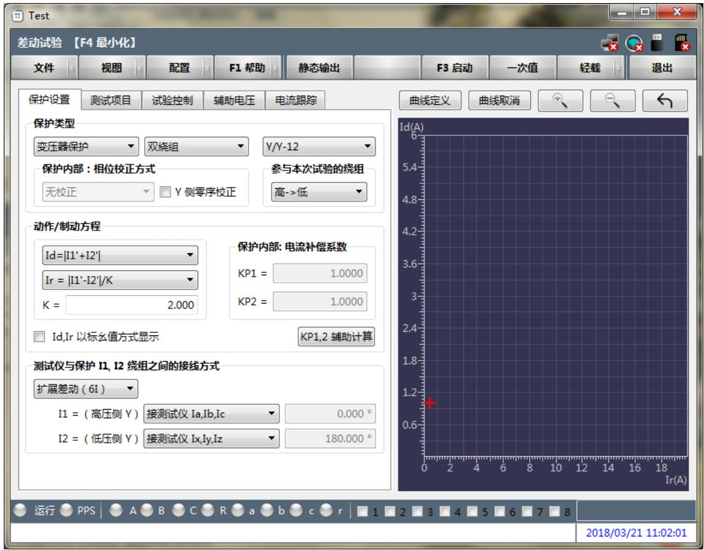

### 简介

差动试验（6 路电流 / 2 路电流）主要用于测试各种发电机、变压器、母差等差动保护的特性，可完成的测试项目包括：

- 比率制动特性；

- 谐波制动特性；

系统提供了两种测试方式：边界扫描和定点测试。边界扫描用于边界特性曲线的自动搜索，定点测试用于动作或者不动作的验证性试验；

### 测试窗口

测试窗口用于试验参数设置；

差动试验的测试窗口包括 5 个属性页和1 个右视图：

- 保护设置：设置差动保护的属性，包括保护类型、动作/制动方程，电流补偿系数等；

- 测试项目：选择测试项目，设置测试点；

- 试验控制：试验控制参数，包括故障前状态及故障限时、动作接点设置等；

- 辅助电压：设置实验中需要输出的辅助电压；

- 电流跟踪：跟踪试验过程中施加到保护各侧的电流输出；

右视图用于设置和显示预定义的各种差动或制动特性曲线等。

### 保护设置

### 保护类型：

选择待测保护的类型；

系统提供了4种类型，包括：变压器保护、发变组保护、发电机保护、母差保护；

### 变压器接线：

保护类型为“变压器保护”或“发变组保护”时有效；

设置变压器的绕组数（双绕组，或，三绕组）及变压器接线钟点数。

- 双绕组：Y/Y-12，Y/△-11，Y/△-1，以及 Y/△-3，Y/△-5，Y/△-7，Y/△-9，

Y/Y-2，Y/Y-4，Y/Y-6，Y/Y-8，Y/Y-10； 

- 三绕组：Y/Y/Y-12，Y/Y/△-11，Y/Y/△-1，Y/△/△-11 和 $Y/△/△-1$ ；

### 保护内部相位校正方式：

保护类型为“变压器保护”或“发变组保护”时有效；

根据保护的实际配置，选择其内部的相位校正方式，

- 无校正：保护内部不做相位校正（由外部 CT 接线校正）；

- Y 侧校正：保护内部通过算法对 Y侧电流做相位校正；

- $\triangle$ 侧校正：保护内部通过算法对△侧电流做相位校正（同时 Y 侧做零序校正）；

对于 Y/Y-12，或 Y/Y/Y-12 点接线，应注意选择保护内部是否做 Y 侧零序校正。

### 参与本次试验的绕组：

选择参与本次试验的绕组，如高-低，高-中，或中-低；

### 动作/制动方程：

系统提供了两种设置方式，

- 根据保护的技术说明书，手动选择待测保护的动作/制动方程；

注：方程“Id=I1, ${ \vert r  = \vert } 2 ^ { \prime \prime }$ 适用于常规的差动继电器测试，I1、I2分别代表保护的动作线圈电流和制动线圈电流；

其他方程适用于微机型差动保护测试，I1，I2 分别代表保护中参与试验的两侧绕组电流；

K： 

动作/制动方程中所可能涉及到的参数；

### Id，Ir以标幺值方式显示

对于南瑞继保护的 RCS-978，RCS-9000等系列的保护，其差动定值为标幺值形式（无量纲），则选中本项，Id，Ir的显示均为无量纲；

### 保护内部：电流补偿系数

正常运行（三相对称）情况下，保护中参与试验的两侧绕组 CT 变比不平衡修正系数；

用户可以自行计算补偿系数并填入，也可以通过“KP1，KP2 辅助计算”由系统自动计算填写；

I1侧 KP1：I1侧绕组电流I1 所对应的电流补偿系数；

- I2 侧 KP2：I2 侧绕组电流 I2 所对应的电流补偿系数；

- 通过“KP1，KP2 辅助计算”提供 I1，I2 侧的补偿系数辅助计算功能；

### 保护 I1,I2 绕组接线方式：

扩展差动（6I）、分相差动（2I）：

根据试验时所选用的测试仪的电流通道数选择。

### I1接测试仪：

保护 I1 侧绕组和测试仪的连接方式；

（因变压器绕组数和参与侧的不同，I1 可能表示保护的不同侧，请根据提示接线）

### I1相位：

保护 I1 侧绕组电流的相位，一般默认取 0° ；

### I2 接测试仪：

保护 I2 侧绕组和测试仪的连接方式；

（因变压器绕组数和参与侧的不同，I2 可能表示保护的不同侧，请根据提示接

线）

### I2 相位：

保护 I2 侧绕组电流的相位，一般由系统自动设定（模拟区外故障）；

### 测试项目

选择测试项目，设置测试点。

系统提供了4个测试项目：比率差动，谐波制动；

每个测试项目分别提供了2 种不同的测试方式：边界扫描和定点测试。

### 1-1．比率差动：边界扫描

用于对指定的Ir 点进行比率制动边界特性搜索。

测试原理：

- 用户根据需要选择制动电流 Ir的测试点；

- 系统根据所设定的动作电流 Id搜索范围和搜索精度，按二分法自动寻找该制动点Ir对应的动作电流边界 Id。

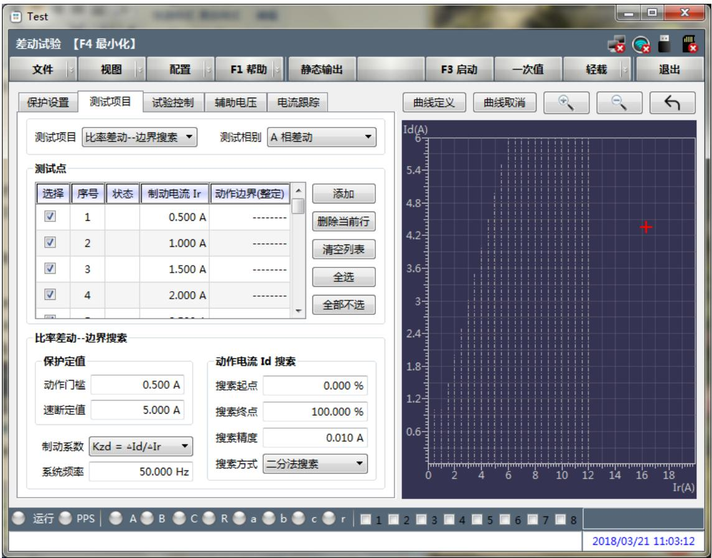

### 测试相别：

类似于故障类型，可模拟不同的差动组合。

对于分相差动，系统提供了 3种测试相别：A、B、C 相差动；

对于扩展差动，系统提供了 7种测试相别：A、B、C 相差动，AB、BC、CA 相差动，

ABC相差动。

### 测试点：

选择制动电流 Ir 的测试点，其对应的动作电流边界 Id 待搜索。

可通过“添加”、“删除当前行”、“清空”按钮操作；

### 保护定值

- 动作门槛：

比率差动保护的启动电流整定值。

- 速断定值：

差动速断保护的动作电流整定值。

- 制动系数 Kzd：

制动系数 Kzd 的计算公式。系统提供了 3 种公式：

- Kzd = △Id / △Ir； 

- Kzd = Id / Ir； 

- Kzd = Ir / Id； 

### 系统频率 Fre

比率差动试验中，电压电流的输出频率；

### 动作电流 Id搜索范围：

设置试验过程中，差流 Id的搜索范围。

- 动作电流 Id搜索起点、终点

用户可手动设置 Id的搜索起点和终点；

如果用户在右视图中通过右键“曲线定义”提供预定义的比率制动特性曲线，则选中“自动调整”，程序可根据允许误差，自动确定Id的搜索范围；

-  搜索精度：

动作电流 Id 搜索过程中的最小允许误差，即搜索的收敛判据。

- 搜索方式：

根据实际需要选择试验搜索方式，可以选择二分法或者单相搜索。

### 1-2．比率差动：定点测试

用于对指定点（Ir，Id）的验证性测试，确定其位于动作区或制动区。

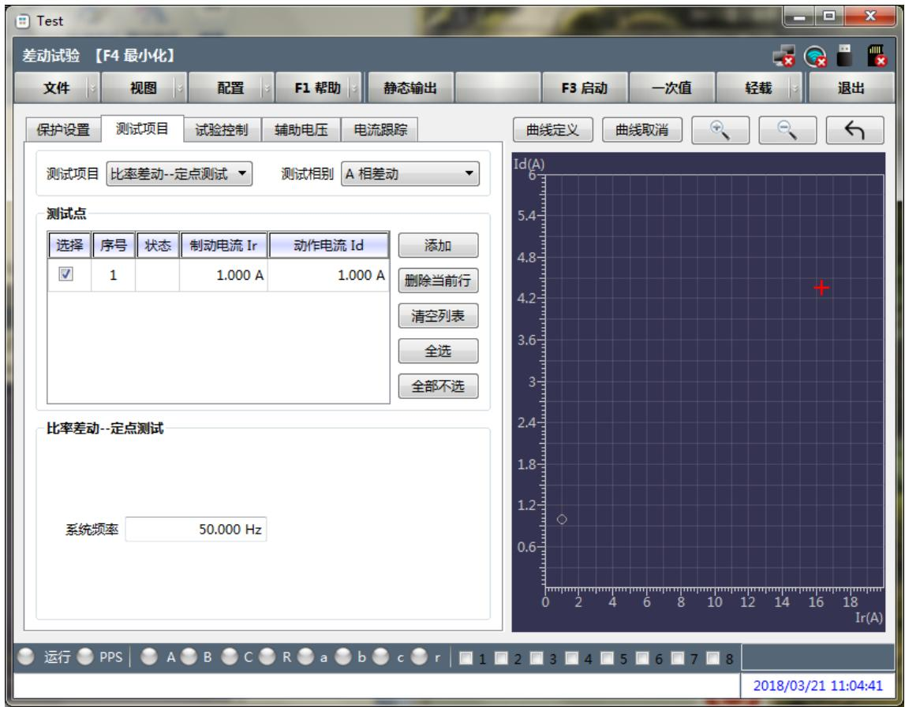

### 测试相别：

类似于故障类型，可模拟不同的差动组合。

对于分相差动，系统提供了 3种测试相别：A、B、C 相差动；

对于扩展差动，系统提供了 7种测试相别：A、B、C 相差动，AB、BC、CA 相差动，ABC相差动。

### 测试点：

选择待验证的测试点（Ir，Id）。

可通过“添加”、“删除当前行”、“清空”按钮操作；

### 系统频率 Fre

比率差动试验中，电压电流的输出频率，默认为 50Hz，也可根据需要设为 60Hz。

### 2-1．谐波制动：边界扫描

用于对指定的Id点进行谐波制动边界特性搜索。

测试原理：

- 用户根据需要选择动作电流 Id的测试点；

- 系统根据所设定的谐波搜索范围和搜索精度，按二分法自动寻找该动作点 Id对应的谐波制动边界 $I \times 6\%$ 。

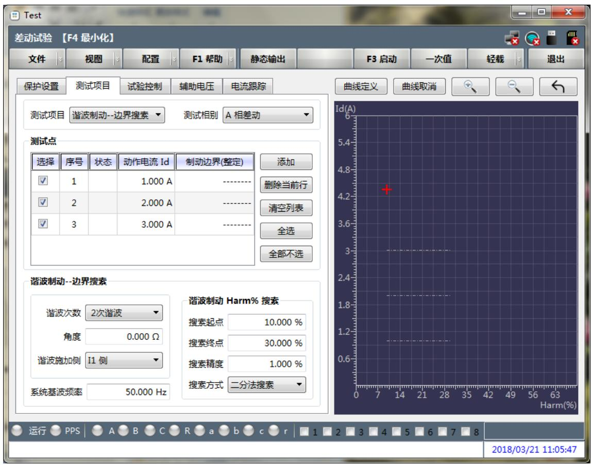

### 测试相别：

类似于故障类型，可模拟不同的差动组合。

对于分相差动，系统提供了 3种测试相别：A、B、C 相差动；

对于扩展差动，系统提供了 7种测试相别：A、B、C 相差动，AB、BC、CA 相差动，三相差动。

### 测试点：

选择动作电流 Id的测试点，其对应的谐波制动边界Ixb% 待测。

可通过“添加”、“删除当前行”、“清空”按钮操作；

### 谐波次数：

选择需要测试的谐波次数，如2 次谐波、3 次谐波 … 20 次谐波等。

### 谐波角度：

设置待叠加谐波的角度。

### 谐波施加侧：

试验时，谐波电流的叠加侧，可选择 I1侧或 I2侧。

### 系统（基波）频率 Fre

谐波制动试验中，电压电流的基波频率；

### 谐波制动 Ixb% 搜索范围：

对应每一个动作电流 Id测试点，设置谐波电流 Ixb% 的搜索起点和终点。

### 搜索精度：

谐波电流 Ixb% 搜索过程中的最小允许误差，即搜索的收敛判据。

### 搜索方式：

根据实际需要选择试验搜索方式，可以选择二分法或者单相搜索。

### 2-2．谐波制动：定点测试

用于对指定点（Id，Ixb%）的验证性测试，确定该谐波含量能否制动。

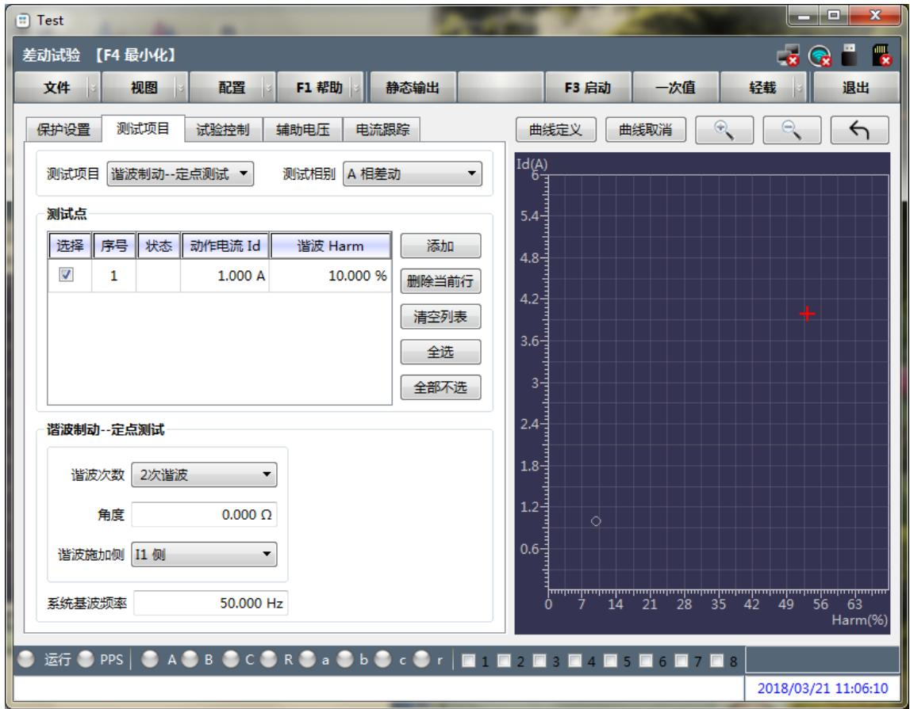

### 测试相别：

类似于故障类型，可模拟不同的差动组合。

对于分相差动，系统提供了 3种测试相别：A、B、C 相差动；

对于扩展差动，系统提供了 7种测试相别：A、B、C 相差动，AB、BC、CA 相差动，ABD相差动。

### 测试点：

选择待验证的测试点（Id，Ixb%）。

可通过“添加”、“删除当前行”、“清空”按钮操作；

### 谐波次数：

选择需要测试的谐波次数，如2 次谐波、3 次谐波 … 20 次谐波等。

### 谐波角度：

设置待叠加谐波的角度。

### 系统（基波）频率 Fre

谐波制动试验中，电压电流的基波频率；

### 谐波施加侧：

试验时，谐波电流的叠加侧，可选择 I1 侧或 I2 侧。

### 试验控制

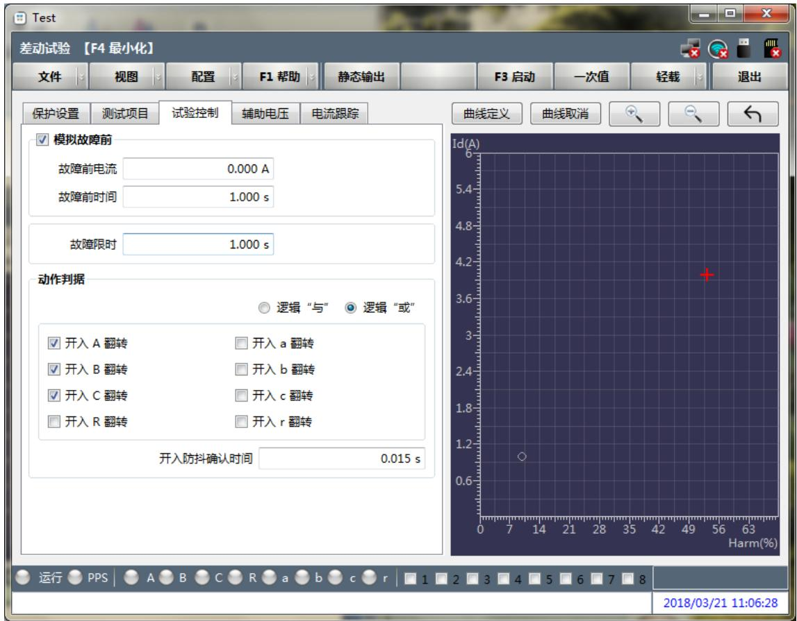

### 故障前

### - 故障前电流：

故障前电流输出，一般设为 0A；

### - 故障前时间：

故障前状态的输出时间，该时间必须保证保护能够可靠复归。一般可取 0.5 秒。

### 故障限时：

故障电流的最大输出时间，该时间必须大于保护的动作时间，以保证保护能可靠动作。

差动保护通常为速动，故障限时一般可取为0.5秒。

注：如果继电器无法长时间通大电流，建议在保证保护动作时间的前提下，尽可能地延长故障前时间，减小故障限时。

### 动作接点：

试验时，程序将根据动作接点的设置确定保护是否动作或返回。

### 动作逻辑：

“逻辑与”：所选开入量全部满足条件，动作成立；

逻辑或”：所选开入量任何一个满足条件，动作成立；

如果只选中一个开入量，则“逻辑与”和“逻辑或”的效果相同。

. 开入 A，B，C，R，a，b，c，r：

打“√”者表示被选中参与翻转判断；

### 开入防抖确认时间：

为避免继电器触点的抖动，开入接点的状态保持一个时间（确认时间）后，系统方予以确认生效。 通常取 10  ~  20 \mathrm  m s 。

### 辅助电压：

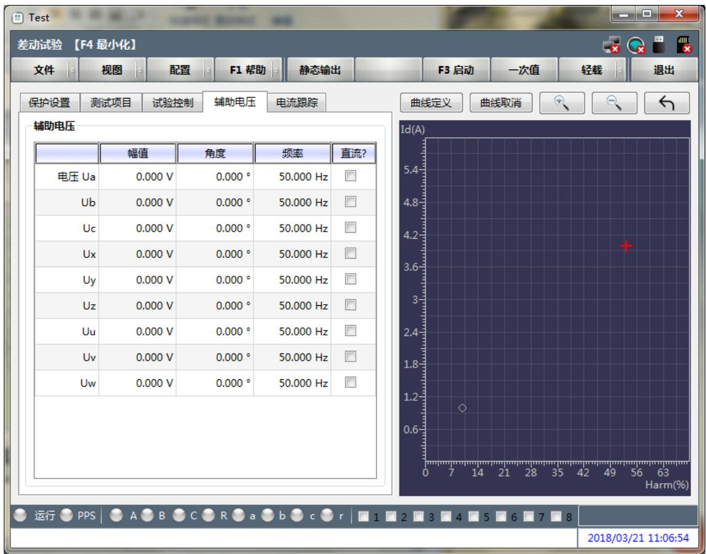

电压 Ua、Ub、Uc、Ux、Uy、Uz、Uu、Uv、Uw：

试验过程中如果需要辅助的电压输出的幅值、角度和频率（或直流），则在此配置。辅助电压在整个试验过程中保持不变。

### 电流跟踪

试验过程中实时跟踪并显示电流的输出情况。

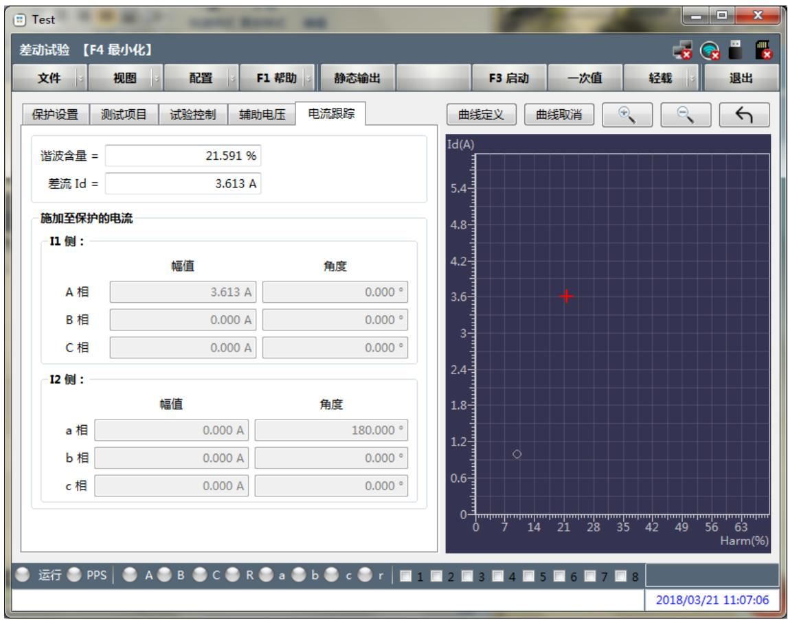

### 右视图

测试窗口的右视图用于设置和显示预定义的各种差动或制动特性曲线，以及测试结果等。

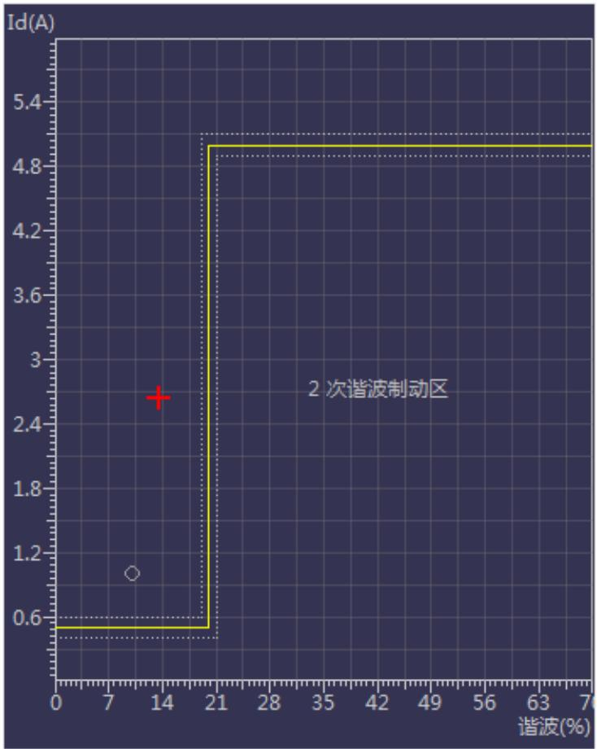

右上方各种按钮（如下图所示），用于曲线设置和操作等。

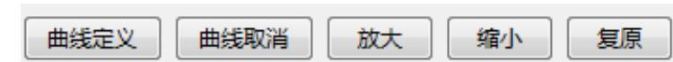

- 曲线定义/曲线取消：

用来定义，或取消，差动保护的各种特性曲线。

- 曲线操作：

对各种特性曲线进行放大、缩小、漫游等操作，以方便查看。

### 曲线定义：

选择“曲线定义”菜单项，弹出“特性曲线定义”对话框，如下图所示：

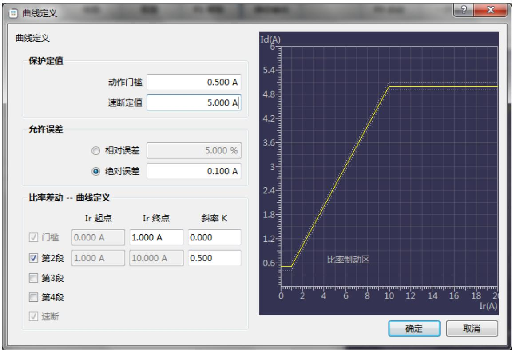

- 动作门槛：

比率差动保护的启动电流整定值。

- 速断电流：

差动速断保护的动作电流整定值。

- 电流允许误差：

边界的允许误差，据此程序可确定出边界特性曲线的允许浮动范围（如虚线所示）；

- 比率差动—特性曲线定义：

根据保护的比率制动特性曲线确定曲线的段数，设置各段的 Ir 终点（即拐点）

和斜率（即比率制动系数）。

- 谐波制动—特性曲线定义：

设置谐波定值和定值允许误差。

曲线取消：

取消预定义的差动保护特性曲线；

注：如果没有进行曲线定义，为保证测试结果的正确性，建议选择“曲线取消”。

曲线操作：

- 放大、缩小：放大或缩小显示特性曲线；

- 复原：恢复特性曲线的初始显示方式；

### 测试结果

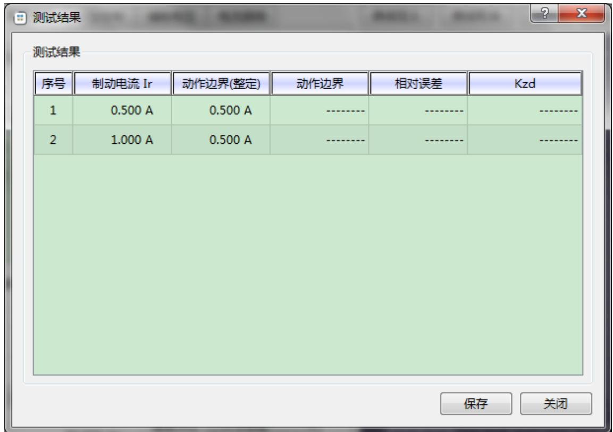

对不同的测试项目，有不同的“测试结果”显示，用于查看差动保护的动作时间、动作边界 Id、比率制动系数 Kzd 等等。

