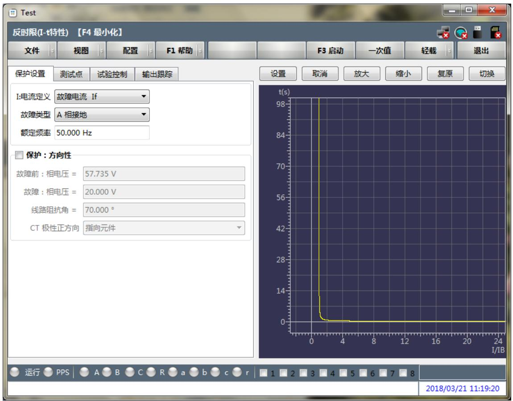
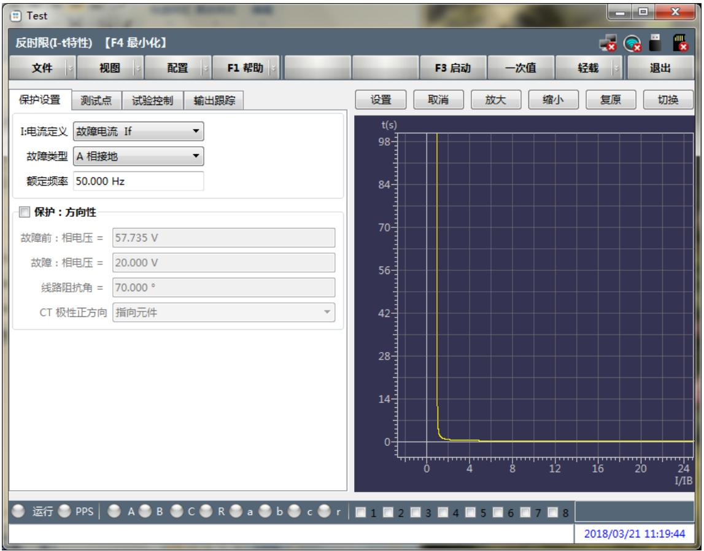
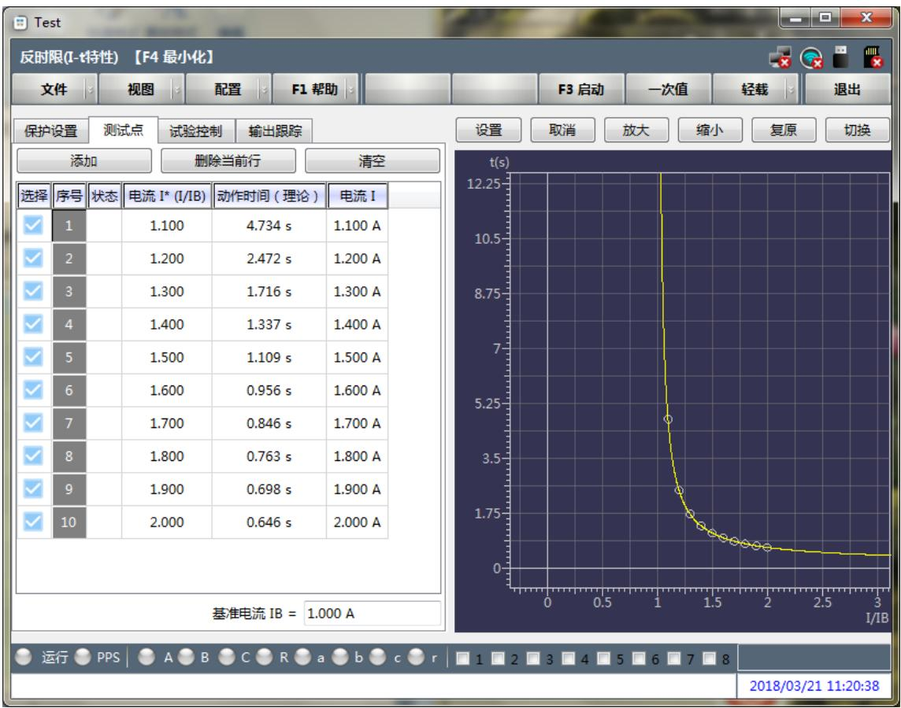
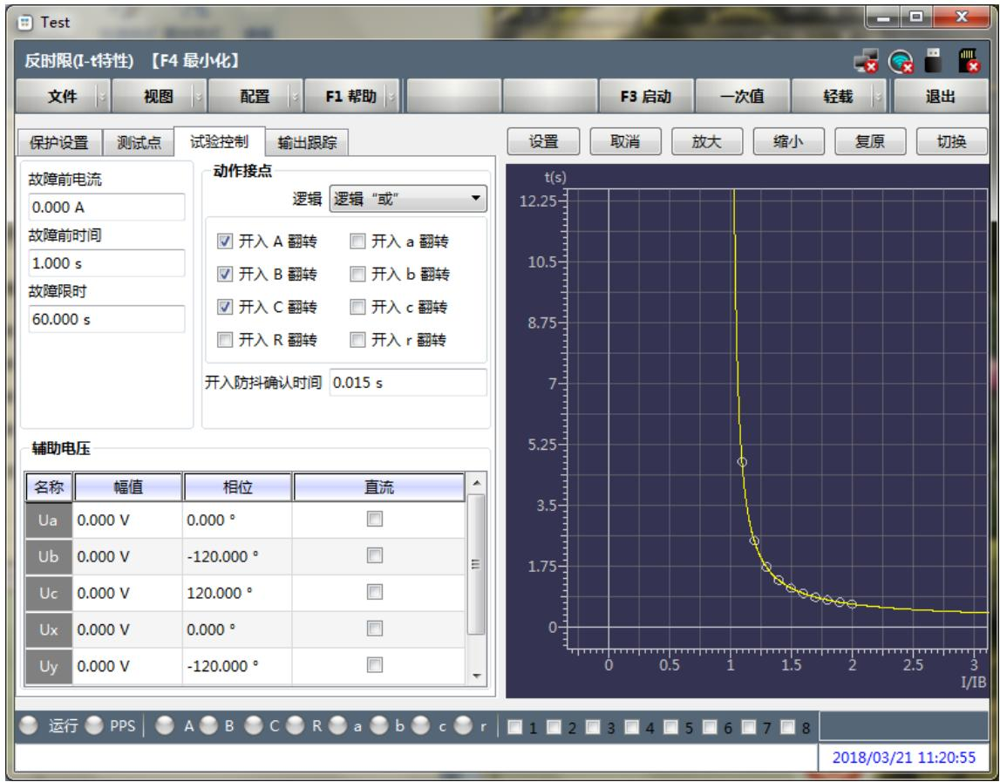
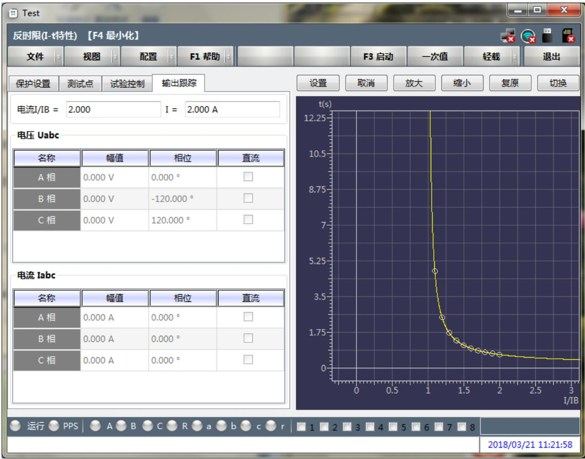
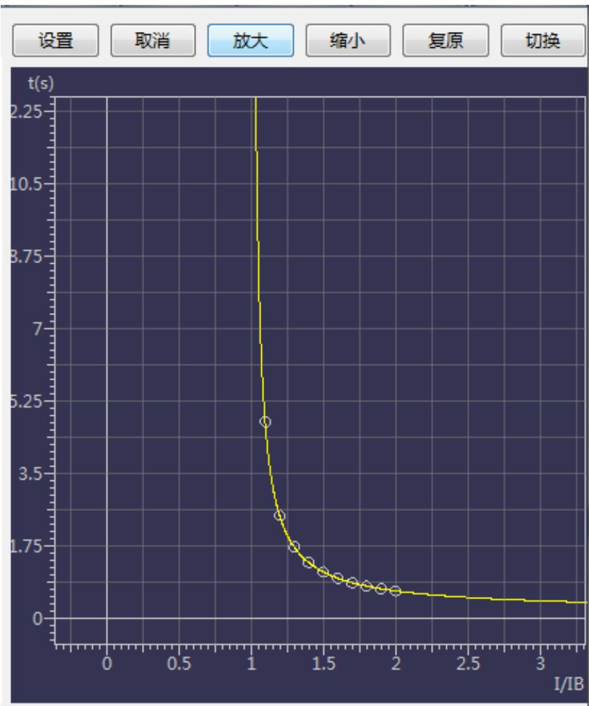
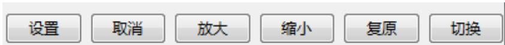
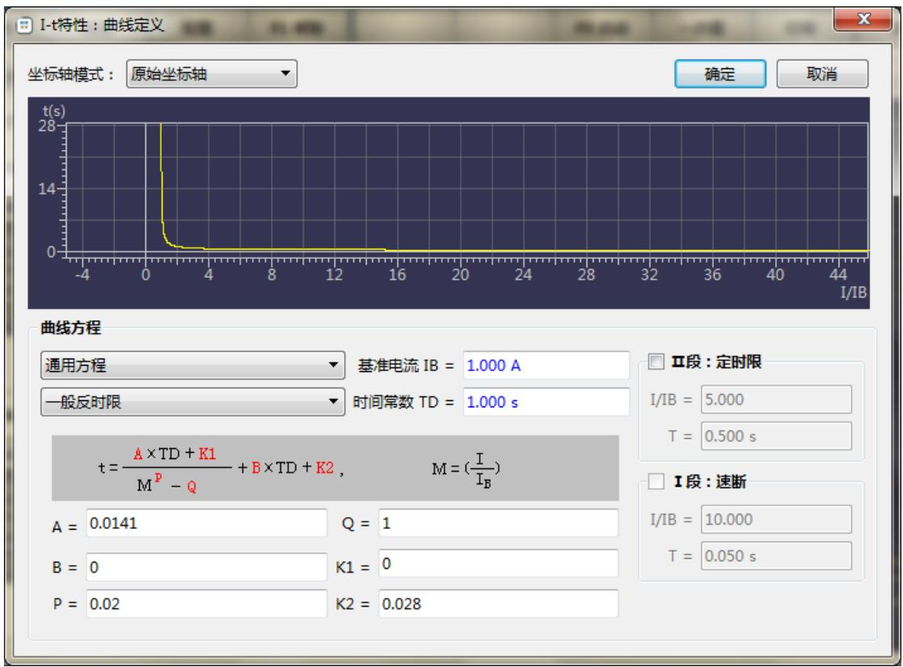
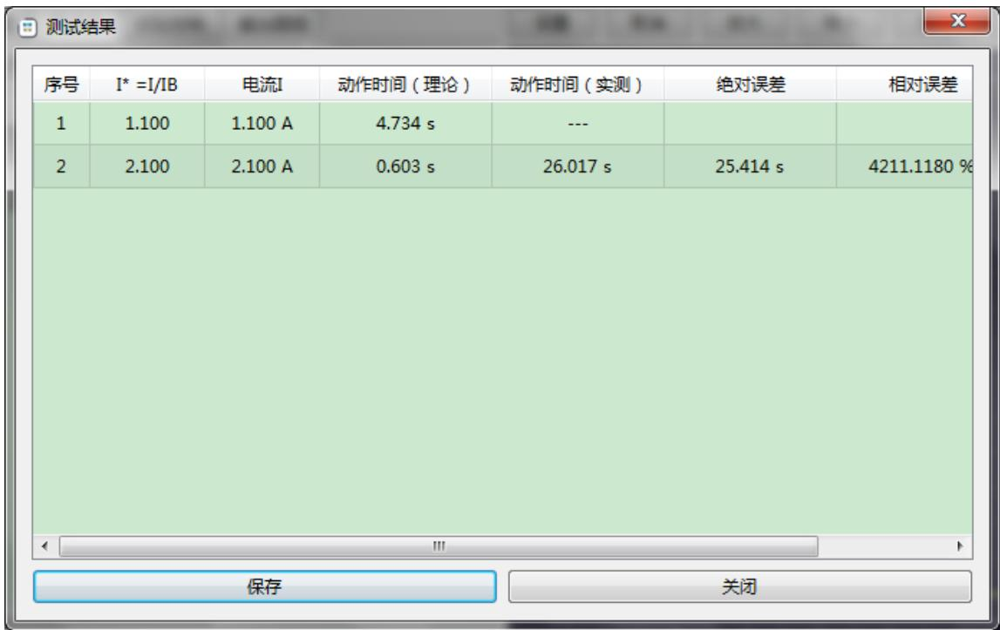

# 2.16 反时限（I-t 特性）

### 简介

本菜单主要用于反时限过电流继电器的 I(t)动作特性测试，包括

- 方向过流，或，无方向过流继电器；

- 负序过流；

- 零序过流；

系统提供了多种反时限特性曲线的预定义功能，包括 IEC特性、IEEE 特性、IAC 特性、I2T特性，以及自定义特性等。

### 测试窗口

测试窗口用于试验参数设置；

I-t特性的测试窗口包括 4 个属性页和1个右视图：

- 保护设置：根据待测保护的特性，设置电流的定义，包括有无方向性等；

- 测试点：设置测试点；

- 试验控制：试验控制参数，包括故障前状态及故障限时、动作接点设置等；

- 输出跟踪：跟踪试验过程中测试仪的各相电压电流输出；

右视图用于设置和显示预定义的各种I-t特性曲线，以及测试结果等。

### 保护设置

###  I：电流定义：

根据待测保护的特性，选择合适的电流定义。

系统提供了4种定义方式：

- 故障电流 If：用于方向过流和无方向过流I-t特性测试；

- 负序电流 I2（或3I2)：用于负序过流I-t特性测试；

- 零序电流3I0：用于零序过流I-t特性测试；

- 单路电流：用于单路电流 I-t特性测试；

### 故障类型：

对于不同的“电流 I定义”，故障类型有所不同；

配合电流定义，决定了试验过程中的电流输出方式。

### 额定频率：

测试仪在试验过程中所输出的电压、电流的频率；

### 有无方向性：

待测保护是否带方向性；

打“√”表示有方向性；

（以下参数仅对保护带方向性有效；）

### 故障前相电压：

故障前相电压值，通常取额定电压，保证保护可靠复归；

### 故障相/线电压：

故障时的相（或线）电压值，以提供可靠的方向性判据；

### 线路阻抗角：

故障时的线路阻抗角，决定了故障后的电压和电流之间的相角差；

### CT极性正方向：

保护 CT 极性的正方向；

CT 极性指向线路（元件）为正：电流从母线流向线路为正；

CT 极性指向母线为正：电流从线路流向母线为正；

### 测试点

### 测试点：

选择电流I的测试点，其对应的动作时间待测。

可通过“添加”、“删除当前行”、“清空”按钮操作；

### 基准电流 IB：

电流基准，主要用于电流标幺值 I* 和 有名值 I(A) 之间的换算；

### 试验控制

故障前电流：

故障前电流。通常取 0；

故障前时间：

故障前状态的输出时间。

进入下一个电流测试点之前，为了保证保护的可靠复归（或继电器的可靠返回），

需要输出一定时间的故障前状态；

故障前状态由“电流I的定义”以及保护是否有方向性决定；

故障限时：

每一个电流测试点的最大输出限时。

通常，“故障限时”应大于继电器I-t特性中所可能出现的最长动作时间；

动作接点：

试验时，程序将根据动作接点的设置确定保护是否动作或返回。

动作逻辑：

“逻辑与”：所选开入量全部满足条件，动作成立；

逻辑或”：所选开入量任何一个满足条件，动作成立；

如果只选中一个开入量，则“逻辑与”和“逻辑或”的效果相同。

. 开入 A，B，C，R，a，b，c，r：

打“√”者表示被选中参与翻转判断。

### 开入防抖确认时间：

为避免继电器触点的抖动，开入接点的状态保持一个时间（确认时间）后，系统方予以确认生效。 通常取 10  ~  20 \mathrm  m s 。

### 辅助电压：

试验过程中如果需要辅助的电压输出（交流或直流），则在此配置。

辅助电压在整个试验过程中保持不变。

注：当保护带有方向性时，电压 Uabc的输出由程序控制，用户不能再选其为辅助电压。

### 输出跟踪

试验过程中实时跟踪并显示当前的电流测试点（标幺值 I/IB、有名值 I），以及施加至保护的各相电流、电压值。

### 右视图

测试窗口的右视图用于设置和显示预定义的 I-t特性曲线。

在右视图上方操作相关的功能键（如下图所示），用于曲线设置。

- 曲线定义/曲线取消：

用来定义，或取消，I-t反时限特性曲线。

- 曲线操作：

对各种特性曲线进行放大、缩小、漫游等操作，以方便查看。

### 设置（曲线定义）：

选择“曲线定义”菜单项，弹出“I-t 特性—曲线定义”对话框，如下图所示：

###  坐标轴模式：

I-t 特性曲线使用的坐标轴模式：对数坐标轴（Log10）或原始坐标轴。

###  曲线方程：

I-t特性曲线所用的方程设置；

系统提供了多种预定义的特性方程，包括 IEC 方程、IEEE 方程、IAC 方程、I2T方程、自定义曲线等。

###  基准电流 IB：

设置 I-t特性方程中的基准电流值 IB；

###  时间常数 Ip：

设置 I-t 特性方程中的时间常数 Ip；

###  II段：定时限：

###  I段：速断：

如果I-t特性测试需要和保护的定时限或速断段配合，则选中相应的“√ 应用”后，设置保护的相应定值。

### 曲线取消：

取消预定义的 I-t特性曲线；

### 曲线操作：

1、 放大、缩小：放大或缩小显示特性曲线；

2、复原：恢复特性曲线的初始显示方式；

3、切换：对数坐标轴（Log10）与原始坐标轴之间的切换。

### 测试结果

试验过程中，测试仪根据接点的翻转，记录保护的动作和返回值结果；

