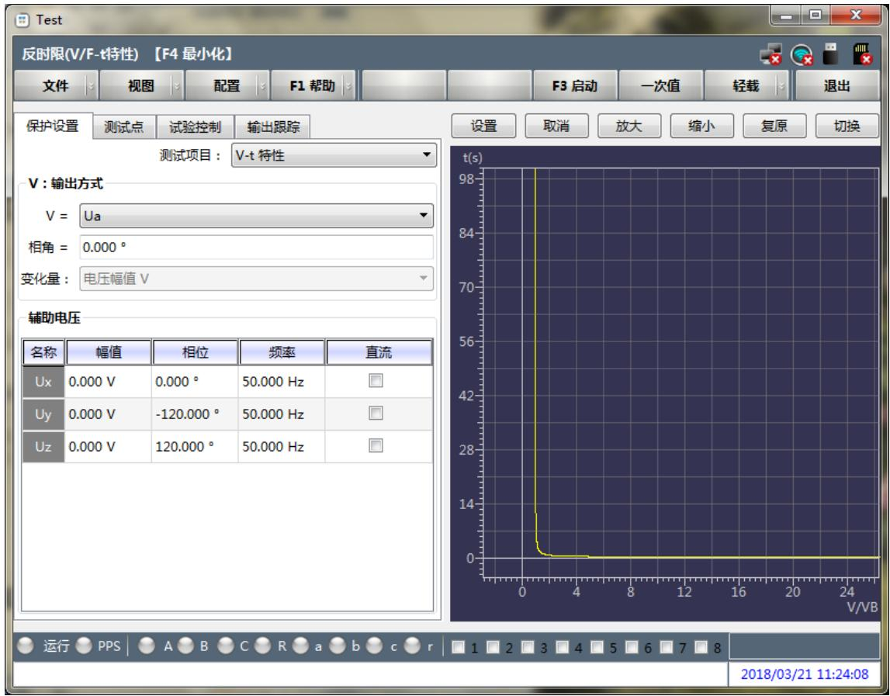
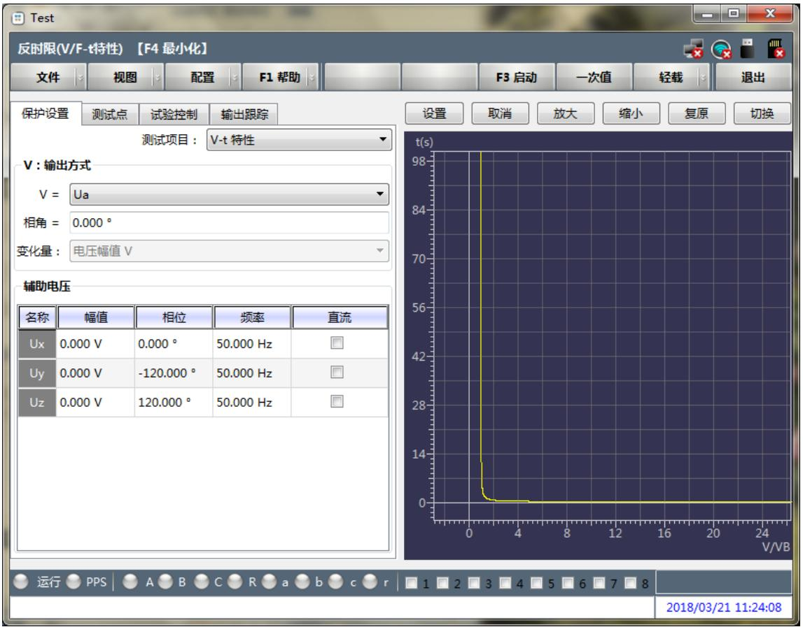
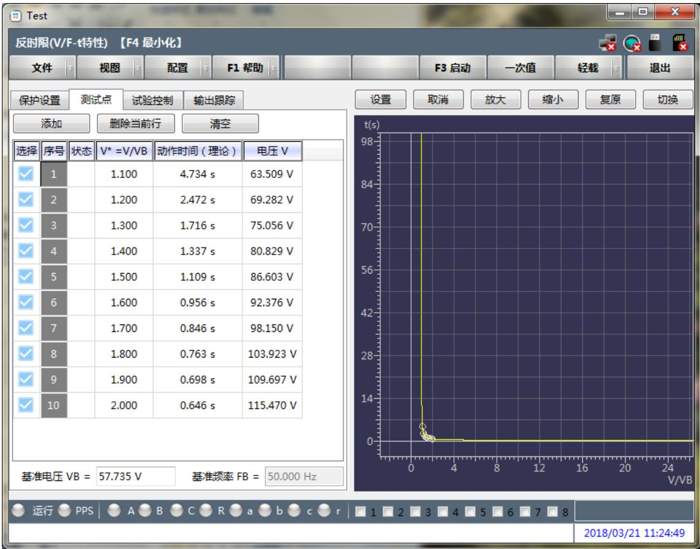
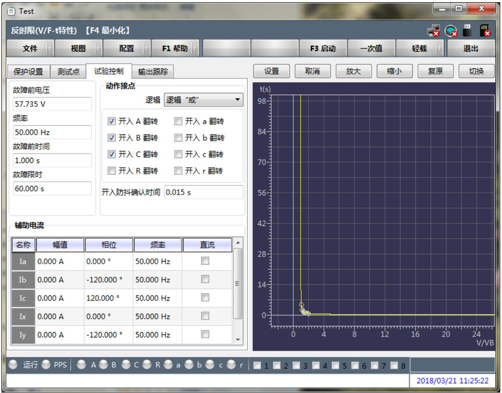
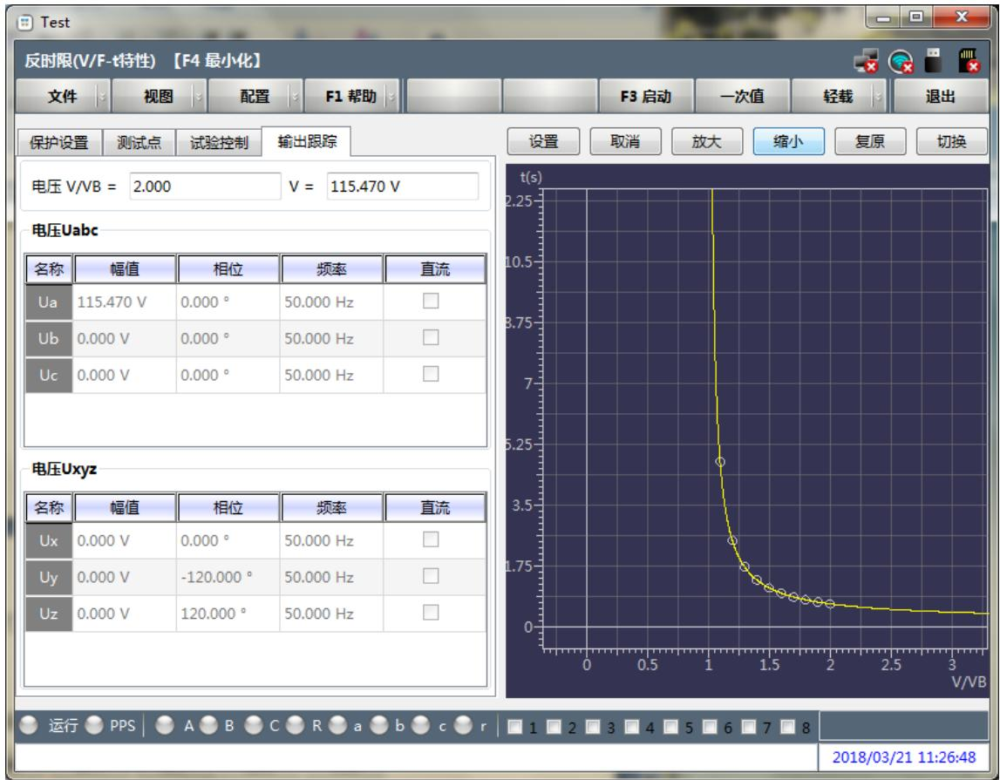
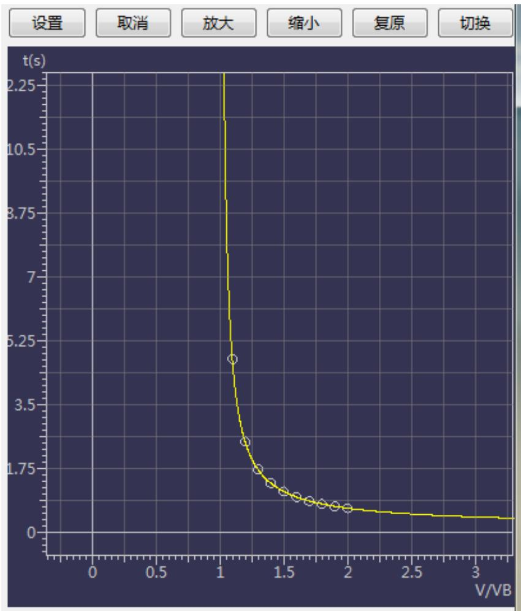
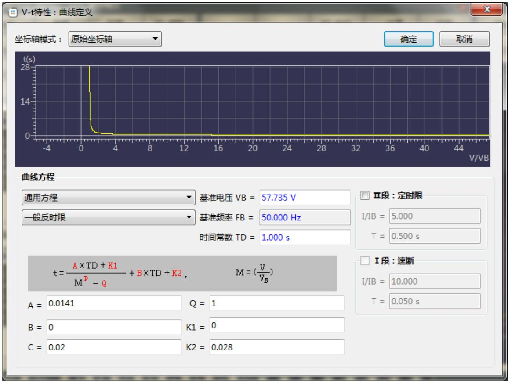
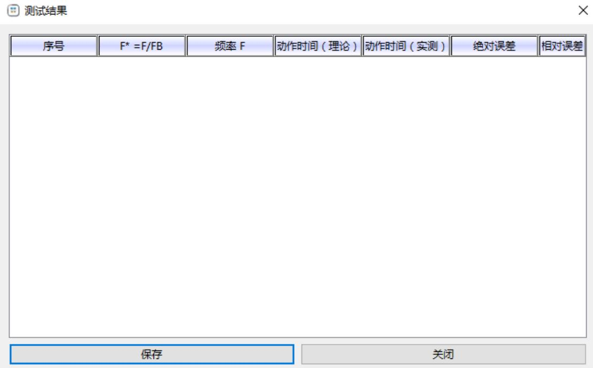

# 2.17 反时限（V/F-t 特性）

### 简介

本菜单主要用于电压或频率类型的反时限继电器特性测试，包括

- 电压继电器的V-t特性；

- 频率继电器的 F-t特性；

- 过激磁保护的 V/F-t 特性；

系统提供了多种反时限特性曲线的预定义功能，包括 IEC特性、IEEE 特性、IAC 特性、ANSI特性，以及自定义特性等。

### 测试窗口

测试窗口用于试验参数设置；

V-t特性的测试窗口包括 4 个属性页和1 个右视图：

- 保护设置：根据待测保护的特性，选择测试项目及电压的输出方式等；

- 测试点：设置测试点；

- 试验控制：试验控制参数，包括故障前状态及故障限时、动作接点设置等；

- 输出跟踪：跟踪试验过程中测试仪的各相电压输出；

右视图用于设置和显示预定义的各种 V-t、F-t、V/F-t特性曲线，以及测试结果等。

### 保护设置

### 测试项目：

系统提供了3种测试项目，包括：V-t特性，F-t特性，V/F-t特性；

### V输出方式：

试验过程中，电压V 的输出方式。

系统提供了9种输出方式，包括

- Ua、Ub、Uc； 

- Uab、Ubc、Uca； 

- Uabc（正序）；

- Uabc（负序）；

- Uabc（零序）；

如果V-t试验时的电压较大，建议选择 Uab、Ubc或Uca线电压方式输出，试验过程中，两相的电压相位自动调整为反 $180 ^ { \circ  }$ ；

### 相角：

试验过程中，电压输出的相位角（绝对相位）；

### 变化量：

根据测试项目的选择，确定试验过程中的变化量。如：

- V-t 特性测试时，变化量为电压幅值 V；

$\diamondsuit F - t $ 特性测试时，变化量为电压频率 F；

- V/F-t 特性测试时，变化量由用户设置，另一个固定为基准值；

### 辅助电压：

试验过程中如果需要辅助的电压输出（交流或直流），则在此配置。

辅助电压在整个试验过程中保持不变。

### 测试点

### 测试点：

选择电压V 的测试点，其对应的动作时间待测。

可通过“添加”、“删除当前行”、“清空”按钮操作；

### 基准电压VB：

电压基准，主要用于标幺值 V* 、 V*/F* 和 有名值 V(V)、V/F 之间的换算；

### 基准频率 FB：

频率基准，主要用于标幺值 V* 、 V*/F* 和 有名值 V(V)、V/F 之间的换算；

### 试验控制

### 故障前电压：

故障前电压。通常取 57.735V，以保证保护复归；

### 频率：

测试仪在整个试验过程中所输出的电压、电流频率；

### 故障前时间：

故障前状态的输出时间。

进入下一个电压测试点之前，为了保证保护的可靠复归（或继电器的可靠返回），需要输出一定时间的故障前状态。

故障前状态由“电压V 的定义”决定。

### 故障限时：

每一个电压测试点的最大输出限时。

通常，“故障限时”应大于继电器特性测试中所可能出现的最长动作时间。

### 动作接点：

试验时，程序将根据动作接点的设置确定保护是否动作或返回。

### 动作逻辑：

“逻辑与”：所选开入量全部满足条件，动作成立；

逻辑或”：所选开入量任何一个满足条件，动作成立；

如果只选中一个开入量，则“逻辑与”和“逻辑或”的效果相同。

- 开入 A，B，C，R，a，b，c，r：

打“√”者表示被选中参与翻转判断；

开入防抖确认时间：

为避免继电器触点的抖动，开入接点的状态保持一个时间（确认时间）后，系统方予以确认生效。通常取 10  ~  20 \mathrm  m s 。

辅助电流：

试验过程中如果需要辅助的电流输出（交流或直流），则在此配置。

辅助电流在整个试验过程中保持不变。

### 输出跟踪

试验过程中实时跟踪并显示当前的 V、F、V/F 测试点（标幺值、有名值），以及施加至保护的各相电压值。

### 右视图

测试窗口的右视图用于设置和显示预定义的V-t、F-t、V/F-t特性曲线等。

- 曲线定义/曲线取消：

用来定义，或取消，V-t、F-t、V/F-t特性曲线。

- 放大/缩小/复原/切换：

对各种特性曲线进行放大、缩小、漫游等操作，以方便查看。

###  曲线定义：

点击“曲线定义”，弹出“V-t 特性—曲线定义”对话框，如下图所示：

### 坐标轴模式：

V-t、F-t、V/F-t 特性曲线使用的坐标轴模式：原始坐标轴或对数坐标轴（Log10）。

### 曲线方程：

特性曲线所用的方程设置；

系统提供了多种预定义的特性方程，包括 IEC 方程、IEEE方程、IAC方程、ANSI方程、自定义曲线等。

### 基准电压VB：

设置特性方程中的基准电压值 VB；

### 基准频率 FB：

设置特性方程中的基准频率值 FB；

### 时间常数TD：

设置特性方程中的时间常数 TD；

### II段：定时限：

### I段：速断：

如果特性测试需要和保护的定时限或速断段配合，则选中相应的“√ ”后，设置保护的相应定值。

### 曲线取消：

取消预定义的特性曲线；

### 曲线操作：

1、放大、缩小：放大或缩小显示特性曲线；

2、复原：恢复特性曲线的初始显示方式；

3、切换：V-t、F-t、V/F-t特性曲线使用的坐标轴模式可自由切换成原始坐标轴或对数坐标轴（Log10）模式。

### 添加测试点：

将当前光标所对应的电压测试点添加到“测试点”页的测试点列表中；

### 测试结果

在“测试结果”中，可查看各电压测试点对应的保护动作时间（理论值、实际值）。

