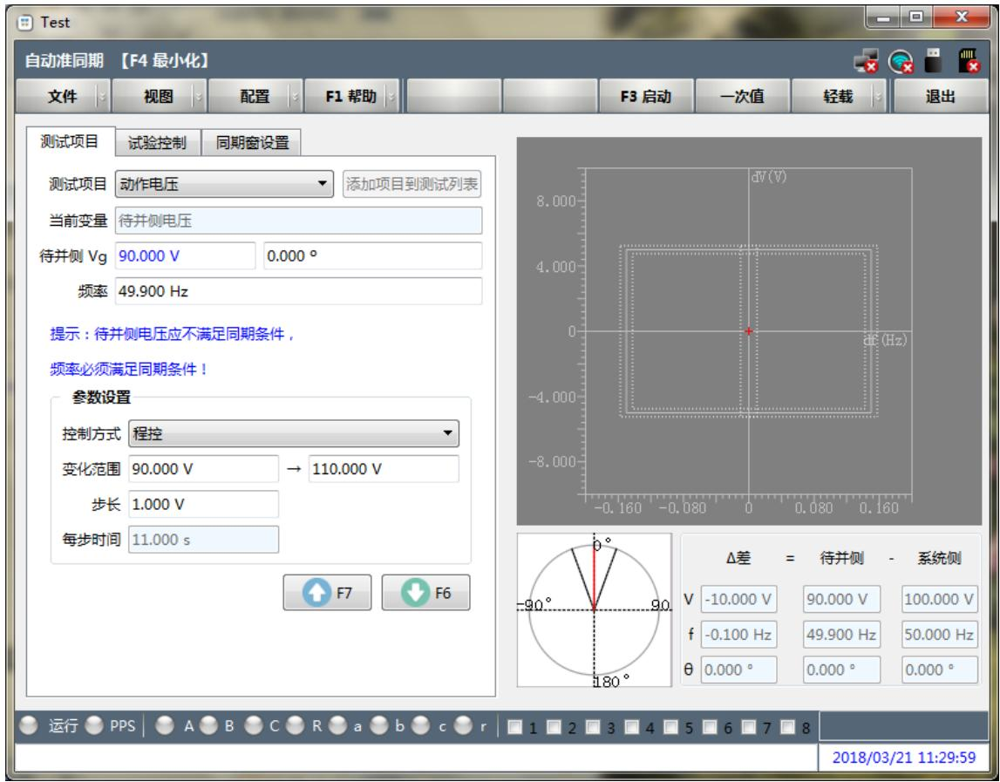
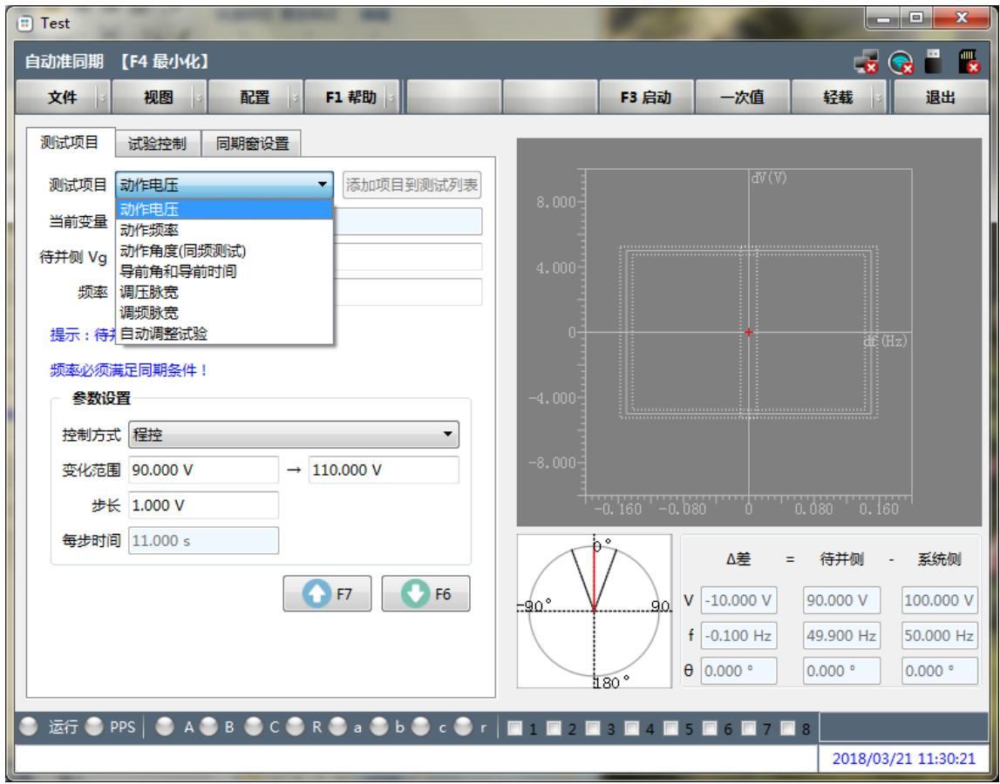
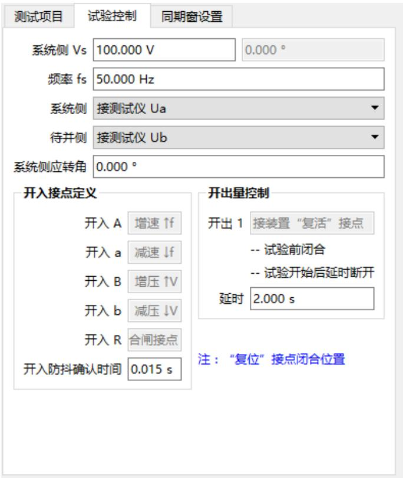
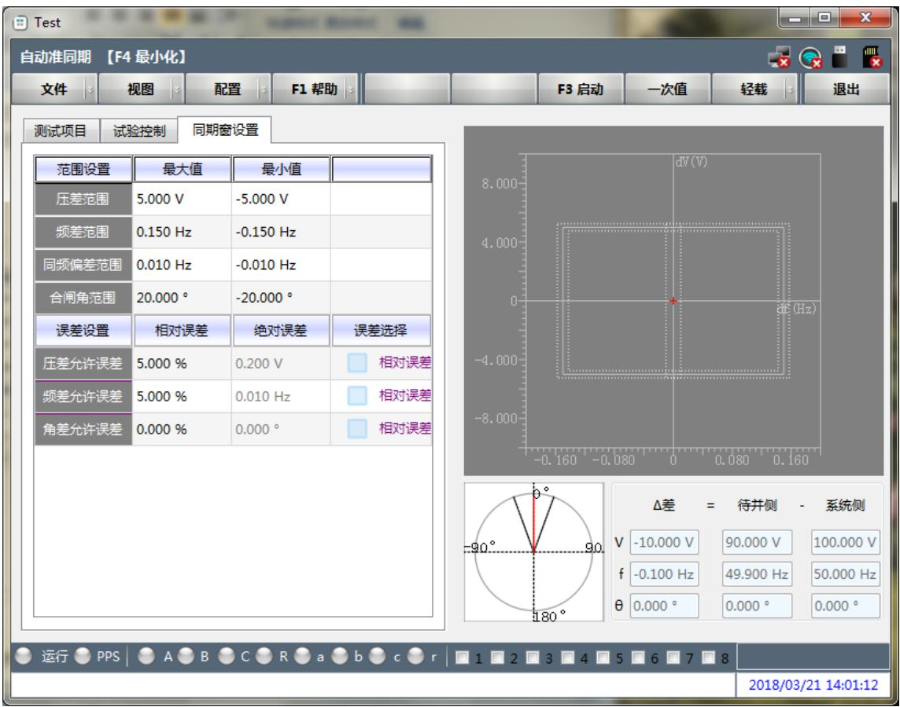
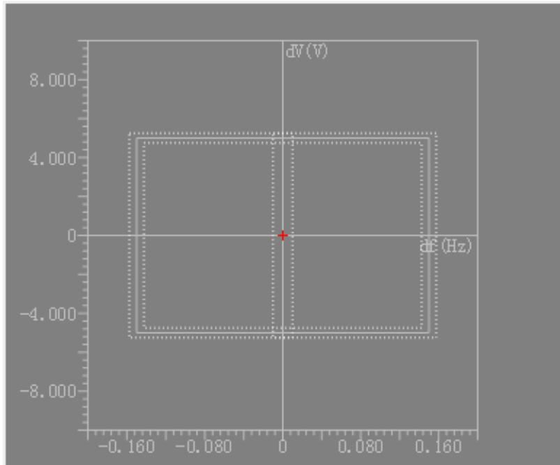
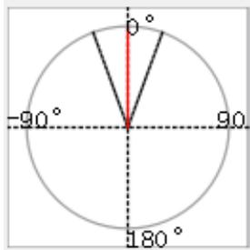
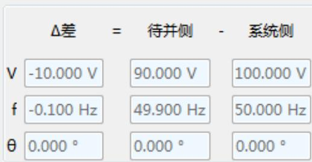

# 2.18 自动准同期

### 简介

本菜单主要用于同期装置以及同步继电器的特性测试，可完成的测试项目包括：

- 动作电压、动作频率、动作角度测试；

- 导前角和导前时间测试；

- 调压脉宽、调频脉宽测试，自动测量脉宽和周期；

- 自动调整试验：模拟发电机的合闸过程；

### 测试窗口

测试窗口用于试验参数设置；

自动准同期的测试窗口包括 3 个属性页和1 个右视图：

- 测试项目：选择测试项目，设置待并侧电压参数等；

- 试验控制：试验控制参数，包括系统侧电压、电压及开入接点的接线方式等；

- 同期窗设置：同期装置的允许误差设置；

右视图为同期试验的辅助显示区，分别以数字、同步窗和同期表的方式显示试验过程中待并侧电压幅值和频率的变化。

### 测试项目

在整个测试过程中，系统侧的电压 Vs 和频率 fs 保持不变，系统根据测试项目的需要调整待并侧变量的大小。当同期条件满足时，同期装置将发出合闸脉冲，测试仪检测到该信号后结束试验，并根据测试项目的要求记录相应的动作值，包括导前角和导前时间。

### 测试项目：

系统提供了 7 种测试项目，包括：动作电压、动作频率、动作角度（同频测试）、导前角和导前时间、调压脉宽、调频脉宽，以及自动调整试验；

### 当前变量：

根据测试项目的选择，自动确定试验过程中的变化量。

- 测试动作电压时，当前变量为待并侧电压 Vg的幅值；

- 测试动作频率时，当前变量为待并侧电压的频率fg；

- 测试动作角度时，当前变量为待并侧电压的角度；

- 其他测试项目无当前变量；

### 待并侧 Vg、频率 fg：

设置并显示当前的待并侧电压，包括幅值、角度、频率；

以下参数因所选择“测试项目”的不同而有不同的显示：

### 控制方式：

选择试验过程的控制方式：程控或手控；

- 程控：试验过程中，当前变量的变化过程完全由程序控制，用户对试验的干预仅限于通过 STOP键中止试验。

- 手控：试验过程中，当前变量的变化过程完全由用户控制，包括按 “↑”、“↓” 键增加、减小当前变量值等。

系统根据同期装置合闸接点的状态变化，自动记录相应的动作值。

### 变化范围：

“程控”时有效；

当前变量的变化起点和终点。

变化范围的起点可以大于终点，也可以小于终点，但二者必须能覆盖同期装置的动作值；

### 步长：

当前变量的变化步长；

根据测试的要求选择合适的大小，通常，步长越小，测试精度越高；

### 每步时间：

当前变量按步长变化时，每一步大小的保持时间。

注：为保证“每步时间”大于同期装置的合闸周期，

- 差频时，每步时间由系统自动计算；

- 同频时，每步时间由用户自行设置。

### 调压 dV/dt：

“自动调整试验”有效；

每一次测试仪检测到调压脉冲，自动按给定的滑差调整待并侧电压的幅值；

### 调速 df/dt：

“自动调整试验”有效；

每一次测试仪检测到调频脉冲，自动按给定的滑差调整待并侧电压的频率；

### 试验控制

### 系统侧 Vs：

设置系统侧电压 Vs的幅值；

### 频率fs：

设置系统侧电压 Vs的频率；

### 系统侧应转角：

当发电机经变压器和系统连接时，为补偿变压器两侧电压的角差，通常需设置转角变压器。

如果同期装置内部可自动补偿变压器的角差，则需要在此设置系统侧 TV二次电压应转角；

### 系统侧：

设置系统侧电压 Vs和测试仪的连接方式；

### 待并侧：

设置待并侧电压 Vg和测试仪的连接方式；

### 开入接点定义：

指定测试仪的各开入接点（A，a，B，b，R）与同期装置的连接方式；

- 开入A：增速↑f，同期装置的增速信号接测试仪的开入A；

- 开入 a：减速↓f，同期装置的减速信号接测试仪的开入 a；

- 开入B：增压↑V，同期装置的增压信号接测试仪的开入B；

- 开入b：减压↓V，同期装置的减压信号接测试仪的开入b；

- 开入 R：合闸接点，同期装置的合闸信号接测试仪的开入 R；

试验时，程序将根据开入R 的状态变化确定装置是否合闸。

- 开入防抖确认时间：

为避免继电器触点的抖动，开入接点的状态保持一个时间（确认时间）后，系统方予以确认生效。 通常取 10  ~  20 \mathrm  m s 。

### 开出量控制：

程序为配合同期装置的复位，指定测试仪的开出1接同期装置的“复位”接点；

试验前，程序通过开出1（闭合）向同期装置发出“复位”信号；

试验开始后，开出1 延时断开，同期装置结束复位，进入正常工作状态。

### 同期窗设置

### 同步窗：

设置同步窗口的大小，包括压差范围、频差范围、同频偏差，以及电压和频率的允许误差等；

### 范围设置：

压差范围：

同步窗口的 dV压差范围；

频差范围：

同步窗口的 df频差范围；

同频偏差范围：

同步窗口的同频偏差范围（同步窗口内原点左右的纵向虚线）；

合闸角范围：

同期表的允许合闸范围（同期表中 0°线左右的实线）；

### 误差设置：

压差允许误差：

同步窗口的 dV允许误差（同步窗口上下边界的横向虚线）；

频允差许误差：

同步窗口的 df允许误差（同步窗口左右边界的纵向虚线）；

角差允许误差：

同期表的合闸角范围允许误差（同期表中合闸角边界左右的虚线）；

### 同期表：

同期表中 0° 线左右的实线表示同期表的允许合闸角范围：

同期表中闸角边界左右的虚线表示同期表的合闸角范围允许误差。

### 右视图

测试窗口的右视图为同期试验的辅助显示区，分别以数字、同步窗和同期表的方式显示试验过程中待并侧电压幅值和频率的变化。

