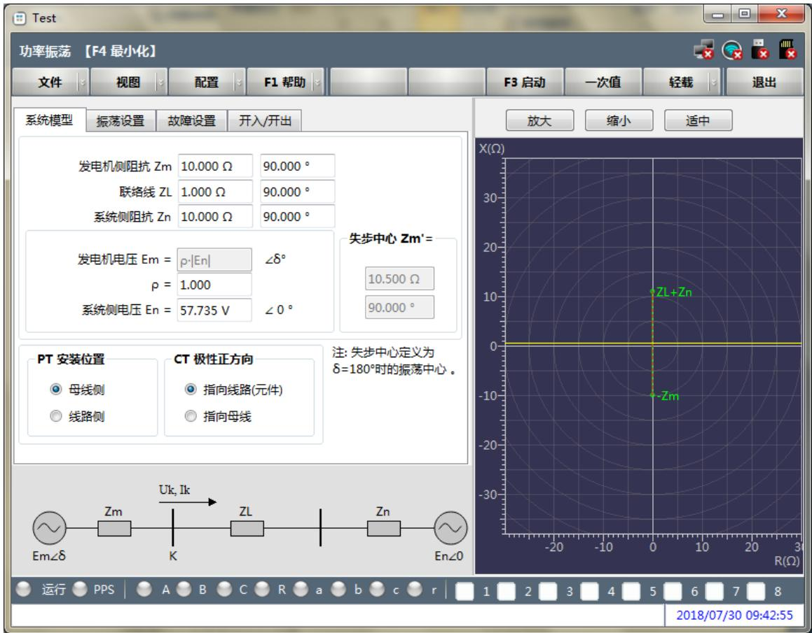
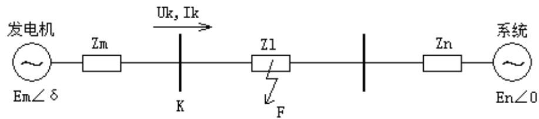
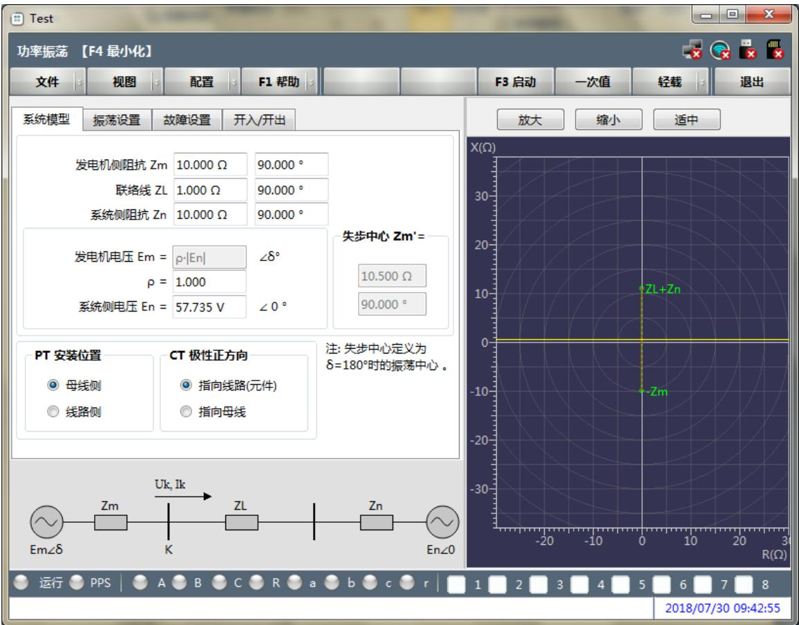
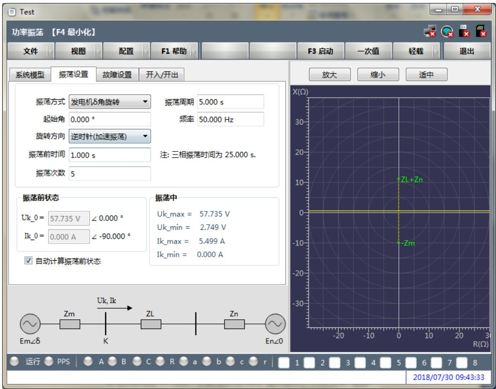
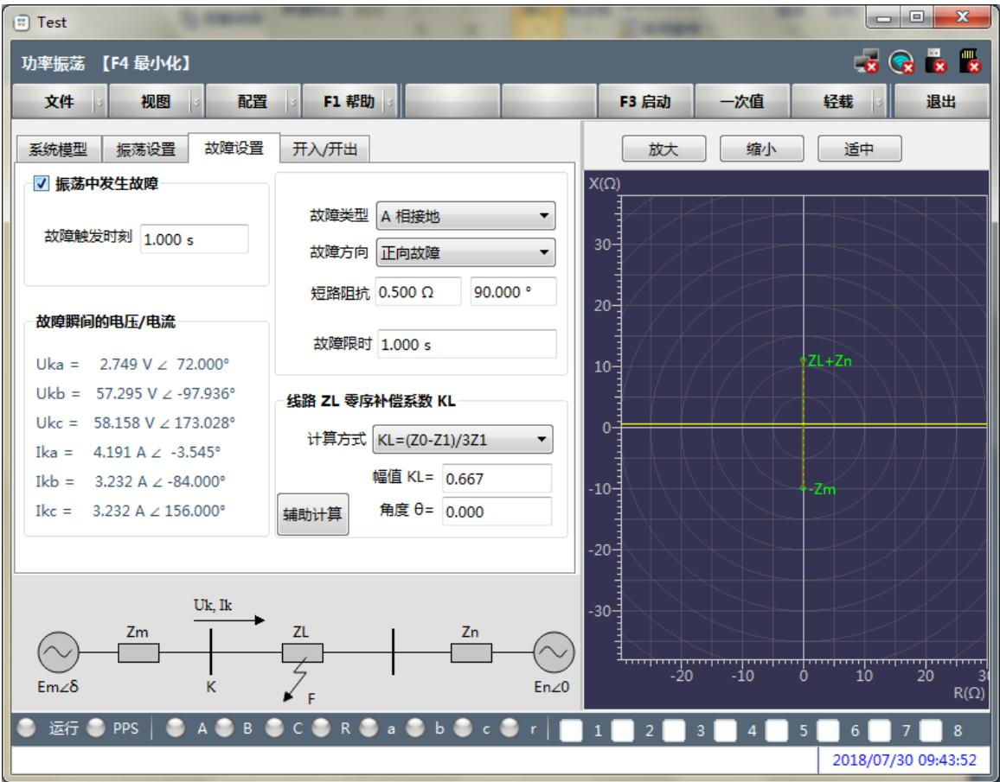
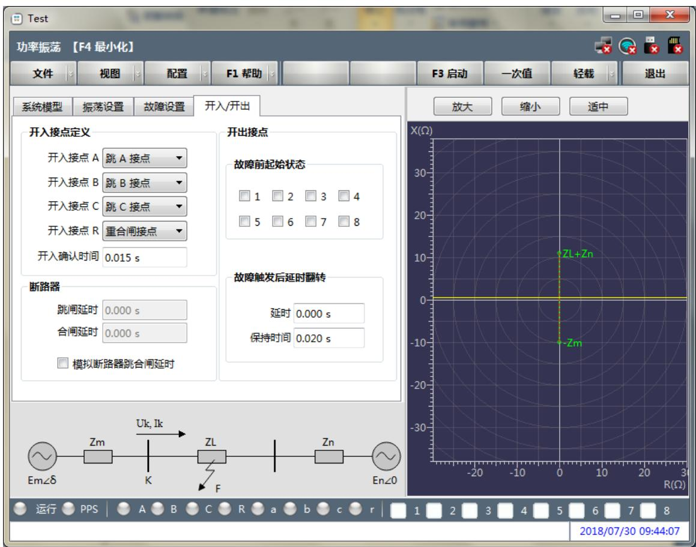
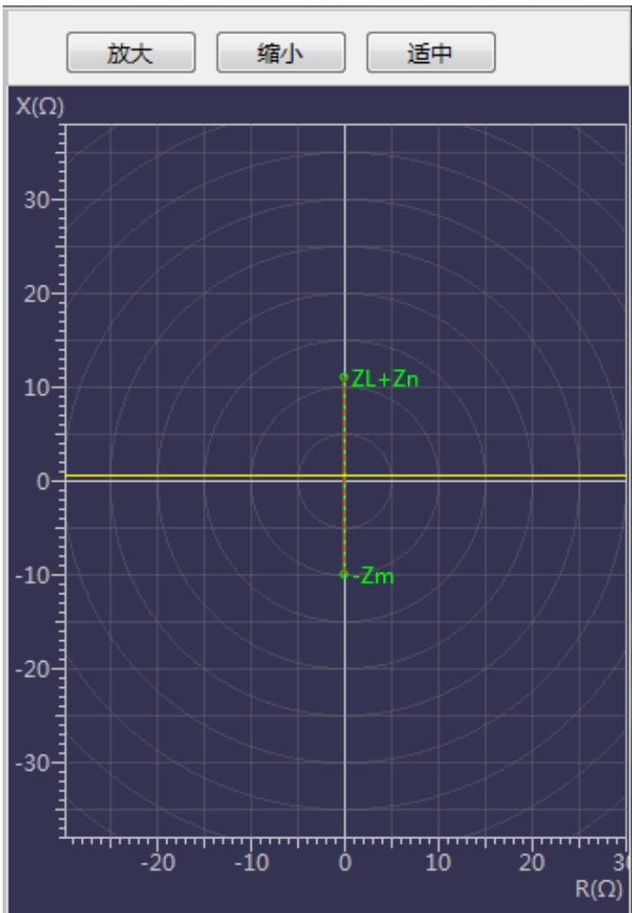
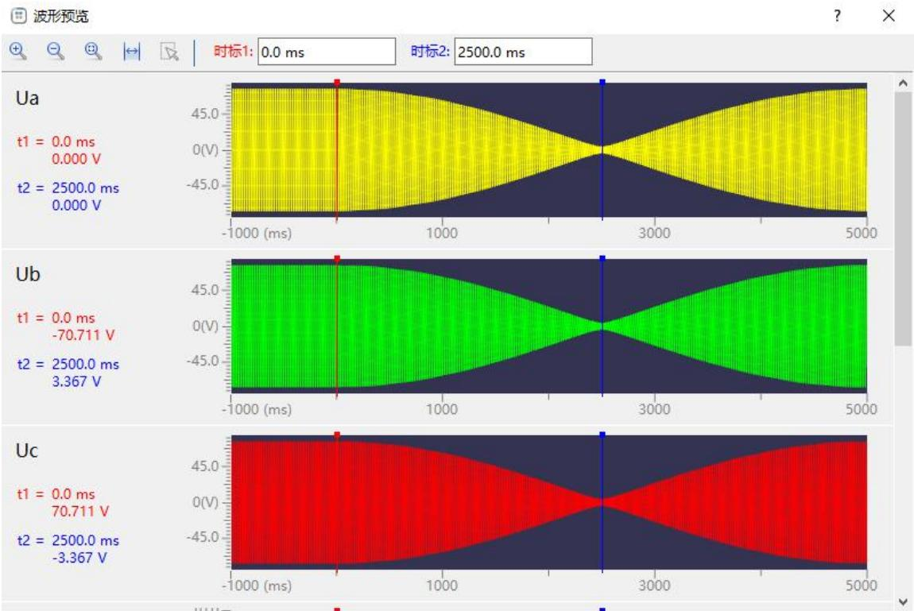
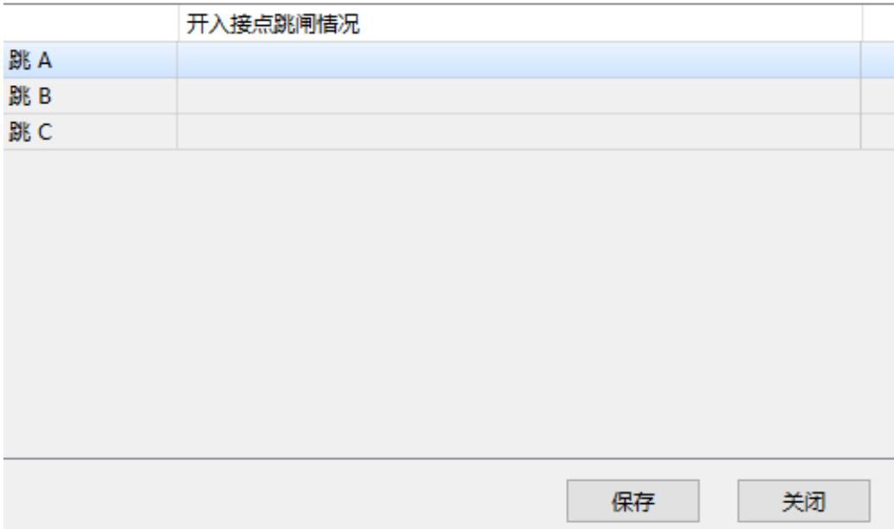

# 2.19 功率振荡

### 简介

本菜单以双端（单机对无穷大）输电系统为模型，如下图所示，模拟双机系统的电压电流振荡，以及振荡中发生故障。

主要用于发电机失步保护、振荡解列装置等的动作特性分析，以及系统振荡对距离、零序等线路保护动作行为的影响分析等。

### 测试窗口

测试窗口用于试验参数设置；

功率振荡的测试窗口包括 4 个属性页和1 个右视图：

- 系统模型：设置双机系统模型，包括阻抗参数，双端电压等；

- 振荡设置：设置振荡参数，包括振荡方式，起始角，振荡周期等；

- 故障设置：振荡中发生故障时，故障参数设置；

- 开关量：测试仪开入、开出量设置；

右视图用于显示振荡过程中，保护安装处的测量阻抗轨迹。

系统模型

发电机侧阻抗 Zm：

发电机侧的等值阻抗；

联络线 ZL：

线路阻抗；

系统侧阻抗 Zn：

无穷大系统侧的等值阻抗；

发电机电压 Em：

发电机侧电压；

振荡过程中该电压幅值不变（Em幅值为En幅值的ρ 倍），角度δ振荡变化；

- ρ： 

发电机侧电压 Em幅值相对于系统侧电压En幅值的倍数；

系统侧电压 En：

无穷大系统侧的电压；

振荡过程中其电压幅值不变，角度固定为 0° ；

### 失步中心 $z m  ^ { \prime }$ ：

根据所设的系统参数，自动计算出失步中心 $z m  ^ { \prime }$ （Zm’表示距离发电机内部等值电源的阻抗）；

### PT 安装位置：

保护 PT 的安装位置：母线侧，或，线路侧。

- PT 位于母线侧，则跳闸后故障相电压恢复为正常电压值（即额定电压）；

- PT 位于线路侧，则跳闸后故障相电压变为零状态；

通常，220KV 及以下的保护，PT 位于母线侧；

### CT极性正方向：

选择保护CT极性正方向；

- CT 极性指向线路（元件）为正；

- CT 极性指向母线为正；

### 振荡设置

### 振荡方式：

发电机侧电压 Em角度δ的振荡变化方式，系统提供了2 种方式，包括

- 发电机δ 角旋转：

功角 δ 从“起始角”开始，按指定的旋转方向（逆时针，或，顺时针）在 0 ~ 360 ^  \circ 

范围内旋转变化；

- 发电机δ 角摇摆：

功角δ从“起始角”开始，在“起始角”～“终止角”之间摇摆变化；

### 起始角、旋转方向：

振荡方式为“发电机δ角旋转”时有效；

设置功角δ的旋转方向：逆时针（加速振荡）、顺时针（减速振荡）；

### 起始角、终止角：

振荡方式为“发电机δ角摇摆”时有效；

设置功角δ的振荡起始角和终止角；

### 振荡前时间：

振荡前状态的输出时间；

进入振荡之前，测试仪将首先输出一段时间的振荡前状态，以保证保护可靠复归。

振荡前状态的设置有 2种方式：

- 自动计算：根据振荡起始角，结合系统模型，自动计算振荡前状态；

- 手动输入：手动输入振荡前状态；

### 振荡次数：

设置功率振荡的振荡次数（即滑极次数）；

功角 δ 振荡过程中，电压、电流的输出频率，通常为 50Hz；

### 振荡周期：

功角δ完成一次振荡所需要的时间，

- 发电机δ 角旋转： 0  ~  360 ^  \circ 旋转一周；

- 发电机δ 角摇摆：起始角 终止角 起始角；

该参数决定了电压、电流的幅值变化（即外包络线）频率。

### 频率：

功角 δ 振荡过程中，电压、电流的输出频率，通常为 50Hz；

### 故障设置

振荡中发生故障？：

系统振荡过程中是否发生故障；

打“√”表示振荡中发生故障。

以下参数仅对于“振荡中发生故障”有效：

故障触发时刻：

故障触发时刻，该时刻以进入振荡为时标参考点；

故障类型：

系统提供了10种故障类型，包括：A、B、C 接地，AB、BC、CA相间，AB、BC、CA两相接地以及三相短路。

系统根据计算模型的设置以及相应的故障参数，自动计算 A、B、C 三相的电压、电流；

故障方向：

选择正方向故障，或，反方向故障；

短路阻抗：

短路点F到保护安装处（K 点）的短路阻抗 Zf，极坐标形式：幅值，角度；

故障限时：

进入故障后的试验限时；

### 线路阻抗 ZL 零序补偿系数 KL：

线路阻抗 $Z_L$ 的零序补偿系数，系统提供了 3 种设置方式：

- **$K_L = (Z_0 - Z_1) / (3 \times Z_1)$**：极坐标形式表示（幅值，角度）；

$$ K_L = \frac{Z_0 - Z_1}{3 Z_1} = Re(K_L) + j \cdot Im(K_L) = |K_L| \angle \theta $$

考虑到通常情况下，电力系统假定零序阻抗 $Z_0$ 和正序阻抗 $Z_1$ 的阻抗角度相等，则 $Im(K_L) = 0$，$K_L$ 为一实数。通常取 $0.667$，角度为 $0^\circ$。

- **$K_R, K_X$ 方式**：分别设置实部和虚部的补偿系数；

$$ K_R = \frac{R_0 - R_1}{3 R_1}, \quad K_X = \frac{X_0 - X_1}{3 X_1} $$

- **$K_L = Z_0 / Z_1$**：直接按照阻抗比值输入（幅值，角度）。

### 开关量

### 开入接点定义：

配置测试仪的开入量与保护动作出口接点的连接方式。

### 开入接点 A：

根据与保护动作出口接点的连接，选择“跳A接点”，或者“三跳接点”；

### 开入接点 B：

根据与保护动作出口接点的连接，选择“跳 B 接点”，或者“三跳接点”；

### 开入接点 C：

根据与保护动作出口接点的连接，选择“跳 C 接点”，或者“三跳接点”；

### 开入接点 R：

根据与保护动作出口接点的连接，选择“重合闸接点”；

### 开入防抖确认时间：

为避免继电器触点的抖动，开入接点的状态保持一个时间（确认时间）后，系统方予以确认生效。 通常取 10  ~  20 \mathrm  m s 。

### 断路器：

### 模拟断路器跳合闸延时：

选择是否模拟断路器跳合闸延时；

打“√”表示模拟断路器跳合闸延时。

### 跳闸延时：

断路器的跳闸动作时间设置；

如果选择了“模拟断路器跳合闸延时”，则测试仪检测到保护的跳闸信号后，经过“跳闸延时”后方切除故障，进入跳闸后的电压电流状态。

（注：如果测试仪开入量直接连接断路器的“跳位”接点，则跳闸延时可取为 0s）；

### 合闸延时：

断路器的合闸动作时间设置；

如果选择了“模拟断路器跳合闸延时”，则测试仪检测到保护的合闸信号后，经过“合闸延时”后方进入重合后状态。

（注：如果测试仪开入量直接连接断路器的“合位”接点，理论上合闸延时可取为 0，但考虑到躲开三相接点合闸动作的不一致性，建议至少取 0.02 秒的合闸延时）；

### 开出接点：

试验过程中，如果需要开出接点的信号输出，则可在此设置开出量。

### 故障前起始状态：

设置开出量的起始状态（即故障前状态）：断开，或，闭合；

注：打 $" \lor ^ { \prime \prime }$ 表示闭合。

### 故障触发后延时翻转：

故障触发后，经过一个延时后，通过测试仪的开出接点发出一个信号脉冲；

###  延时：

以故障触发为时标零点 $t  = 0$ ，即进入故障后，经过所设定的延时后，开出量翻转（与各自的起始状态相反）；

注：该“延时”应小于“故障限时”。

### -  保持时间：

开出量翻转后的保持时间，即信号脉冲的宽度。

保持时间到达后，开出量再次翻转，返回各自的起始状态；

### 右视图

测试窗口的右视图用于显示振荡过程中，保护安装处的测量阻抗轨迹。

（图中“ooooo”处表示振荡轨迹的起点）

- 放大、缩小：放大或缩小显示特性曲线；

- 适中：恢复特性曲线的初始显示方式；

### 波形预览

用于显示整个试验中保护安装处“K”点的电压电流波形。

界面左侧，用数字形式显示 2 个时标（红色时标 1 和蓝色时标 2）所对应的通道波形的瞬时值。

系统提供了2种进入波形操作的方法：

- 点击主菜单中“视图”中的“波形预览”，选择相应的操作命令；

- 通过波形工具栏的相应按钮对波形进行操作；

### 1. 横向放大、缩小：

沿 X轴（时间）方向放大/缩小所有的通道波形；

### 3. 复原：

取消所有的操作，所有通道波形复原；

### 4. 横向：按照当前的区间展开：

沿 X 轴（时间）方向，展开 2 个时标之间的所有通道波形；区域放大：

### 5. 区域放大：

选择“区域放大”操作后，将鼠标置于“波形预览”视图的待操作通道上，光标变为 $\Game$ ；

按下鼠标左键，拖动鼠标，选中所要放大的波形区域；

释放左键，则所选区域的波形被放大；

如欲取消“区域放大”操作，再次选择“区域放大”即可；

### 6. 时标信息：

显示波形图中时标1 和时标2所对应的时间；

用户也可以通过在对话框中输入，直接对时标 1、2 进行定位；

### 测试结果

### 测试结果

试验过程中，测试仪可根据各开入接点的翻转情况，记录相应的动作时间信息；