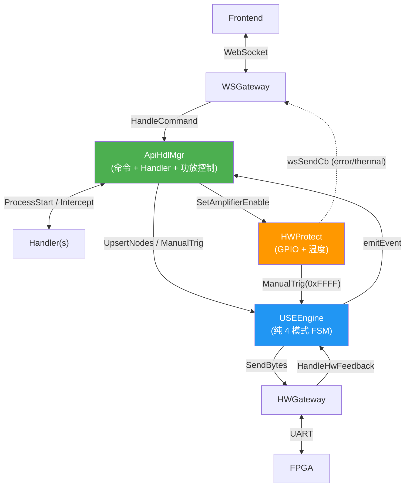

# 架构重构：纯粹 4 模式状态机

## 1. 核心思想

USEEngine 是一个**纯粹的无限循环波形播放器**，内部只有 4 种波形模式。它不知道"启动"、"停止"、"生命周期"这些概念。

Node 0 和 0xFFFF **和普通节点完全一样**——它们只是 Static 模式节点，Ss 帧碰巧是 FPGA 系统指令帧而非 DDS 波形帧。

### USEEngine 对外接口

```python
class USEEngine:
    # ── 仅 2 个方法 ──
    def UpsertNodes(self, flat_nodes: list): ...
    def ManualTrig(self, target_id: int): ...

    # ── 直写属性 ──
    debounce: int = 61    # HDL 直写, Node 0 编译时使用
```

> [!NOTE]
> **`currentNodeId` 不需要对外暴露**——每次节点跳转都会发送 `[EvtTrigger, cond, next_id, hw_ts]`，HDL 通过事件就知道当前在哪个节点。

---

## 2. 哨兵节点 = 普通 Static 节点

### Node 0x0000 (IDLE)

**预编译的 Ss 帧：**
```python
Ss = [
    FRAME_SYS_RESET,                              # FPGA 硬复位
    BuildSystemFrame(SYS_SET_DBNC, self.debounce), # 设置防抖
    FRAME_SYS_START,                               # 启动硬件空转
]
# 然后正常发 Update 帧 → 拿到 hw_ts 作为节点进入时间戳
```

- 无 Triggers → 无限等待 ManualTrig
- 无 Static (DDS) → 不输出波形
- 无 DoAction
- **和普通 Static 节点一模一样**，只是 Ss 里放的是系统帧

### Node 0xFFFF (TERMINAL)

**预编译的 Ss 帧：**
```python
Ss = [
    FRAME_SYS_RESET,  # FPGA 硬复位
]
```

- 同样无限等待 ManualTrig
- **和 Node 0 唯一区别：没有 DBNC 和 START 帧**

### 编译方式

在 `_compileNode` 或单独的 `_compileSentinelNodes` 中预编译：

```python
def _compileSentinelNodes(self):
    """编译 IDLE 和 TERMINAL 的 Ss 帧"""
    # IDLE: reset + debounce + start
    idle_frms = {
        "Ss": [
            HWCodec.FRAME_SYS_RESET,
            HWCodec.BuildSystemFrame(HWCodec.SYS_SET_DBNC, self.debounce),
            HWCodec.FRAME_SYS_START,
        ],
        "Up": [HWCodec.FRAME_SYS_UPDATE],
        # 其余全部为空
        "Rs": [], "S0_Ss": [], "S0_St": [], "Ss_Dc": [],
        "Ss_Rs": [], "St": []
    }
    idle_node = SequenceNode({NodeKey.Id: 0x0000})
    idle_node.frms = idle_frms
    idle_node.mode = WaveMode.Static
    self.nodes[0x0000] = idle_node

    # TERMINAL: reset only
    term_frms = {
        "Ss": [HWCodec.FRAME_SYS_RESET],
        "Up": [HWCodec.FRAME_SYS_UPDATE],
        "Rs": [], "S0_Ss": [], "S0_St": [], "Ss_Dc": [],
        "Ss_Rs": [], "St": []
    }
    term_node = SequenceNode({NodeKey.Id: 0xFFFF})
    term_node.frms = term_frms
    term_node.mode = WaveMode.Static
    self.nodes[0xFFFF] = term_node
```

### FSM 执行流程（所有节点统一）

```
进入节点 → 发送 Ss 帧 → 发送 Update → 拿到 hw_ts
  → OnValueUpdate(node.id, 0, do)
  → 等待触发条件 (DI/Timeout/CountOver/ManualTrig)
  → EvtTrigger(cond, next_id, hw_ts)
  → 跳到 next_id
```

Node 0 和 0xFFFF 走的是**完全相同的代码路径**，只是 Ss 帧内容不同。

---

## 3. 功放控制移到 HDL/ApiHdlMgr

USEEngine **完全不知道功放的存在**。功放由 ApiHdlMgr（或 HDL）在命令处理层控制。

### HDL 启动流程

```python
# ApiHdlMgr.HandleCommand(cmd="start"):
engine.debounce = data["sys"]["debounce"]
engine.ManualTrig(0)                     # → IDLE: FPGA reset + debounce + start
# IDLE 完成后等待 ManualTrig (无 Triggers)
hwProtect.SetAmplifierEnable(True)       # 开功放
engine.UpsertNodes(flat_nodes)           # 写入测试节点
engine.ManualTrig(1)                     # 跳到首节点, 测试开始
```

### HDL 停止流程

```python
# ApiHdlMgr.HandleCommand(cmd="stop"):
hwProtect.SetAmplifierEnable(False)      # 先关功放
engine.ManualTrig(0xFFFF)                # → TERMINAL: FPGA reset
```

### HWProtect 紧急停止

```python
# HWProtect._TriggerProtection:
self.SetAmplifierEnable(False)           # 立即关功放 (GPIO 硬件级)
self.engine.ManualTrig(0xFFFF)           # 走统一路径
```

### 自然结束（节点触发到 0xFFFF）

```python
# HDL.InterceptWsEvent 收到 EvtTrigger(cond, 0xFFFF, hw_ts):
#   → 生成报告
#   → 发 stop 给前端
#   → hwProtect.SetAmplifierEnable(False)  ← HDL 负责关功放
```

---

## 4. 整体架构



**注意**: USEEngine 不再持有 HWProtect 引用。功放控制完全在 ApiHdlMgr 层。

---

## 5. USEEngine 内部简化

Engine 内部只有：

| 区域 | 内容 |
|---|---|
| **数据模型** | SequenceNode + 4 种 WaveMode |
| **AOT 编译** | `_compileNode` + `_compileSentinelNodes` |
| **FSM 循环** | 永久 `while True`，所有节点统一执行 |
| **4 种模式运行器** | `_RunStatic`, `_RunSweep`, `_RunReset`, `_RunDcComp` |
| **触发逻辑** | `_EvaluateTriggers` (DI/Timeout/CountOver/ManualTrig) |
| **硬件 I/O** | `_SendWithAck`, `FlushFrames`, `HandleHwFeedback` |

**删除的概念：**
- ~~Start/Stop/ForceStopLocal~~ — 不存在
- ~~LoadConfig~~ — 不存在
- ~~_OnCoreFinished~~ — FSM 永不退出
- ~~_term_sent / _suppress_hw_teardown / _lock~~ — 不存在
- ~~currentNodeId 对外暴露~~ — HDL 通过 EvtTrigger 获取
- ~~功放控制~~ — 不在 engine 里
- ~~{type: "terminal"} 事件~~ — EvtTrigger(cond, 0xFFFF) 替代

---

## 6. 初始化

```python
async def main():
    hwGateway = HWGateway()
    wsGateway = WSGateway()
    hwProtect = HWProtect(wsSendCb=wsGateway.SendToClient)
    useEngine = USEEngine(hwGateway=hwGateway, emitEvent=None)
    apiHdlMgr = ApiHdlMgr(useEngine=useEngine, hwGateway=hwGateway,
                           hwProtect=hwProtect, wsSendCb=wsGateway.SendToClient)
    # 反向引用
    hwGateway.engine = useEngine
    wsGateway.dispatcher = apiHdlMgr
    useEngine.emitEvent = apiHdlMgr.DispatchWsEvent
    hwProtect.engine = useEngine  # 仅用于 ManualTrig(0xFFFF)
    # 启动
    asyncio.create_task(useEngine._CoreLoop())
    asyncio.create_task(hwGateway.Connect())
    async with wsGateway.StartServer():
        await asyncio.Future()
```

---

## 7. 文件变更清单

| 文件 | 操作 | 改动 |
|---|---|---|
| `logic/CmdRouter.py` | **DELETE** | 合并到 ApiHdlMgr |
| `logic/USEEngine.py` | **REWRITE** | 纯 4 模式 FSM + 哨兵节点预编译 + 删全部生命周期代码 |
| `logic/HWProtect.py` | MODIFY | 构造 `(wsSendCb)` + 后赋值 engine + 删死代码 |
| `api/ApiHdlMgr.py` | MODIFY | 合并 CmdRouter + 功放控制 + 新构造参数 |
| `api/*Hdl.py` (全部) | MODIFY | `terminal` → `trigger(0xFFFF)` + 功放关闭 |
| `SysEngine.py` | MODIFY | 重写 main |
| `docs/internal_protocol.md` | MODIFY | 更新哨兵节点说明 |
| `tests/Test*.py` | MODIFY | 适配 |
